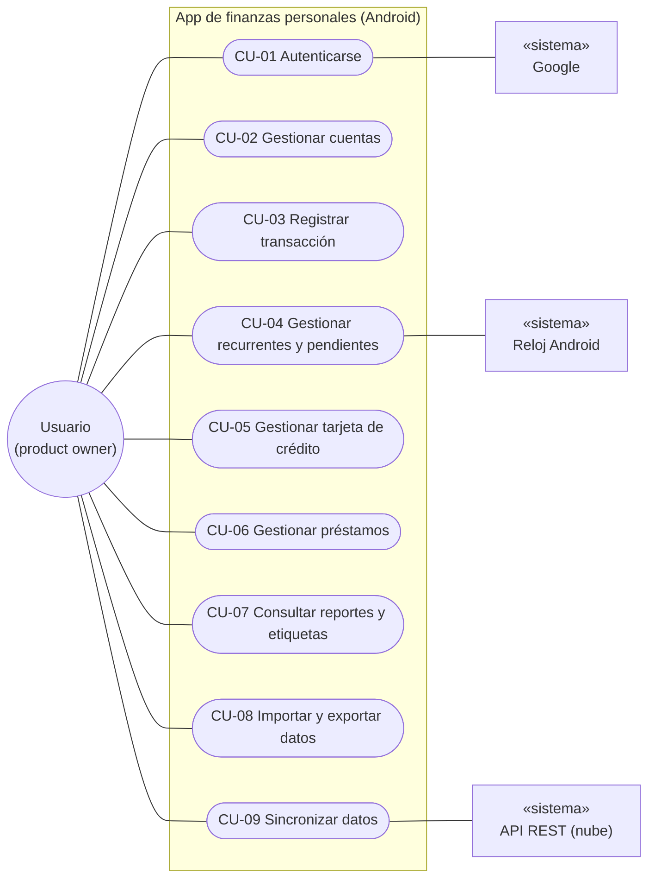
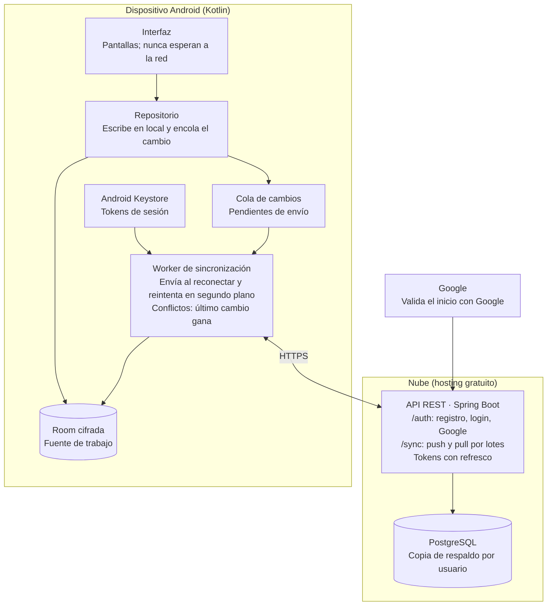

# SRS — Aplicación de Finanzas Personales

Especificación de Requisitos de Software según ISO/IEC/IEEE 29148:2018

Oct 6, 2026 · @Julian

## Control de versiones

| Versión | Fecha | Autor | Cambios |
| --- | --- | --- | --- |
| 1.0 | 2026-10-06 | Product owner + Claude | Aprobada como línea base del producto. |
| 0.3 | 2026-10-06 | Product owner + Claude | Búsqueda y filtros del histórico, agrupación por día y mes, préstamo en modo simple, interés con mes de 30 días. |
| 0.2 | 2026-10-06 | Product owner + Claude | Primer borrador completo: requisitos funcionales y no funcionales, historias de usuario, casos de uso, interfaces, modelo de datos, arquitectura, backlog y trazabilidad. |
| 0.1 | 2026-10-06 | Product owner + Claude | Estructura inicial y contexto del proyecto. |

## Aprobación

| Rol | Nombre | Decisión | Fecha |
| --- | --- | --- | --- |
| Product owner y usuario final | @Julian | Aprobado, versión 1.0 | Oct 6, 2026 |
| Redacción asistida | Claude (asistente de IA, Anthropic) | Elaboró el documento; no es parte aprobadora | 2026-10-06 |

Las preguntas abiertas de la sección 10.2 no bloquean la aprobación; se resolverán antes del sprint que las necesite. Los cambios posteriores se registran como nuevas versiones en la tabla de control de versiones.

## 1. Introducción

### 1.1 Propósito

Este documento especifica los requisitos de una aplicación de finanzas personales, móvil en primera instancia y con extensión futura a web. Sirve como base acordada entre el product owner (usuario final y orientador del desarrollo) y el equipo de desarrollo para evolucionar el MVP existente hacia un producto robusto.

### 1.2 Alcance

La versión 1.0 debe cubrir, como mínimo, las funciones que hoy ofrece la aplicación de finanzas que usa el product owner, implementadas de forma sólida. Su rasgo arquitectónico central es el funcionamiento **offline-first**: el usuario registra transacciones sin conexión y estas se sincronizan con la nube al recuperar la red, lo que además provee respaldo (backup). Las mejoras sobre la app actual que se vayan identificando se registran en la sección 9 como alcance futuro.

### 1.3 Definiciones y acrónimos

- **SRS**: Software Requirements Specification (Especificación de Requisitos de Software).
- **MVP**: Minimum Viable Product; versión mínima ya existente de la app.
- **Offline-first**: diseño en el que la app opera con datos locales y sincroniza con el servidor cuando hay conexión.
- **Transacción**: registro de un movimiento de dinero (ingreso, gasto o transferencia).
- **Microservicio de transacciones**: componente de backend independiente responsable de persistir y sincronizar transacciones.

### 1.4 Referencias

- ISO/IEC/IEEE 29148:2018 — Systems and software engineering — Life cycle processes — Requirements engineering.

### 1.5 Visión general del documento

La sección 2 describe el producto y su contexto; la 3, actores y casos de uso; las 4 a 7, requisitos funcionales, historias de usuario, no funcionales e interfaces; la 8, la arquitectura de referencia; la 9, el alcance futuro; y la 10, trazabilidad y preguntas abiertas.

## 2. Descripción general

### 2.1 Perspectiva del producto

El producto evoluciona un MVP existente hacia una app Android de finanzas personales con respaldo en la nube. Tiene dos componentes:

- **App móvil (Android, Kotlin)**: opera siempre sobre una base de datos local, que es la fuente de trabajo del usuario. Funciona completa sin conexión.
- **API REST (Java, en la nube)**: mantiene una copia de los datos del usuario. Se usa para respaldo y para restaurar los datos al instalar la app de nuevo.

La sincronización es bidireccional y ocurre al recuperar la conexión. Los conflictos se resuelven por **último cambio gana** (last-write-wins). La versión web queda fuera del alcance de la v1.0.

La línea base funcional es la app Cashew, que el product owner usa hoy. La v1.0 debe igualar sus funciones de uso diario y resolver los "trucos" que hoy el usuario aplica para suplir funciones faltantes (presupuesto negativo para agrupar gastos, transferencias para simular pagos de tarjeta de crédito).

### 2.2 Funciones principales

- Gestión de cuentas (efectivo, débito, ahorros, crédito) y saldos por cuenta o agregados.
- Registro de ingresos, gastos y transferencias entre cuentas.
- Categorías base y personalizadas; agrupación transversal de transacciones.
- Transacciones recurrentes con recordatorio previo.
- Reportes por categoría y periodo.
- Importación y exportación de datos.
- Operación offline con sincronización y respaldo en la nube.

### 2.3 Características de los usuarios

La v1.0 tiene un único usuario: el product owner, para uso personal. Es un usuario con experiencia en apps de finanzas que registra movimientos a diario y consulta saldos con frecuencia. El soporte multiusuario y las finanzas compartidas (pareja, familia) quedan para versiones futuras, pero la arquitectura no debe impedirlos.

### 2.4 Restricciones

- Plataforma: solo Android en v1.0. Cliente en Kotlin; API en Java.
- Infraestructura: el backend se despliega en un servicio de hosting gratuito, con sus límites de cómputo, almacenamiento y arranque en frío.
- Moneda: una sola divisa por usuario, elegida por él (por defecto COP), sin conversión.
- Las políticas de Google Play restringen la lectura de SMS, lo que condiciona cualquier registro automático desde mensajes.

### 2.5 Supuestos y dependencias

- El dispositivo tiene conectividad intermitente; la app no depende de ella para operar.
- El usuario rara vez edita la misma transacción en dos dispositivos sin conexión; si ocurre, se acepta perder el cambio más antiguo.
- La importación inicial depende del formato de exportación del formato que solicite la o modificable.
- La escalabilidad a múltiples usuarios es un objetivo futuro que condiciona el diseño desde ahora.

## 3. Actores y casos de uso

El usuario es el único actor humano. Google interviene en la autenticación, el reloj de Android abre las ventanas de aviso de pendientes y la API REST recibe y entrega cambios en la sincronización.

**Un solo actor humano; Google, la API y el reloj apoyan tres casos**

*Diagrama de casos de uso · 1 actor humano, 3 sistemas, 9 casos*

Relaciones: pagar un pendiente (CU-04) incluye registrar una transacción (CU-03); una compra con tarjeta a 2 o más cuotas extiende CU-03 con el plan de cuotas de CU-05.

| CU | Actores | Descripción |
| --- | --- | --- |
| CU-01 Autenticarse | Usuario, Google, API | Registro o inicio de sesión con usuario y contraseña o con Google; descarga inicial de datos. |
| CU-02 Gestionar cuentas | Usuario | Crear, editar, desactivar o quitar cuentas; elegir cuentas del saldo total y la vista de inicio. |
| CU-03 Registrar transacción | Usuario | Gasto, ingreso o transferencia con categoría y etiqueta; editar, eliminar y restaurar desde el historial. |
| CU-04 Gestionar recurrentes y pendientes | Usuario, Reloj Android | Crear recurrentes; al abrirse la ventana se avisa, y el usuario paga, omite o finaliza. |
| CU-05 Gestionar tarjeta de crédito | Usuario | Configurar la tarjeta, registrar compras diferidas y pagar mínimo o total. |
| CU-06 Gestionar préstamos | Usuario | Registrar el préstamo, pagar cuotas y abonar a capital. |
| CU-07 Consultar reportes y etiquetas | Usuario | Gastos e ingresos por categoría, periodo y etiqueta; intereses pagados. |
| CU-08 Importar y exportar datos | Usuario | Importar CSV o Excel con mapeo y control de duplicados; exportar CSV. |
| CU-09 Sincronizar datos | Usuario, API | Envío y recepción automáticos de cambios al haber conexión; el usuario ve el estado. |

## 4. Requisitos funcionales

### 4.0 Inventario y priorización (borrador para validar)

La prioridad sigue el esquema MoSCoW: **Must** = imprescindible para el primer release; **Should** = importante, siguiente sprint tras el núcleo; **Could** = deseable, diferenciador; **Won't (v1)** = fuera de la v1.0, va al backlog. Puedes cambiar la columna Prioridad directamente en la tabla.

| ID | Funcionalidad | Prioridad |
| --- | --- | --- |
| F01 | Registro e inicio de sesión con usuario y contraseña, una sola vez por instalación | Must |
| F02 | Descarga completa de datos desde la nube tras iniciar sesión | Must |
| F03 | Múltiples cuentas (efectivo, débito, ahorros, tarjeta de crédito, préstamo) | Must |
| F04 | Registro de gastos e ingresos (monto, fecha, cuenta, categoría, nota, etiqueta) | Must |
| F05 | Transferencias entre cuentas, accesibles desde la pantalla principal | Must |
| F06 | Saldo por cuenta y saldo total de las cuentas que el usuario elija | Must |
| F07 | Categorías y subcategorías base precargadas, editables y personalizadas | Must |
| F08 | Operación offline con sincronización y respaldo en la nube (último cambio gana) | Must |
| F09 | Importación de transacciones desde CSV/Excel con mapeo de columnas y detección de duplicados | Must |
| F10 | Exportación de transacciones a CSV | Must |
| F11 | Gastos recurrentes con recordatorio, pago, omisión y finalización | Must |
| F12 | Reportes por categoría y periodo (semanal, mensual, rango) | Should |
| F13 | Etiquetas (una por transacción) consultables por rango de fechas | Should |
| F14 | Tarjeta de crédito: cupo, corte, pago, tasa, compras a cuotas y tasas preferenciales | Must |
| F15 | Préstamos recibidos con cuotas, intereses, seguro de vida y costos adicionales | Should |
| F16 | Calendario con el saldo de cada día | Could |
| F17 | Presupuestos con alertas | Could |
| F18 | Desbloqueo biométrico opcional (huella) | Won't (v1) |
| F19 | Registro automático de gastos desde SMS, notificaciones o correo del banco | Could |
| F20 | Multimoneda con conversión | Won't (v1) |
| F21 | Multiusuario y finanzas compartidas | Won't (v1) |
| F22 | Versión web | Won't (v1) |
| F23 | Pantalla de inicio personalizable (mostrar, ocultar y reordenar tarjetas) | Should |
| F24 | Historial de cambios (logs) de transacciones con restauración, 90 días | Should |
| F25 | Desactivar cuentas sin perder su historial | Must |
| F26 | Proyección del mes siguiente: dinero mínimo necesario según recurrentes y cuotas | Could |
| F27 | Ingresos recurrentes | Won't (v1) |
| F28 | Registro e inicio de sesión con Google | Should |
| F29 | Desglose de cada cuota en capital, intereses y otros cargos | Should |
| F30 | Dos vistas del saldo total: neto (descontando lo que vence en el periodo) y disponible | Should |
| F31 | Conteo de transacciones por periodo | Could |

Los préstamos otorgados a terceros no se modelan: se siguen gestionando como gasto, ingreso o transferencia. Los requisitos siguientes usan "deberá" como término obligatorio (equivalente a *shall* en IEEE 29148). Los marcados *(por confirmar)* dependen de una pregunta abierta.

### 4.1 Autenticación y sesión (F01, F02)

| ID | Requisito | Prioridad |
| --- | --- | --- |
| REQ-AUT-01 | El sistema deberá permitir registrarse desde la app con nombre, correo, nombre de usuario y contraseña. | Must |
| REQ-AUT-02 | El sistema deberá autenticar al usuario con nombre de usuario y contraseña. | Must |
| REQ-AUT-03 | El sistema deberá permitir registrarse e iniciar sesión con una cuenta de Google. | Should |
| REQ-AUT-04 | El sistema deberá mantener la sesión activa indefinidamente y solo pedir credenciales tras reinstalar la app, borrar sus datos o cerrar sesión. | Must |
| REQ-AUT-05 | Tras el primer inicio de sesión, el sistema deberá descargar todos los datos del usuario desde la nube y mostrar el progreso. | Must |
| REQ-AUT-06 | Al cerrar sesión, el sistema deberá conservar los datos locales y detener la sincronización, advirtiendo que los cambios posteriores no tendrán respaldo. | Must |

### 4.2 Cuentas (F03, F06, F25)

| ID | Requisito | Prioridad |
| --- | --- | --- |
| REQ-CTA-01 | El sistema deberá permitir crear cuentas con nombre, tipo (efectivo, débito, ahorros, tarjeta de crédito, préstamo) y saldo inicial. | Must |
| REQ-CTA-02 | El sistema deberá permitir editar el nombre y el saldo inicial de una cuenta. | Must |
| REQ-CTA-03 | Al quitar una cuenta, el sistema deberá ofrecer tres opciones: desactivarla (recomendada), mover sus transacciones a otra cuenta y eliminarla, o eliminarla junto con sus transacciones. | Must |
| REQ-CTA-04 | Una cuenta desactivada deberá desaparecer de inicio, selectores y saldo total, conservar sus transacciones en reportes y poder reactivarse. | Must |
| REQ-CTA-05 | La opción "eliminar con transacciones" deberá pedir una confirmación reforzada (por ejemplo, escribir el nombre de la cuenta) e informar el impacto en saldos y reportes antes de ejecutarse. | Must |
| REQ-CTA-06 | El sistema deberá calcular el saldo de cada cuenta como saldo inicial + ingresos − gastos ± transferencias. | Must |
| REQ-CTA-07 | Cada cuenta deberá tener la opción "incluir en saldo total". | Must |
| REQ-CTA-08 | El sistema deberá calcular dos vistas del saldo total: **neto** = cuentas incluidas − lo que vence en el periodo actual de tarjetas y préstamos; **disponible** = cuentas incluidas sin tarjetas ni préstamos. | Should |
| REQ-CTA-09 | El usuario deberá elegir qué vista de saldo total aparece en inicio; la otra se consulta desde el detalle del saldo. | Should |

Ejemplo de REQ-CTA-08: con $1.000.000 en cuentas y $800.000 de tarjeta que vencen en el periodo actual, el saldo neto es $200.000 y el disponible es $1.000.000.

### 4.3 Transacciones (F04, F05)

| ID | Requisito | Prioridad |
| --- | --- | --- |
| REQ-TRX-01 | El sistema deberá registrar gastos e ingresos con monto mayor que cero, fecha y hora, cuenta y categoría (obligatorios), y nota y etiqueta (opcionales). | Must |
| REQ-TRX-02 | El sistema deberá registrar transferencias con cuenta origen, cuenta destino distinta, monto, fecha y hora, y nota opcional. | Must |
| REQ-TRX-03 | Las transferencias no deberán contarse como gasto ni ingreso en los reportes. | Must |
| REQ-TRX-04 | El usuario deberá poder iniciar una transferencia desde la pantalla principal en máximo dos toques. | Must |
| REQ-TRX-05 | La fecha y la hora deberán prellenarse con el momento actual y ser editables, para registrar después movimientos en el orden en que ocurrieron. | Must |
| REQ-TRX-06 | Los listados deberán ordenarse por fecha y hora de la transacción, no por fecha de registro. | Must |
| REQ-TRX-07 | El sistema deberá permitir editar y eliminar transacciones; la eliminación es directa, previa confirmación. | Must |
| REQ-TRX-08 | El sistema deberá permitir registrar, editar y eliminar transacciones sin conexión a internet. | Must |
| REQ-TRX-09 | El histórico de transacciones deberá filtrarse, de forma combinable, por tipo (gasto, ingreso, transferencia), categoría y subcategoría, cuenta, etiqueta y rango de fechas. | Must |
| REQ-TRX-10 | El histórico deberá tener una búsqueda por texto que muestre resultados a medida que se escribe, buscando coincidencias parciales en nota, categoría, cuenta y etiqueta, y combinable con los filtros. | Must |
| REQ-TRX-11 | La lista de movimientos recientes en inicio deberá agruparse por día con encabezados "Hoy", "Ayer", "Antier" y la fecha, hasta un máximo de 5 días. | Must |
| REQ-TRX-12 | El histórico completo deberá agruparse por mes (más reciente primero) y, dentro de cada mes, por día en orden descendente, con encabezado por mes y por día. | Must |

### 4.4 Categorías (F07)

| ID | Requisito | Prioridad |
| --- | --- | --- |
| REQ-CAT-01 | En el primer uso, el sistema deberá crear un conjunto base de categorías y subcategorías de gasto e ingreso, incluida "Intereses y cargos financieros". | Must |
| REQ-CAT-02 | El usuario deberá poder crear, renombrar y eliminar categorías y subcategorías (un nivel de profundidad), incluidas las base. | Must |
| REQ-CAT-03 | Al eliminar una categoría o subcategoría con transacciones, el sistema deberá exigir reasignarlas a otra antes de completar la eliminación. | Must |

### 4.5 Etiquetas (F13)

Una etiqueta agrupa transacciones de distintas categorías bajo un mismo motivo. Ejemplo: "Viaje Cartagena" reúne hotel (Alojamiento), taxis (Transporte) y restaurantes (Comida); "Salidas" reúne cine, comida y postre de cada salida con amigos, mes a mes.

| ID | Requisito | Prioridad |
| --- | --- | --- |
| REQ-ETQ-01 | El usuario deberá poder crear, renombrar y eliminar etiquetas. | Should |
| REQ-ETQ-02 | Una transacción deberá tener como máximo una etiqueta. | Should |
| REQ-ETQ-03 | El sistema deberá mostrar el total y el detalle de transacciones de una etiqueta para el mes actual, el mes anterior o un rango de fechas elegido. | Should |
| REQ-ETQ-04 | El usuario deberá poder fijar etiquetas en la pantalla de inicio, mostrando su total del mes actual. | Should |

### 4.6 Gastos recurrentes (F11)

| ID | Requisito | Prioridad |
| --- | --- | --- |
| REQ-REC-01 | El sistema deberá permitir crear gastos recurrentes con nombre, monto estimado, cuenta, categoría, fecha de inicio y frecuencia. | Must |
| REQ-REC-02 | Las frecuencias deberán incluir semanal, quincenal, mensual, trimestral, anual y personalizada (cada N días, semanas o meses). | Must |
| REQ-REC-03 | El sistema deberá tener una anticipación global de aviso, configurable, con valor por defecto de 5 días. | Must |
| REQ-REC-04 | Dentro de la ventana de anticipación, el sistema deberá mostrar en inicio un pago pendiente que no afecta ningún saldo. | Must |
| REQ-REC-05 | El pendiente deberá mostrar un indicador de urgencia que aumenta al acercarse la fecha y se destaca si ya venció. | Must |
| REQ-REC-06 | Al tocar un pendiente, el sistema deberá ofrecer: **Pagar**, **Omitir esta vez** (salta a la siguiente ocurrencia) y **Finalizar recurrencia** (no genera más pendientes). | Must |
| REQ-REC-07 | "Pagar" deberá mostrar un diálogo con el monto del último pago, la fecha de hoy y la cuenta, todos editables, y al confirmar crear la transacción real. | Must |
| REQ-REC-08 | Tras pagar u omitir, el sistema deberá programar la siguiente ocurrencia según la frecuencia. | Must |
| REQ-REC-09 | El sistema deberá enviar notificaciones del teléfono solo para pagos pendientes: una al iniciar la ventana de anticipación y otra el día de vencimiento si sigue sin pagar. | Should |
| REQ-REC-10 | El sistema no deberá enviar notificaciones de ningún otro tipo (promocionales, sugerencias, resúmenes) y el usuario deberá poder desactivarlas. | Must |
| REQ-REC-11 | En v1.0 las recurrentes aplican solo a gastos. | Must |

### 4.7 Tarjetas de crédito (F14)

Ejemplo de referencia: compra de $1.200.000 a 12 cuotas. La deuda total queda en la tarjeta, pero el saldo neto solo descuenta lo que vence en el periodo actual. Principio de diseño: registrar una compra con tarjeta no debe pedir más campos que una compra normal, salvo número de cuotas y, si son 2 o más, la tasa prellenada.

Cada pago de cuota se guarda como **una sola transacción con desglose** (capital, intereses, otros cargos), visible al tocarla. Poder visualizar detalladamente el valor de captital, intereses y otros cargos

| ID | Requisito | Prioridad |
| --- | --- | --- |
| REQ-TC-01 | El sistema deberá permitir crear una tarjeta de crédito con cupo total, deuda actual, día de corte, día de pago y tasa de interés. | Must |
| REQ-TC-02 | Al ingresar la tasa, el usuario deberá elegir si es efectiva anual (EA) o mes vencido (MV); el sistema deberá convertir entre ambas con MV = (1 + EA)^(1/12) − 1. | Must |
| REQ-TC-03 | La tarjeta deberá tener la opción "primera cuota sin intereses". | Must |
| REQ-TC-04 | El saldo de la tarjeta deberá mostrarse como la deuda total en valor negativo; el cupo disponible solo en su detalle. | Must |
| REQ-TC-05 | Al registrar una compra con tarjeta, el usuario deberá indicar el número de cuotas (1 por defecto). | Must |
| REQ-TC-06 | Si la compra tiene 2 o más cuotas, el sistema deberá mostrar el campo tasa, prellenado con la de la tarjeta y editable (para convenios con tasa 0 o preferencial). | Must |
| REQ-TC-07 | El sistema deberá generar el plan de cuotas de cada compra diferida con capital fijo (monto ÷ cuotas) más interés sobre el saldo pendiente. | Must |
| REQ-TC-08 | Lo que vence en el periodo deberá ser: compras a 1 cuota del periodo + cuotas del periodo de compras diferidas + intereses + cargos. | Must |
| REQ-TC-09 | En reportes, una compra a 1 cuota deberá contar en su fecha de compra; una diferida, cuota a cuota en la fecha de pago de cada una; los intereses, en "Intereses y cargos financieros" en la fecha de pago. | Must |
| REQ-TC-10 | El pago de la tarjeta deberá aparecer como pendiente con las opciones "pago mínimo" (lo que vence en el periodo) y "pago total" (deuda total). | Must |
| REQ-TC-11 | Al elegir una opción, el sistema deberá pedir la cuenta de origen y registrar una transferencia a la tarjeta con monto editable y desglose en capital, intereses y cargos. | Must |
| REQ-TC-12 | El pago total deberá liquidar las cuotas restantes sin cobrar intereses futuros y reconocer su capital en el mes del pago. | Must |
| REQ-TC-13 | Al crear una tarjeta con deuda existente, esa deuda deberá tratarse como compra a 1 cuota del periodo actual; las compras posteriores se registran con sus cuotas. | Must |
| REQ-TC-14 | El usuario podrá, opcionalmente, indicar que la deuda inicial está diferida en N cuotas restantes. | Could |
| REQ-TC-15 | El interés de cada cuota deberá calcularse sobre un mes comercial de 30 días completos, sin distinguir días hábiles. | Must |

### 4.8 Reportes (F12)

| ID | Requisito | Prioridad |
| --- | --- | --- |
| REQ-REP-01 | El sistema deberá mostrar gastos e ingresos agrupados por categoría y subcategoría para la semana, el mes o un rango de fechas elegido. | Should |
| REQ-REP-02 | El sistema deberá mostrar la evolución de gastos e ingresos entre periodos consecutivos. | Should |
| REQ-REP-03 | Los reportes deberán incluir solo transacciones registradas; los pendientes y las cuotas futuras se excluyen. | Should |
| REQ-REP-04 | El sistema deberá mostrar el total pagado en intereses y cargos financieros por periodo, por tarjeta y por préstamo. | Should |
| REQ-REP-05 | El sistema deberá mostrar la cantidad de transacciones registradas por periodo. | Could |

### 4.9 Pantalla de inicio (F06, F23)

| ID | Requisito | Prioridad |
| --- | --- | --- |
| REQ-INI-01 | La pantalla de inicio deberá mostrar las cuentas activas con su saldo en un carrusel horizontal. | Must |
| REQ-INI-02 | La pantalla de inicio deberá mostrar el saldo total (REQ-CTA-06). | Must |
| REQ-INI-03 | La pantalla de inicio deberá mostrar los pagos pendientes próximos (REQ-REC-04, REQ-TC-07). | Must |
| REQ-INI-04 | El usuario deberá poder ocultar, mostrar y reordenar las tarjetas de la pantalla de inicio. | Should |

### 4.10 Importación y exportación (F09, F10)

| ID | Requisito | Prioridad |
| --- | --- | --- |
| REQ-IMP-01 | El sistema deberá importar transacciones desde archivos CSV y Excel (.xlsx). | Must |
| REQ-IMP-02 | El sistema deberá permitir asociar cada columna del archivo a un campo de la transacción, y ofrecer una plantilla de formato descargable. | Must |
| REQ-IMP-03 | Antes de importar, el sistema deberá mostrar una vista previa y advertir las filas con errores. | Must |
| REQ-IMP-04 | El sistema deberá detectar posibles duplicados (misma fecha y hora, monto, cuenta y tipo) y preguntar al usuario; la opción por defecto es omitirlos. | Must |
| REQ-IMP-05 | Si el archivo menciona cuentas o categorías inexistentes, el sistema deberá listarlas antes de importar y permitir, para cada una, crearla o asociarla a una existente, o crear todas de una vez. | Must |
| REQ-IMP-06 | Al terminar, el sistema deberá mostrar un resumen: filas importadas, omitidas y con error. | Must |
| REQ-EXP-01 | El sistema deberá exportar transacciones a CSV, con rango de fechas opcional. | Must |

### 4.11 Sincronización y respaldo (F08)

| ID | Requisito | Prioridad |
| --- | --- | --- |
| REQ-SYN-01 | El sistema deberá guardar en cola los cambios hechos sin conexión y enviarlos automáticamente al recuperarla. | Must |
| REQ-SYN-02 | Ante cambios concurrentes sobre un mismo registro, deberá prevalecer el de marca de tiempo de modificación más reciente. | Must |
| REQ-SYN-03 | Las eliminaciones deberán propagarse a la nube y a otros dispositivos. | Must |
| REQ-SYN-04 | El reenvío de un cambio ya recibido no deberá crear registros duplicados. | Must |
| REQ-SYN-05 | El sistema deberá mostrar el estado de sincronización: cambios pendientes y fecha de la última sincronización. | Should |

### 4.12 Historial de cambios (F24)

| ID | Requisito | Prioridad |
| --- | --- | --- |
| REQ-HIS-01 | El sistema deberá registrar la creación, edición (valor anterior y nuevo) y eliminación de cada transacción, con fecha y hora. | Should |
| REQ-HIS-02 | El usuario deberá poder consultar el historial (logs) desde la app. | Should |
| REQ-HIS-03 | El usuario deberá poder restaurar una transacción eliminada o revertir una edición desde el historial. | Should |
| REQ-HIS-04 | El sistema deberá conservar cada entrada del historial 90 días y luego eliminarla; el plazo no es configurable por el usuario. | Should |

### 4.13 Préstamos recibidos (F15, F29)

Un préstamo es un tipo de cuenta cuyo saldo es la deuda pendiente (negativa). Recibir el dinero es una transferencia del préstamo a la cuenta de destino, por lo que no cuenta como ingreso.

El registro de un préstamo ofrece dos modos: **detallado**, cuando el usuario conoce las condiciones, y **simple**, cuando solo sabe cuánto paga al mes. Si tampoco conoce el saldo, se registra como gasto recurrente.

| ID | Requisito | Prioridad |
| --- | --- | --- |
| REQ-PRE-01 | En modo detallado, el sistema deberá registrar un préstamo con monto, cuenta de destino, número de cuotas, tasa (EA o MV), fecha de la primera cuota y día de pago. | Should |
| REQ-PRE-02 | El registro deberá incluir las casillas "seguro de vida" y "costos adicionales"; al marcarlas, el usuario indica su valor mensual y el sistema informa que se cobrarán en cada cuota. | Should |
| REQ-PRE-03 | El sistema deberá generar el plan de pagos con cuota fija de capital más intereses, sumando seguro y costos mensuales a cada cuota. | Should |
| REQ-PRE-04 | Cada cuota deberá aparecer como pago pendiente con la misma anticipación y urgencia de los recurrentes. | Should |
| REQ-PRE-05 | Al pagar una cuota, el sistema deberá registrar una transferencia al préstamo con desglose: el capital reduce la deuda; intereses, seguro y costos van a "Intereses y cargos financieros". | Should |
| REQ-PRE-06 | El usuario deberá poder hacer abonos extraordinarios a capital; el sistema deberá preguntar si reducen el plazo o el valor de la cuota y recalcular el plan. | Should |
| REQ-PRE-07 | En el saldo neto, un préstamo deberá descontar solo la cuota del periodo actual. | Should |
| REQ-PRE-08 | En modo simple, el sistema deberá pedir solo el saldo adeudado actual, el valor de la cuota mensual y el día de pago; sin tasa ni desglose, y cada pago reduce el saldo por su valor completo. | Should |
| REQ-PRE-09 | El usuario deberá poder pasar un préstamo de modo simple a detallado cuando conozca sus condiciones. | Could |
| REQ-PRE-10 | Al elegir crear un préstamo, el sistema deberá indicar que, si no se conoce el saldo, conviene registrarlo como gasto recurrente. | Could |

Los cobros puntuales no previstos en el plan (por ejemplo, un estudio de crédito) se registran como gastos normales.

## 5. Historias de usuario

Cada historia sigue el formato *Como usuario, quiero… para…* y sus criterios de aceptación usan *Dado / Cuando / Entonces*. La columna de requisitos indica la trazabilidad.

| ID | Historia | Requisitos | Prioridad |
| --- | --- | --- | --- |
| HU-01 | Registrar un gasto en segundos para no olvidarlo | REQ-TRX-01, RNF-14 | Must |
| HU-02 | Registrar movimientos tarde en su orden real | REQ-TRX-05, REQ-TRX-06 | Must |
| HU-03 | Transferir entre mis cuentas sin buscar la opción | REQ-TRX-02 a 04 | Must |
| HU-04 | Ver mi saldo neto y mi saldo disponible | REQ-CTA-07 a 09 | Should |
| HU-05 | Registrar sin internet y que se respalde solo | REQ-SYN-01 a 05 | Must |
| HU-06 | Recuperar mis datos al reinstalar la app | REQ-AUT-04, REQ-AUT-05 | Must |
| HU-07 | Pagar u omitir un gasto recurrente desde inicio | REQ-REC-04 a 08 | Must |
| HU-08 | Diferir una compra con tarjeta sin ver la deuda completa en mi saldo | REQ-TC-05 a 09 | Must |
| HU-09 | Pagar la tarjeta eligiendo mínimo o total | REQ-TC-10 a 12 | Must |
| HU-10 | Saber cuánto gasté en un viaje o en salidas | REQ-ETQ-01 a 04 | Should |
| HU-11 | Traer mi histórico de Cashew | REQ-IMP-01 a 06 | Must |
| HU-12 | Deshacer un borrado por error | REQ-HIS-01 a 04 | Should |
| HU-13 | Quitar una cuenta sin descuadrar mis reportes | REQ-CTA-03 a 05 | Must |
| HU-14 | Registrar un préstamo y abonar a capital | REQ-PRE-01 a 07 | Should |

### HU-01 Registrar un gasto rápido

Como usuario, quiero registrar un gasto con el mínimo de pasos, para hacerlo en el momento sin fricción.

- Dado que estoy en inicio, cuando toco "nuevo gasto", ingreso monto y categoría y guardo, entonces el gasto queda registrado con la fecha y hora actuales y la cuenta por defecto.
- Dado que no hay conexión, cuando guardo, entonces el gasto se guarda en menos de 300 ms y queda pendiente de sincronizar.
- Dado un monto igual a cero o vacío, cuando intento guardar, entonces el sistema no lo permite e indica el error.

### HU-02 Registrar movimientos en su orden real

Como usuario, quiero cambiar la fecha y la hora de una transacción, para que, si registro todo en la noche, el listado refleje el orden en que gasté.

- Dado que registro un gasto con hora 13:00 y luego otro con hora 09:00 del mismo día, entonces el listado muestra primero el de 09:00 en orden cronológico.

### HU-03 Transferir entre cuentas

Como usuario, quiero hacer transferencias desde la pantalla principal, para mover dinero (por ejemplo, un retiro de cajero) sin buscar la opción.

- Dado que estoy en inicio, entonces llego al formulario de transferencia en máximo dos toques.
- Dado que elijo la misma cuenta como origen y destino, entonces el sistema no permite guardar.
- Dada una transferencia registrada, entonces no aparece como gasto ni ingreso en los reportes.

### HU-04 Ver saldo neto y disponible

Como usuario, quiero ver cuánto tengo descontando lo que debo pagar este periodo, y también cuánto tengo en efectivo y bancos, para decidir cuánto puedo gastar.

- Dado $1.000.000 en cuentas incluidas y $800.000 de tarjeta que vencen en el periodo, entonces el saldo neto es $200.000 y el disponible $1.000.000.
- Dado que elijo la vista "disponible" para inicio, entonces inicio muestra esa vista y la otra se ve al tocar el saldo.

### HU-05 Registrar sin internet

Como usuario, quiero registrar movimientos sin conexión, para no depender de la señal; y que se respalden solos al reconectar.

- Dado que registro 3 transacciones sin conexión, cuando recupero la conexión, entonces se envían sin intervención y el indicador pasa a "sincronizado".
- Dado que el servidor tarda en responder, entonces la app sigue usable y reintenta en segundo plano.
- Dado que un envío se repite por un corte de red, entonces en la nube no quedan duplicados.

### HU-06 Recuperar datos al reinstalar

Como usuario, quiero iniciar sesión una vez y recuperar todo, para no perder mi información si cambio o restauro el teléfono.

- Dado que instalo la app e inicio sesión, entonces se descargan todos mis datos con indicador de progreso.
- Dado que ya inicié sesión, cuando cierro y abro la app, entonces no se piden credenciales.

### HU-07 Pagar u omitir un recurrente

Como usuario, quiero que mis gastos recurrentes aparezcan antes de vencer, para no olvidarlos sin que se registren solos.

- Dado un recurrente que vence en 5 días o menos (anticipación por defecto), entonces aparece como pendiente en inicio y no afecta ningún saldo.
- Cuando toco "Pagar", entonces veo el monto del último pago editable y, al confirmar, se crea el gasto y se programa la siguiente ocurrencia.
- Cuando toco "Omitir esta vez", entonces no se registra gasto y aparece la siguiente ocurrencia a su tiempo.

### HU-08 Diferir una compra con tarjeta

Como usuario, quiero registrar una compra a cuotas, para que mi saldo refleje solo lo que pago este periodo.

- Dada una tarjeta con tasa 2 % MV, cuando registro $1.200.000 a 12 cuotas, entonces la deuda de la tarjeta sube $1.200.000 y el saldo neto solo descuenta la cuota del periodo.
- Dado que elijo 2 o más cuotas, entonces aparece el campo tasa prellenado con 2 % MV y puedo cambiarlo a 0 %.
- Dada una compra a 1 cuota, entonces no aparece el campo tasa y el gasto cuenta en reportes en la fecha de compra.

### HU-09 Pagar la tarjeta

Como usuario, quiero pagar la tarjeta eligiendo mínimo o total, para registrar el pago tal como lo hago en el banco.

- Dado el pendiente de pago de la tarjeta, cuando elijo "pago mínimo", entonces el monto propuesto es lo que vence en el periodo y debo elegir la cuenta de origen.
- Al confirmar, entonces se registra una transferencia con desglose en capital, intereses y cargos, y los intereses suman en "Intereses y cargos financieros".

### HU-10 Consultar una etiqueta

Como usuario, quiero etiquetar gastos de distintas categorías, para saber cuánto me costó un viaje o cuánto gasto en salidas al mes.

- Dados gastos de Comida, Transporte y Alojamiento con la etiqueta "Viaje Cartagena", entonces al consultar la etiqueta veo el total y el detalle de los tres.
- Dado que fijo "Salidas" en inicio, entonces veo su total del mes actual.

### HU-11 Importar desde Cashew

Como usuario, quiero importar el CSV exportado de Cashew, para conservar mi histórico.

- Dado un archivo, cuando lo cargo, entonces asocio sus columnas a los campos y veo una vista previa.
- Dadas categorías que no existen, entonces el sistema las lista y puedo crearlas o asociarlas.
- Dadas filas posiblemente duplicadas, entonces el sistema pregunta y por defecto las omite; al final veo el resumen.

### HU-12 Deshacer un borrado

Como usuario, quiero ver el historial de cambios de mis transacciones, para restaurar algo borrado o editado por error.

- Dada una transacción eliminada hace menos de 90 días, cuando la restauro desde el historial, entonces vuelve con sus datos originales.
- Dada una entrada de hace más de 90 días, entonces ya no aparece en el historial.

### HU-13 Quitar una cuenta

Como usuario, quiero quitar una cuenta que ya no uso sin descuadrar mis números.

- Cuando elijo quitar una cuenta, entonces el sistema ofrece desactivar (recomendado), mover transacciones o eliminar todo.
- Si elijo "eliminar todo", entonces debo escribir el nombre de la cuenta para confirmar y veo el impacto antes de ejecutar.

### HU-14 Registrar un préstamo

Como usuario, quiero registrar un préstamo con su tasa, seguro y costos, para saber cuánto pago en intereses y cuánto debo.

- Dado un préstamo de $5.000.000 a 24 cuotas, entonces el sistema genera el plan con cuota fija y cada cuota aparece como pendiente.
- Cuando hago un abono a capital, entonces el sistema pregunta si reduce el plazo o la cuota y recalcula el plan.

## 6. Requisitos no funcionales

La carga de referencia es de unas 200 transacciones al mes (129 a 196 en los últimos meses) y unos 2 años de histórico importado, es decir, cerca de 5.000 transacciones iniciales. Los valores de rendimiento son propuestas a validar en pruebas.

| ID | Atributo | Requisito | Prioridad |
| --- | --- | --- | --- |
| RNF-01 | Compatibilidad | La app deberá funcionar en Android 12 (API 31) o superior y apuntar a la versión de API más reciente exigida por Google Play. | Must |
| RNF-02 | Rendimiento | La pantalla de inicio deberá mostrarse en menos de 2 s en arranque en frío con 10.000 transacciones locales. | Must |
| RNF-03 | Rendimiento | Guardar una transacción deberá tardar menos de 300 ms, con o sin conexión. | Must |
| RNF-04 | Rendimiento | La importación deberá ejecutarse en segundo plano con barra de progreso; como referencia, 5.000 filas en menos de 60 s en un equipo de gama media. | Could |
| RNF-05 | Disponibilidad | Todas las funciones, salvo registro, inicio de sesión y sincronización, deberán operar sin conexión. | Must |
| RNF-06 | Disponibilidad | La sincronización deberá tolerar el arranque en frío del servidor gratuito con reintentos, sin bloquear la interfaz. | Must |
| RNF-07 | Seguridad | El indicador de sincronización deberá mostrar estados genéricos (sincronizando, sincronizado, pendiente) sin exponer detalles técnicos del servidor. | Must |
| RNF-08 | Seguridad | La base de datos local deberá estar cifrada en reposo. | Must |
| RNF-09 | Seguridad | Los tokens de sesión deberán guardarse en almacenamiento persistente y cifrado (Android Keystore), que sobreviva al cierre de la app y no se borre al limpiar la caché. | Must |
| RNF-10 | Seguridad | Toda comunicación con la API deberá usar HTTPS. | Must |
| RNF-11 | Seguridad | Las contraseñas deberán almacenarse en el servidor con un hash adaptativo (por ejemplo, bcrypt). | Must |
| RNF-12 | Integridad | Los montos deberán almacenarse como valores decimales exactos, nunca como punto flotante. | Must |
| RNF-13 | Usabilidad | El usuario deberá poder elegir mostrar montos con 0 o 2 decimales (por defecto 0, para COP). | Should |
| RNF-14 | Usabilidad | Registrar un gasto básico deberá requerir como máximo 4 interacciones desde inicio (abrir, monto, categoría, guardar). | Must |
| RNF-15 | Usabilidad | Ningún formulario de transacción deberá mostrar campos de tarjeta o préstamo salvo que la cuenta elegida lo requiera. | Must |
| RNF-16 | Usabilidad | La app deberá estar en español y respetar el formato de la moneda elegida. | Must |
| RNF-17 | Escalabilidad | El modelo de datos y la API deberán asociar todo registro a un usuario, de modo que el soporte multiusuario no requiera migrar datos. | Must |
| RNF-18 | Mantenibilidad | El backend de transacciones deberá desplegarse como servicio independiente (Spring Boot + PostgreSQL); la app usará Room como base local. | Must |

## 7. Interfaces externas y modelo de datos

### 7.1 Interfaces de usuario

| Pantalla | Contenido principal | Requisitos |
| --- | --- | --- |
| Registro / inicio de sesión | Usuario y contraseña, botón de Google | REQ-AUT-01 a 03 |
| Inicio | Carrusel de cuentas, saldo total, pendientes, etiquetas fijadas, accesos a gasto, ingreso y transferencia | REQ-INI-01 a 04 |
| Formulario de transacción | Monto, categoría, cuenta, fecha y hora, nota, etiqueta; cuotas y tasa solo con tarjeta | REQ-TRX-01, REQ-TC-05, RNF-15 |
| Listado de transacciones | Lista cronológica con filtros | REQ-TRX-09 |
| Detalle de cuenta | Saldo, movimientos; cupo y plan de cuotas en tarjetas; plan de pagos en préstamos | REQ-TC-04, REQ-PRE-03 |
| Reportes | Por categoría, periodo, intereses pagados | REQ-REP-01 a 05 |
| Recurrentes | Lista, creación y edición | REQ-REC-01 a 02 |
| Importar / exportar | Selección de archivo, mapeo, vista previa, resumen | REQ-IMP-01 a 06, REQ-EXP-01 |
| Historial | Cambios de los últimos 90 días con opción de restaurar | REQ-HIS-01 a 04 |
| Ajustes | Anticipación de avisos, decimales, notificaciones, estado de sincronización, cerrar sesión | REQ-REC-03, RNF-13, REQ-SYN-05 |

### 7.2 Interfaces de software

- **API REST propia** (Spring Boot): JSON sobre HTTPS, autenticación por token de acceso y token de refresco.
- **Google Sign-In** (Credential Manager de Android) para REQ-AUT-03; el backend valida el token de Google.
- **Selector de archivos de Android** (Storage Access Framework) para importar y exportar sin permisos amplios de almacenamiento.
- **Notificaciones locales de Android**, programadas en el dispositivo; no requieren servidor de notificaciones push.

### 7.3 Interfaces de comunicación

Endpoints de referencia, a detallar en el contrato OpenAPI:

| Método y ruta | Uso |
| --- | --- |
| `POST /auth/register` | Registro con usuario y contraseña |
| `POST /auth/login` | Inicio de sesión |
| `POST /auth/google` | Registro o inicio con Google |
| `POST /auth/refresh` | Renovación del token de acceso |
| `POST /sync/push` | Envío de cambios locales (lote idempotente) |
| `GET /sync/pull?since={marca}` | Cambios del servidor desde la última sincronización |

### 7.4 Modelo de datos lógico

Todas las entidades sincronizables llevan: id UUID generado en el dispositivo, `usuario_id`, `actualizado_en` (marca de tiempo usada por "último cambio gana") y `eliminado_en` (borrado lógico para propagar eliminaciones).

| Entidad | Atributos clave | Relaciones |
| --- | --- | --- |
| Usuario | nombre, correo, nombre de usuario, hash de contraseña, proveedor (local o Google), moneda, decimales | Dueño de todo lo demás |
| Cuenta | nombre, tipo (efectivo, débito, ahorros, tarjeta, préstamo), saldo inicial, incluir en total, activa | Tiene transacciones |
| DatosTarjeta | cupo total, día de corte, día de pago, tasa, tipo de tasa (EA o MV), primera cuota sin intereses | 1 a 1 con Cuenta tipo tarjeta |
| DatosPrestamo | monto, cuotas, tasa, tipo de tasa, seguro mensual, costos mensuales | 1 a 1 con Cuenta tipo préstamo |
| Categoria | nombre, tipo (gasto o ingreso), es base | Padre opcional (subcategoría, un nivel) |
| Etiqueta | nombre, fijada en inicio | 0 a 1 por transacción |
| Transaccion | tipo (gasto, ingreso, transferencia), monto, fecha y hora, nota, capital, intereses, cargos | Cuenta, cuenta destino, categoría, etiqueta, compra diferida o cuota opcionales |
| CompraDiferida | monto, número de cuotas, tasa aplicada | Tarjeta; genera Cuotas |
| Cuota | número, fecha de vencimiento, capital, intereses, seguro, costos, estado | Compra diferida o préstamo |
| Recurrente | nombre, monto estimado, frecuencia, intervalo, próxima fecha, activa | Cuenta, categoría |
| HistorialCambio | acción (crear, editar, eliminar), valores anteriores y nuevos, fecha | Transacción; se purga a los 90 días |
| Ajustes | anticipación de avisos (5 días), notificaciones activas, vista de saldo en inicio, orden de tarjetas de inicio | 1 por usuario |

## 8. Arquitectura de referencia y sincronización

La app nunca depende de la red para operar: toda escritura va primero a la base local cifrada y a una cola de cambios; un proceso en segundo plano los envía a la API cuando hay conexión y aplica los cambios que llegan del servidor.

**La app trabaja contra su base local; la nube solo recibe y devuelve cambios**

*Arquitectura de referencia · dispositivo offline-first y nube de respaldo*

El worker también escribe en Room los cambios recibidos del servidor y lee de Keystore el token para autenticar cada lote.

### 8.1 Ciclo de sincronización

1. El usuario guarda un cambio: se escribe en Room y se añade a la cola con su marca de tiempo de modificación.
2. Al detectar conexión (o de forma periódica), el worker envía la cola en lotes a `POST /sync/push`; cada cambio lleva su id UUID, por lo que un reenvío no duplica.
3. El servidor compara marcas de tiempo por registro y conserva la más reciente (último cambio gana).
4. El worker pide `GET /sync/pull` con la marca de la última sincronización y aplica en Room lo recibido.
5. Los cambios confirmados salen de la cola y se actualiza el indicador de estado.
6. Si el servidor no responde (por ejemplo, en arranque en frío), el worker reintenta con espera creciente sin bloquear la interfaz.

### 8.2 Decisiones de diseño

| Decisión | Motivo |
| --- | --- |
| Ids UUID generados en el dispositivo | Permiten crear registros sin conexión y hacen idempotente el reenvío. |
| Borrado lógico (`eliminado_en`) | Propaga eliminaciones y habilita el historial y la desactivación de cuentas. |
| Saldos calculados, no almacenados | Evitan descuadres al sincronizar transacciones en distinto orden. |
| Pago de cuota como una transacción con desglose | Una sola unidad de sincronización; no puede quedar a medias. |
| Notificaciones programadas en el dispositivo | Funcionan sin conexión y no requieren servicio push en el servidor gratuito. |
| `usuario_id` en toda entidad | Prepara el paso a multiusuario sin migración (RNF-17). |

## 9. Alcance futuro (backlog)

Estas funcionalidades quedan fuera de la v1.0 o para después del núcleo. Se detallarán como requisitos cuando entren a un sprint.

| ID | Funcionalidad | Nota | Prioridad |
| --- | --- | --- | --- |
| F19 | Registro automático desde SMS, notificaciones o correo del banco | Google Play restringe el permiso de lectura de SMS; la vía viable es leer notificaciones de apps bancarias con permiso explícito del usuario | Could |
| F16 | Calendario con el saldo de cada día | Visualización sobre datos ya existentes | Could |
| F17 | Presupuestos con alertas | Las etiquetas cubren hoy el uso de "presupuesto negativo" | Could |
| F26 | Proyección del mes siguiente | Suma recurrentes y cuotas de tarjetas y préstamos del próximo periodo | Could |
| F18 | Desbloqueo biométrico opcional | Activable por el usuario | Won't (v1) |
| F27 | Ingresos recurrentes | El salario del usuario no es fijo | Won't (v1) |
| F20 | Multimoneda con conversión | El modelo ya guarda la moneda por usuario | Won't (v1) |
| F21 | Multiusuario y finanzas compartidas | Habilitado por RNF-17 | Won't (v1) |
| F22 | Versión web | Consumirá la misma API | Won't (v1) |
| — | Varias etiquetas por transacción | Descartado por ahora; revisar si surge la necesidad | Won't (v1) |
| — | Exportación de respaldo completo (JSON) | El CSV cubre la necesidad actual | Won't (v1) |

## 10. Trazabilidad, preguntas abiertas y glosario

### 10.1 Matriz de trazabilidad

| Funcionalidad | Requisitos | Historias | Caso de uso |
| --- | --- | --- | --- |
| F01, F02, F28 | REQ-AUT-01 a 06 | HU-06 | CU-01 |
| F03, F06, F25, F30 | REQ-CTA-01 a 09, REQ-INI-01 a 04 | HU-04, HU-13 | CU-02 |
| F04, F05 | REQ-TRX-01 a 09 | HU-01, HU-02, HU-03 | CU-03 |
| F07 | REQ-CAT-01 a 03 | — | CU-03 |
| F08 | REQ-SYN-01 a 05 | HU-05 | CU-09 |
| F09, F10 | REQ-IMP-01 a 06, REQ-EXP-01 | HU-11 | CU-08 |
| F11 | REQ-REC-01 a 11 | HU-07 | CU-04 |
| F12, F31 | REQ-REP-01 a 05 | — | CU-07 |
| F13 | REQ-ETQ-01 a 04 | HU-10 | CU-07 |
| F14, F29 | REQ-TC-01 a 14 | HU-08, HU-09 | CU-05 |
| F15 | REQ-PRE-01 a 07 | HU-14 | CU-06 |
| F23 | REQ-INI-04 | — | CU-02 |
| F24 | REQ-HIS-01 a 04 | HU-12 | CU-03 |

### 10.2 Preguntas abiertas

- Categorías y subcategorías base concretas que se precargan.
- Columnas exactas del CSV exportado por Cashew, para definir el mapeo por defecto y la plantilla.
- Cálculo de intereses de la tarjeta: base de días (mes normal de 30 días) y tratamiento de compras entre la fecha de corte y la de pago.
- Proveedor de hosting gratuito para la API y la base de datos PostgreSQL, y sus límites.

### 10.3 Glosario

- **Saldo neto**: saldo de cuentas incluidas menos lo que vence en el periodo actual de tarjetas y préstamos.
- **Saldo disponible**: saldo de cuentas incluidas, sin tarjetas ni préstamos.
- **Pendiente**: ocurrencia de un recurrente o cuota que aún no se paga; no afecta saldos.
- **Ventana de anticipación**: días antes del vencimiento en que aparece un pendiente (5 por defecto).
- **EA / MV**: tasa efectiva anual / tasa mes vencido.
- **Compra diferida**: compra con tarjeta a 2 o más cuotas.
- **Abono a capital**: pago extraordinario que reduce la deuda de un préstamo.
- **Último cambio gana**: ante dos versiones de un registro, se conserva la de modificación más reciente.
