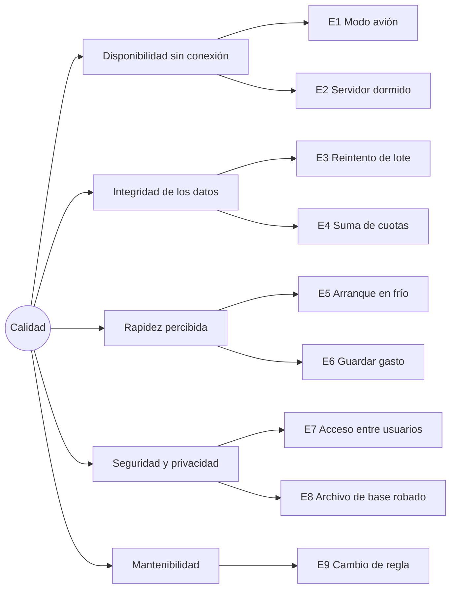

# Descripción de la arquitectura — Coffer

| Campo | Valor |
| --- | --- |
| Sistema de interés | Coffer: app Android offline-first + servicio en la nube *Coffer Server* |
| Nombre | **Coffer** (cofre de dinero; suena a *coffee*, guiño a Colombia). Antes se llamó "Finance App": ese nombre se conserva en el SRS v1.0 aprobado, en `legacy/` y en el archivo de Figma |
| Versión del documento | 1.0 (arquitectura objetivo para la v1.0 del producto) |
| Fecha | 2026-10-09 |
| Responsable | @Julian (product owner y arquitecto) |
| Requisitos de origen | [SRS — Aplicación de Finanzas Personales v1.0](../01-requirements/srs.md) |
| Norma | ISO/IEC/IEEE 42010:2022, *Architecture description* |
| Plantilla | arc42 (versión 8) |
| Arquitectura anterior | [`legacy/`](legacy/) (MVP v0.1.0) |
| Decisiones | [`adr/`](adr/) |
| Diagramas | [`diagrams/`](diagrams/) (C4 en Mermaid) |

## Conformidad con ISO/IEC/IEEE 42010

Este documento es una *descripción de arquitectura* (AD) en el sentido de la norma. La tabla relaciona cada elemento exigido con la sección que lo cubre:

| Elemento de 42010 | Dónde está |
| --- | --- |
| Identificación del sistema de interés y de la AD | Tabla de cabecera |
| Partes interesadas (*stakeholders*) | §1.3 |
| Intereses (*concerns*) | §1.4 |
| Puntos de vista (*viewpoints*) y su justificación | §1.5 |
| Vistas (*views*) y modelos | §3, §5, §6, §7, §8.1 y [`diagrams/`](diagrams/) |
| Correspondencias entre vistas y con los requisitos | §1.6 y §10 |
| Justificación de la arquitectura (*rationale*) | §4 y §9 ([ADR](adr/)) |
| Problemas conocidos, riesgos y decisiones abiertas | §11 |

---

## 1. Introducción y metas

### 1.1 Resumen de requisitos

Coffer es una app de finanzas personales para Android que debe funcionar **completa sin conexión** y respaldarse en la nube cuando haya red (SRS §1.2). Cubre las funciones de uso diario de Cashew y resuelve sus "trucos":

| Área | Funciones (SRS) |
| --- | --- |
| Acceso | Registro, login con usuario o Google y descarga inicial (F01, F02, F28) |
| Cuentas | Efectivo, débito, ahorros, tarjeta de crédito y préstamo; saldo neto y disponible; desactivar (F03, F06, F25, F30) |
| Movimientos | Gasto, ingreso y transferencia; fecha editable; filtros y búsqueda (F04, F05) |
| Clasificación | Categorías con subcategorías y etiquetas (F07, F13) |
| Compromisos | Gastos recurrentes con pendientes y avisos (F11) |
| Crédito | Tarjetas con cuotas y tasas; préstamos con plan de pagos y abonos (F14, F15, F29) |
| Análisis | Reportes por categoría y periodo; intereses pagados (F12, F31) |
| Datos | Importar CSV o .xlsx; exportar CSV; historial de 90 días; sincronización (F08, F09, F10, F24) |

### 1.2 Metas de calidad

Las cinco metas que más condicionan la arquitectura, en orden de prioridad:

| # | Meta | Escenario de referencia | Origen |
| --- | --- | --- | --- |
| Q1 | **Disponibilidad sin conexión** | Con el modo avión activado, el usuario registra, edita, consulta y paga pendientes sin errores. | RNF-05, REQ-TRX-08 |
| Q2 | **Integridad de los datos** | Ningún reintento duplica ni pierde transacciones; los montos son exactos; la suma de las cuotas es igual a la compra. | REQ-SYN-02 a 04, RNF-12 |
| Q3 | **Rapidez percibida** | Inicio en menos de 2 s en arranque en frío con 10.000 transacciones; guardar en menos de 300 ms. | RNF-02, RNF-03, RNF-14 |
| Q4 | **Seguridad y privacidad** | Base local cifrada; tokens en Keystore; HTTPS; aislamiento por usuario. | RNF-08 a 11, RNF-17 |
| Q5 | **Mantenibilidad** | Una regla financiera vive en un solo lugar y tiene pruebas; el esquema cambia solo por migraciones. | RNF-18, §8.2 |

### 1.3 Partes interesadas

| Parte interesada | Rol | Expectativa principal |
| --- | --- | --- |
| Product owner y usuario final (@Julian) | Usa la app a diario y aprueba el alcance | Que no se pierda nada, que funcione sin señal y que registrar sea rápido |
| Desarrollador (@Julian, con asistentes de IA) | Implementa cliente y servidor | Límites claros por módulo, decisiones documentadas y stack conocido |
| Operador | Despliega y mantiene el servicio | Costo cero, despliegue automático y respaldos |
| Evaluador académico | Revisa el proyecto | Trazabilidad SRS → arquitectura → código y uso de normas |
| Plataformas externas (Google Play, Google Identity) | Restringen el diseño | Cumplimiento de sus políticas (permisos, SMS, Sign-In) |

### 1.4 Intereses (*concerns*)

| Id | Interés | Partes interesadas | Vistas que lo atienden |
| --- | --- | --- | --- |
| C1 | ¿Funciona sin conexión y se respalda solo? | Usuario | Contenedores, dinámica D1 y D3 |
| C2 | ¿Pueden perderse o duplicarse datos al sincronizar? | Usuario, desarrollador | Dinámica D1 y D3, información |
| C3 | ¿Los cálculos de tarjetas, préstamos y saldos son correctos y exactos? | Usuario, evaluador | Componentes de la app, información |
| C4 | ¿Están protegidos los datos financieros? | Usuario, operador | Contenedores, despliegue, §8.4 |
| C5 | ¿Cuánto cuesta y cómo se despliega? | Operador | Despliegue |
| C6 | ¿Dónde va cada pieza de código? | Desarrollador | Componentes (servidor y app) |
| C7 | ¿Se puede pasar a multiusuario o web sin rehacer? | Product owner | Información, §8.6 |
| C8 | ¿Cómo se migra desde el MVP? | Desarrollador | §4.3, [`legacy/`](legacy/) |

### 1.5 Puntos de vista utilizados

| Punto de vista | Modelo o notación | Intereses | Vista |
| --- | --- | --- | --- |
| Contexto | C4 nivel 1 (Mermaid `C4Context`) | C1, C5 | [c4-1-context](diagrams/c4-1-context.md) |
| Composición | C4 niveles 2 y 3 (`C4Container`, `C4Component`) | C1, C4, C6 | [contenedores](diagrams/c4-2-containers.md), [componentes del servidor](diagrams/c4-3-components-server.md), [componentes de la app](diagrams/c4-3-components-app.md) |
| Comportamiento | Diagramas de secuencia | C1, C2, C3 | [dynamic-views](diagrams/dynamic-views.md) |
| Despliegue | C4 de despliegue (`C4Deployment`) | C4, C5 | [c4-4-deployment](diagrams/c4-4-deployment.md) |
| Información | Diagrama entidad-relación | C2, C3, C7 | [data-model](diagrams/data-model.md) |
| Decisiones | ADR (MADR) | Todos | [adr/](adr/) |

Se elige C4 porque separa la descripción por niveles de zoom que coinciden con las preguntas de cada parte interesada (usuario y evaluador: contexto; operador: contenedores y despliegue; desarrollador: componentes).

### 1.6 Correspondencias

- Cada elemento de los diagramas C4 tiene el mismo nombre que su paquete o clase en el código (regla de [`diagrams/README.md`](diagrams/README.md)).
- Cada ADR enumera los requisitos que atiende; la matriz de §10.3 relaciona metas de calidad, decisiones y requisitos no funcionales.
- El modelo de datos traza cada tabla con una entidad de SRS §7.4.

---

## 2. Restricciones

### 2.1 Técnicas

| Restricción | Origen | Consecuencia |
| --- | --- | --- |
| Solo Android en la v1.0, mínimo Android 12 (API 31) | SRS §2.4, RNF-01 | `minSdk 31` ([ADR-0011](adr/0011-android-client-stack.md)) |
| Cliente en Kotlin; API en Java | SRS §2.4 | Kotlin 2.2 + Compose; Java 21 + Spring Boot 4 |
| Backend como servicio independiente con Spring Boot + PostgreSQL; Room en el cliente | RNF-18 | [ADR-0002](adr/0002-single-spring-boot-cloud-service.md) |
| Migraciones con Flyway (ya en uso) | Código existente | [ADR-0003](adr/0003-flyway-for-migrations.md) |
| Hosting gratuito con arranque en frío | SRS §2.4 | Cliente tolerante a red lenta; [ADR-0009](adr/0009-free-tier-hosting.md) |
| Una sola moneda por usuario (COP por defecto), sin conversión | SRS §2.4 | `users.currency`; sin tipos de cambio |
| Google Play restringe la lectura de SMS | SRS §2.4 | F19 queda en backlog; no se piden permisos de SMS |

### 2.2 Organizativas

| Restricción | Consecuencia |
| --- | --- |
| Un desarrollador; proyecto académico con plazo | Monolito modular, un despliegue, sin infraestructura propia |
| Dos repositorios Git: `coffer-app` y `coffer-server`, y documentación en `docs/` | El contrato de la API (`docs/04-api/openapi.yml`) es la frontera entre repositorios |
| Commits con Conventional Commits; CHANGELOG con Keep a Changelog y SemVer | Se mantiene |
| Documentación en español; código y mensajes de commit en inglés | Se mantiene |

### 2.3 Convenciones

- Interfaz en español con formato es-CO (RNF-16) y diseño según `design.md` (Material 3, tokens claro y oscuro).
- La prioridad MoSCoW del SRS guía el orden de implementación (§4.3).

---

## 3. Contexto y alcance

### 3.1 Contexto de negocio

Ver [C4 nivel 1](diagrams/c4-1-context.md).

| Socio | Entrada al sistema | Salida del sistema |
| --- | --- | --- |
| Usuario | Movimientos, cuentas, configuraciones, archivos a importar | Saldos, pendientes, reportes, avisos, archivo CSV exportado |
| Google Identity | ID token del usuario | — |
| Sistema Android | Eventos de conectividad, alarmas, archivo elegido | Notificaciones locales, tareas programadas |
| Archivos de Cashew | CSV o .xlsx con el histórico | — |

### 3.2 Contexto técnico

| Canal | Protocolo | Formato | Seguridad |
| --- | --- | --- | --- |
| App ↔ Coffer Server | HTTPS (TLS 1.2+) | JSON, `/api/v1` | JWT Bearer, refresh rotativo |
| App ↔ Google | Credential Manager | ID token (JWT) | Validado en el servidor con JWKS |
| Coffer Server ↔ PostgreSQL | JDBC sobre TLS | SQL | Credenciales por variables de entorno |
| App ↔ archivos | Storage Access Framework | CSV, .xlsx | Sin permisos amplios de almacenamiento |

### 3.3 Fuera de alcance de la v1.0

Versión web, multiusuario y finanzas compartidas, multimoneda, desbloqueo biométrico, ingresos recurrentes y registro automático desde SMS (SRS §9). La arquitectura no los impide (§8.6).

---

## 4. Estrategia de solución

### 4.1 Decisiones fundamentales

| Problema | Estrategia | ADR |
| --- | --- | --- |
| Operar sin red (Q1) | **Local-first**: Room cifrada como fuente de verdad; la red solo sincroniza en segundo plano | [0005](adr/0005-offline-first-room-source-of-truth.md) |
| No perder ni duplicar (Q2) | Ids UUID del cliente, push por lotes idempotente, pull con cursor, borrado lógico y último cambio gana | [0006](adr/0006-sync-protocol.md) |
| Exactitud financiera (Q2, Q3) | `NUMERIC`/`BigDecimal`; un único motor financiero en el dominio Kotlin | [0004](adr/0004-numeric-bigdecimal-amounts.md), [0010](adr/0010-financial-logic-on-client.md) |
| Seguridad (Q4) | JWT propio con refresh rotativo; SQLCipher + Keystore; HTTPS | [0007](adr/0007-self-issued-jwt-auth.md), [0008](adr/0008-on-device-security.md) |
| Costo cero y simplicidad (Q5) | Un servicio Spring Boot (monolito modular) en hosting gratuito | [0002](adr/0002-single-spring-boot-cloud-service.md), [0009](adr/0009-free-tier-hosting.md) |
| Evolución del esquema | Flyway con migraciones SQL versionadas | [0003](adr/0003-flyway-for-migrations.md) |

### 4.2 Estilo arquitectónico

- **Sistema:** cliente rico offline-first + servicio de respaldo y sincronización en la nube.
- **App:** MVVM + Clean Architecture (UI → ViewModel → casos de uso → puertos ← adaptadores de datos), con flujo de datos unidireccional.
- **Servidor:** monolito modular por dominio (`identity`, `sync`, `ledger`, `shared`), en capas dentro de cada módulo (controlador → servicio → repositorio).

### 4.3 Plan de implementación desde el MVP

Cada incremento se puede publicar por sí mismo. El orden sigue la prioridad del SRS (Must primero). El reparto en sprints, con sus versiones y tareas, está en el [plan de sprints](../07-management/sprint-plan.md) (I3 se divide en S4 y S5, I6 e I8 se unen en S8 y la entrega de `v1.0.0`, e I7 se reparte en S9–S11).

| Incremento | Servidor | App | Requisitos |
| --- | --- | --- | --- |
| **I0 · Cimientos** | Dockerfile, CI con Testcontainers, `/api/v1`, ProblemDetail, ArchUnit | `minSdk 31`, kotlinx.serialization, `BuildConfig.API_BASE_URL`, tema `design.md`, CI | RNF-01, RNF-10, RNF-18 |
| **I1 · Identidad** | `V3__identity`, auth (registro, login, refresh, logout) | Login, registro, `SessionStore` (Keystore), `AuthInterceptor` | REQ-AUT-01, 02, 04, 06 |
| **I2 · Sincronización** | `V4`, `V5`, `V6`; push y pull genéricos con `SyncEntityRegistry` | `finance.db` (Room + SQLCipher) + `LegacyDatabaseMigrator` del MVP, `SyncWorker`, indicador de estado, descarga inicial | F08, REQ-SYN-*, REQ-AUT-05, RNF-08 |
| **I3 · Núcleo diario** | Validadores de `accounts`, `categories`, `transactions` | Cuentas, transacción (gasto, ingreso, transferencia), Inicio, Historial con filtros y búsqueda, categorías base | F03–F07, F25, REQ-TRX-*, REQ-INI-01 a 03 |
| **I4 · Recurrentes** | `V8` (recurrentes) | Recurrentes, pendientes, pago, omisión, avisos | F11, REQ-REC-* |
| **I5 · Tarjetas** | `V7` (tarjetas y cuotas) | Motor de cuotas, compra diferida, pago mínimo y total, detalle de tarjeta | F14, REQ-TC-* |
| **I6 · Importar y exportar** | — | Importador CSV/.xlsx con mapeo, duplicados y resumen; exportación CSV | F09, F10 |
| **I7 · Should** | `change_log` y purga, préstamos | Reportes, etiquetas, préstamos, historial, saldo neto y disponible, Google, personalizar inicio | F12, F13, F15, F23, F24, F28–F30 |
| **I8 · Producción** | Despliegue en Render + Neon, respaldos | Firma de release, pruebas de rendimiento | §7, RNF-02 |

---

## 5. Vista de bloques

### 5.1 Nivel 1 — Contenedores

Ver [C4 nivel 2](diagrams/c4-2-containers.md).

| Bloque | Responsabilidad | Interfaz principal |
| --- | --- | --- |
| App Android | Toda la funcionalidad del usuario, sin red | Pantallas (prototipo de Figma "Finance App") |
| Base local (Room + SQLCipher) | Fuente de verdad del dispositivo | DAOs con `Flow` |
| SyncWorker | Sincronización en segundo plano | `SyncScheduler.requestSync()` |
| Almacén de secretos | Tokens y claves | `SessionStore` |
| Coffer Server | Autenticación y respaldo multi-dispositivo | `/api/v1/auth/*`, `/api/v1/sync/*` |
| PostgreSQL | Copia por usuario | Esquema Flyway |

### 5.2 Nivel 2 — Coffer Server

Ver [componentes del servidor](diagrams/c4-3-components-server.md).

| Módulo | Responsabilidad | Interfaces que ofrece |
| --- | --- | --- |
| `identity` | Usuarios, contraseñas, JWT, refresh, Google | `AuthController`; `CurrentUser` para otros módulos |
| `sync` | Protocolo push/pull, idempotencia, LWW, cursor | `SyncController` |
| `ledger` | Entidades del dominio, persistencia y validación de integridad | `LedgerStore` (API interna usada por `sync`) |
| `shared` | Errores, configuración, reloj, observabilidad | Utilidades transversales |

### 5.3 Nivel 2 — App Android

Ver [componentes de la app](diagrams/c4-3-components-app.md).

| Paquete | Responsabilidad |
| --- | --- |
| `ui/feature/*` | Una carpeta por flujo del prototipo: `home`, `history`, `reports`, `accounts`, `transaction`, `recurring`, `cards`, `loans`, `tags`, `categories`, `importexport`, `settings`, `auth` |
| `domain/model` | Entidades y value objects (`Money`, `Rate`, `Recurrence`) |
| `domain/finance` | Motor financiero (ADR-0010) |
| `domain/usecase` | Un caso de uso por acción del usuario |
| `domain/port` | Interfaces que implementa `data` |
| `data/local`, `data/remote`, `data/sync`, `data/reminder`, `data/io` | Adaptadores |

### 5.4 Correspondencia entre pantallas y casos de uso

| Pantalla (prototipo) | Casos de uso principales |
| --- | --- |
| Inicio | `ObserveHomeDashboard`, `ObservePendingPayments`, `RequestSync` |
| Nueva transacción / transferencia | `RegisterTransaction`, `RegisterTransfer`, `DeferCardPurchase` |
| Historial y filtros | `SearchTransactions(filter, query)` |
| Detalle de transacción | `UpdateTransaction`, `DeleteTransaction` |
| Cuentas, detalle y edición | `CreateAccount`, `UpdateAccount`, `RemoveAccount(option)`, `ReactivateAccount` |
| Tarjeta: detalle y pago | `ObserveCardStatement`, `PayCreditCard(option)` |
| Préstamo: alta, detalle y abono | `CreateLoan(mode)`, `PayLoanInstallment`, `ExtraPayment(reduce)` |
| Recurrentes y pendientes | `CreateRecurring`, `PayPending`, `SkipPending`, `EndRecurrence` |
| Reportes | `BuildReport(period)`, `ObserveFinancialCharges` |
| Etiquetas | `CreateTag`, `PinTag`, `ObserveTagSummary(range)` |
| Importar y exportar | `PreviewImport`, `CommitImport`, `ExportCsv(range)` |
| Historial de cambios | `ObserveChangeLog`, `RestoreTransaction`, `RevertEdit` |
| Ajustes | `UpdateSettings`, `Logout`, `ObserveSyncStatus` |

---

## 6. Vista de ejecución

Escenarios detallados en [`diagrams/dynamic-views.md`](diagrams/dynamic-views.md):

| Escenario | Qué demuestra | Metas |
| --- | --- | --- |
| D1 · Registrar un gasto sin conexión y respaldarlo | Guardado local atómico, cola por fila, push idempotente | Q1, Q2, Q3 |
| D2 · Primer inicio de sesión y descarga | Pull paginado con progreso; sesión persistente | Q1, Q4 |
| D3 · Conflicto entre dos dispositivos | Último cambio gana y propagación por cursor | Q2 |
| D4 · Pagar la tarjeta | Motor financiero, transferencia con desglose, liquidación | Q2, Q3 |
| D5 · Renovar la sesión | Refresh rotativo y detección de reutilización | Q4 |

Escenarios adicionales que se resuelven con las mismas piezas:
- **Pagar un pendiente:** `PayPending` crea el gasto real con el monto editable, actualiza `last_paid_amount` y calcula `next_due_date` con `RecurrenceCalculator` en la misma transacción de Room.
- **Avisos:** `ReminderWorker` corre a diario. Para cada pendiente que entra en la ventana o vence hoy y no se ha avisado, publica una notificación local (REQ-REC-09). Si las notificaciones están desactivadas, no hace nada (REQ-REC-10).
- **Importar:** `PreviewImport` lee el archivo en streaming, aplica el mapeo y marca errores y posibles duplicados (misma fecha y hora, monto, cuenta y tipo). `CommitImport` inserta por lotes de 500 en segundo plano con progreso (RNF-04), y todo queda `PENDING` para la sincronización.

---

## 7. Vista de despliegue

Ver [C4 de despliegue](diagrams/c4-4-deployment.md).

| Nodo | Artefacto | Configuración |
| --- | --- | --- |
| Teléfono Android 12+ | APK `release` firmado | `API_BASE_URL` de producción; sin tráfico en claro |
| Render Web Service (gratuito) | Imagen Docker de `coffer-server` (multi-etapa, JRE 21) | Variables: `DB_URL`, `DB_USER`, `DB_PASSWORD`, `JWT_PRIVATE_KEY`, `JWT_PUBLIC_KEY`, `GOOGLE_CLIENT_ID`; `SPRING_PROFILES_ACTIVE=prod` |
| Neon PostgreSQL 16 (gratuito) | Base `coffer` | TLS obligatorio; Flyway migra al arrancar |
| GitHub Actions | CI y respaldo semanal (`pg_dump` cifrado) | Secretos en GitHub |

Entornos: local (Docker Compose + emulador), CI (Testcontainers) y producción. Los perfiles de Spring son `local`, `test` y `prod`.

---

## 8. Conceptos transversales

### 8.1 Modelo de dominio y datos

Ver [data-model.md](diagrams/data-model.md). Principios:
- Todas las entidades sincronizables comparten `id` UUID del cliente, `user_id`, `created_at`, `updated_at`, `deleted_at` y `version`.
- Los saldos, los pendientes y "lo que vence" **se calculan**, no se guardan.
- Una compra con tarjeta es una transacción `EXPENSE` en la cuenta de la tarjeta. Si tiene 2 o más cuotas, además tiene una `deferred_purchase` con su plan de cuotas.
- Pagar una tarjeta o un préstamo es una `TRANSFER` con desglose (`principal`, `interest`, `fees`). En reportes, los intereses y cargos cuentan en la categoría de sistema `FINANCIAL_CHARGES` ("Intereses y cargos financieros").
- Un préstamo es una cuenta de tipo `LOAN`. Recibir el dinero es una transferencia del préstamo a la cuenta destino.

### 8.2 Dinero, tasas y tiempo

- `Money` con `BigDecimal`, escala y redondeo centralizados ([ADR-0004](adr/0004-numeric-bigdecimal-amounts.md)).
- Tasas guardadas con su tipo (`EA` o `MV`); se convierten en `RateConverter`. El interés de cada cuota usa un mes comercial de 30 días (REQ-TC-15).
- Las fechas con hora se guardan en UTC (`Instant`) y se muestran en la zona del dispositivo (`America/Bogota`). Las fechas de vencimiento y de inicio son `LocalDate`.
- Los listados se ordenan por `occurred_at`, nunca por fecha de registro (REQ-TRX-06).
- Se inyecta un `Clock` en el dominio y en el servidor para poder probar fechas.

### 8.3 Sincronización y consistencia

Protocolo en [ADR-0006](adr/0006-sync-protocol.md):
- Cada escritura local es atómica (una transacción de Room) y deja sus filas en `PENDING`.
- Siempre push antes que pull; consistencia eventual entre dispositivos.
- Se guarda el historial de cambios (`change_log`) en la misma transacción que el cambio (REQ-HIS-01). Se sincroniza como solo-agregar y se purga a los 90 días en ambos lados (REQ-HIS-04).

### 8.4 Seguridad

| Capa | Medida | Requisito |
| --- | --- | --- |
| Transporte | Solo HTTPS en `release` | RNF-10 |
| Identidad | BCrypt de costo 12; JWT RS256 de 15 min; refresh rotativo con detección de reutilización | RNF-11, REQ-AUT-04 |
| Autorización | `user_id` solo desde el JWT; todas las consultas filtran por usuario | RNF-17 |
| Dispositivo | SQLCipher; tokens cifrados con Keystore; `allowBackup=false` | RNF-08, RNF-09 |
| Exposición | Errores genéricos; sin trazas; estados de sincronización genéricos | RNF-07 |
| Abuso | Límite de intentos de login | ADR-0007 |
| Secretos | Variables de entorno; nunca en Git | ADR-0009 |

### 8.5 Manejo de errores

- **Servidor:** `ProblemDetail` (RFC 9457) con `code` estable ([ADR-0012](adr/0012-api-v1-contract-and-errors.md)).
- **App:** los casos de uso devuelven `Result<T, DomainError>`. La UI muestra mensajes en español junto al campo afectado. Los errores de red nunca se muestran como error: se convierten en "N pendientes".

### 8.6 Evolución y escalabilidad

- **Multiusuario o finanzas compartidas:** el `user_id` ya está en todas las tablas (RNF-17). Para compartir cuentas haría falta una tabla de membresía, pero no migrar datos.
- **Web:** consumiría la misma API; la lógica de `domain/finance` se extraería a Kotlin Multiplatform ([ADR-0010](adr/0010-financial-logic-on-client.md)).
- **Multimoneda:** `currency` ya existe en usuario y `Money`.

### 8.7 Pruebas

| Nivel | Servidor | App |
| --- | --- | --- |
| Unitarias | Servicios, validadores, `TokenService` | `domain/finance` (≥ 90 %), casos de uso, ViewModels con Turbine |
| Integración | `@SpringBootTest` + Testcontainers; migraciones Flyway | Room (migraciones, DAOs), `SyncWorker` con MockWebServer |
| Contrato | `openapi.yml` contra el código generado | DTO contra `openapi.yml` |
| Arquitectura | ArchUnit (límites entre módulos) | Lint y reglas de dependencias por paquete |
| UI y rendimiento | — | Compose UI Test; Macrobenchmark (RNF-02, RNF-03) |

### 8.8 Experiencia de usuario

- Diseño según el [sistema de diseño](../08-ui/design-system.md) (Material 3, base neutra con detalles caramelo y botones espresso, bordes de 1 px, sin sombras, tokens claro y oscuro) y el prototipo de Figma "Finance App".
- Registrar un gasto básico en 4 interacciones como máximo (RNF-14): el botón **+** abre el formulario con la fecha, la hora y la última cuenta usada ya puestas.
- Los campos de tarjeta o préstamo solo aparecen si la cuenta elegida lo requiere (RNF-15).

### 8.9 Observabilidad

- **Servidor:** Actuator (`health`, `info`, `metrics`), logs JSON con `traceId`, sin montos ni datos personales.
- **App:** registro local de la última sincronización y del número de pendientes; sin analítica de terceros.

---

## 9. Decisiones de arquitectura

Registro completo en [`adr/`](adr/README.md):

| ADR | Decisión | Estado |
| --- | --- | --- |
| [0001](adr/0001-record-architecture-decisions.md) | Registrar decisiones con ADR (MADR) | Aceptado |
| [0002](adr/0002-single-spring-boot-cloud-service.md) | Un único servicio Spring Boot 4 en la nube (monolito modular) | Aceptado |
| [0003](adr/0003-flyway-for-migrations.md) | Flyway como única vía de cambio del esquema | Aceptado |
| [0004](adr/0004-numeric-bigdecimal-amounts.md) | `NUMERIC(19,4)` + `BigDecimal` | Aceptado |
| [0005](adr/0005-offline-first-room-source-of-truth.md) | Room como fuente de verdad (offline-first) | Aceptado |
| [0006](adr/0006-sync-protocol.md) | Push/pull con cursor y último cambio gana | Aceptado |
| [0007](adr/0007-self-issued-jwt-auth.md) | JWT propio, refresh rotativo y Google | Aceptado |
| [0008](adr/0008-on-device-security.md) | SQLCipher + Keystore | Aceptado |
| [0009](adr/0009-free-tier-hosting.md) | Render + Neon | Aceptado |
| [0010](adr/0010-financial-logic-on-client.md) | Lógica financiera en el cliente | Aceptado |
| [0011](adr/0011-android-client-stack.md) | Stack del cliente Android | Aceptado |
| [0012](adr/0012-api-v1-contract-and-errors.md) | Contrato `/api/v1` y errores RFC 9457 | Aceptado |
| [0013](adr/0013-on-device-sync-queue.md) | Cola de sincronización en el dispositivo con WorkManager, sin broker | Aceptado |

---

## 10. Requisitos de calidad

### 10.1 Árbol de calidad

### 10.2 Escenarios de calidad

| Id | Estímulo | Respuesta esperada | Medida |
| --- | --- | --- | --- |
| E1 | El usuario usa la app en modo avión | Todas las funciones salvo login y sincronización operan | 0 errores; prueba instrumentada |
| E2 | El servidor está dormido (arranque en frío) | La UI no se bloquea; el worker reintenta | Ninguna pantalla espera a la red |
| E3 | Se reenvía un lote ya aplicado | Sin duplicados | Conteo en BD sin cambios; respuesta `STALE` |
| E4 | Compra de $1.200.000 a 12 cuotas | La suma del capital de las cuotas es exacta | Igual a $1.200.000 |
| E5 | Abrir la app con 10.000 transacciones | Inicio visible | < 2 s (Macrobenchmark, gama media) |
| E6 | Guardar un gasto sin conexión | Persistido y visible | < 300 ms |
| E7 | El usuario A envía un cambio con el id de un registro de B | Rechazado | `REJECTED`; prueba de integración |
| E8 | Se copia `finance.db` del teléfono | No se puede leer | Sin texto legible sin la clave |
| E9 | Cambia la regla de interés de las cuotas | Un solo cambio en `InstallmentCalculator` | Pruebas del dominio cubren el cambio |

### 10.3 Trazabilidad: metas de calidad, decisiones y requisitos no funcionales

| Meta | ADR | RNF |
| --- | --- | --- |
| Q1 | 0005, 0006, 0010, 0013 | RNF-05, RNF-06 |
| Q2 | 0004, 0006, 0003 | RNF-12, REQ-SYN-02 a 04 |
| Q3 | 0005, 0011 | RNF-02, RNF-03, RNF-04, RNF-14 |
| Q4 | 0007, 0008, 0012 | RNF-07 a 11 |
| Q5 | 0001, 0002, 0003, 0010 | RNF-17, RNF-18 |

---

## 11. Riesgos y deuda técnica

| # | Riesgo o deuda | Probabilidad | Impacto | Mitigación |
| --- | --- | --- | --- | --- |
| R1 | Cambien las condiciones del hosting gratuito | Media | Medio | Contenedor portable; respaldo semanal; límites revisados en ADR-0009 |
| R2 | Un reloj del dispositivo desfasado gana un conflicto LWW | Baja | Bajo | Aceptado por el SRS §2.5; se registra en `change_log` y se puede revertir |
| R3 | Pérdida de la clave del Keystore (restablecer el teléfono) | Baja | Medio | La nube restaura todo (HU-06) |
| R4 | Errores en los cálculos de tarjeta y préstamo | Media | Alto | Motor único con pruebas de los ejemplos del SRS y casos límite (febrero, día 31, primera cuota sin intereses) |
| R5 | Formatos de importación variables (Cashew, Excel) | Alta | Medio | Mapeo de columnas, plantilla y vista previa; pregunta abierta del SRS §10.2 |
| R6 | Rendimiento de SQLCipher con 10.000 filas | Baja | Medio | Índices en `occurred_at` y `account_id`; Macrobenchmark en CI |
| D1 | El MVP mezcla red y UI (`runBlocking`) y usa `Double` | — | — | Se reemplaza en I2 e I3 (plan §4.3) |
| D2 | La prueba `TransactionRepositoryImplTest` no compila (usa `Int` como id) | — | — | Se reescribe en I3 |
| D3 | El servidor del MVP no tiene autenticación | — | — | Se corrige en I1 antes de cualquier despliegue público |

### Preguntas abiertas heredadas del SRS

| Pregunta (SRS §10.2) | Dónde impacta | Estado |
| --- | --- | --- |
| Categorías base concretas | Semilla en el cliente (REQ-CAT-01) | Resuelta en la planificación de S3: detailed-design §6.9.10 |
| Columnas del CSV de Cashew | Mapeo por defecto del importador | Abierta |
| Intereses de compras entre corte y pago | `CardPeriodCalculator` | Abierta; se aísla en una sola función |
| Proveedor de hosting | Despliegue | Resuelta: Render + Neon (ADR-0009, aceptado) |

---

## 12. Glosario

| Término | Definición |
| --- | --- |
| Local-first / offline-first | La app opera sobre su base local; la red solo sincroniza. |
| Fuente de verdad | El almacén cuyo contenido manda; en el dispositivo es Room. |
| Push / pull | Envío de cambios locales al servidor / recepción de cambios del servidor. |
| Cursor (`version`) | Número monotónico que identifica hasta dónde se ha recibido. |
| Último cambio gana (LWW) | Ante dos versiones de un registro, prevalece la de `updated_at` más reciente. |
| Borrado lógico | Marcar `deleted_at` en lugar de borrar la fila, para propagar la eliminación. |
| Monolito modular | Un solo despliegue organizado en módulos con límites explícitos. |
| Servicio en la nube (Coffer Server) | El "microservicio de transacciones" del SRS: un único servicio independiente del APK. |
| Vista / punto de vista | En ISO/IEC/IEEE 42010, representación del sistema para ciertos intereses / convenciones para construirla. |
| ADR | Registro de una decisión de arquitectura con su contexto y consecuencias. |
| C4 | Modelo de diagramas por niveles: contexto, contenedores, componentes y código. |
| Saldo neto / disponible, pendiente, compra diferida, EA/MV, abono a capital | Ver el glosario del SRS §10.3. |
