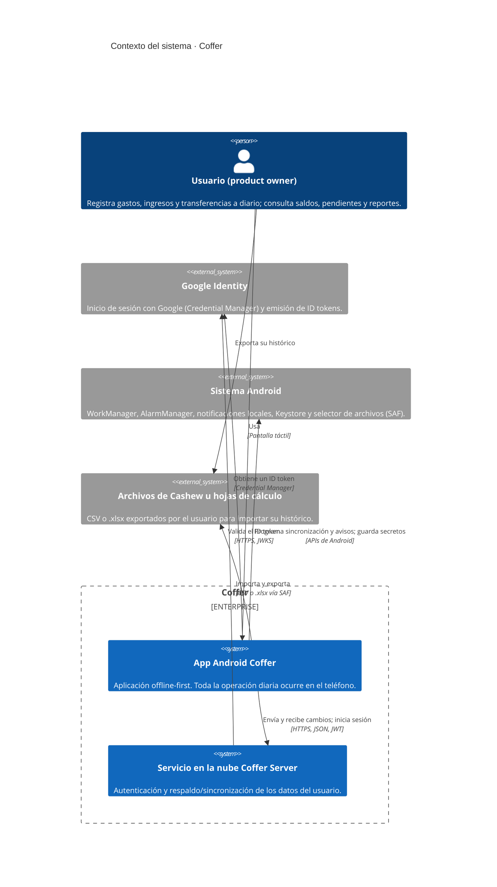

# C4 · Nivel 1 · Contexto del sistema

Vista de contexto (punto de vista *Contexto* de ISO/IEC/IEEE 42010). Responde a: ¿quién usa el sistema y con qué sistemas externos se relaciona?

## Elementos

| Elemento | Tipo | Responsabilidad | Requisitos |
| --- | --- | --- | --- |
| Usuario | Persona | Único actor humano de la v1.0. | §2.3 |
| App Android | Sistema (propio) | Opera completa sin conexión sobre su base local cifrada. | F01–F31, RNF-05 |
| Servicio en la nube | Sistema (propio) | Autentica, guarda una copia por usuario y sincroniza dispositivos. | F01, F02, F08, RNF-17, RNF-18 |
| Google Identity | Externo | Proveedor de identidad para REQ-AUT-03. | REQ-AUT-03 |
| Sistema Android | Externo | Planificación en segundo plano, notificaciones locales, almacén de claves y archivos. | REQ-REC-09, RNF-09, §7.2 |
| Archivos de Cashew | Externo | Fuente del histórico inicial. | HU-11, REQ-IMP-01 |

> El SRS llama "microservicio de transacciones" al servicio en la nube. Es **un único servicio** independiente del APK, no varios microservicios. Ver [ADR-0002](../adr/0002-servicio-unico-en-la-nube-spring-boot.md).
