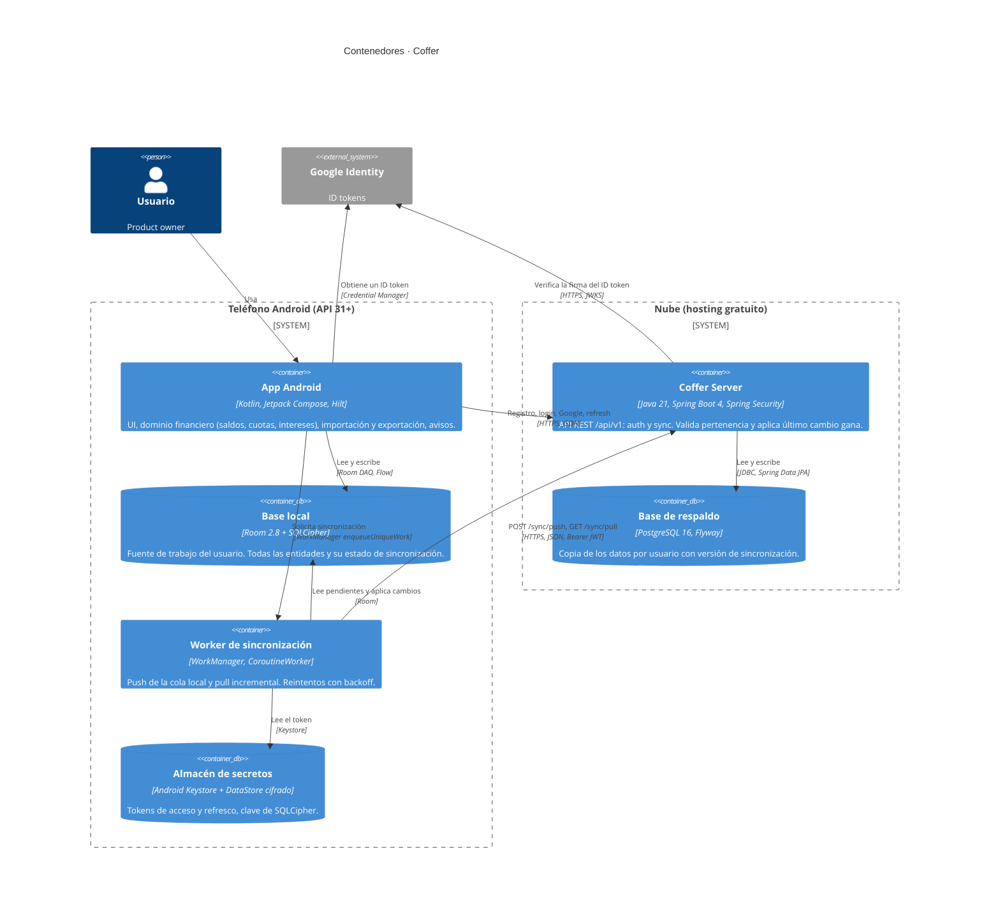

# C4 · Nivel 2 · Contenedores

Vista de contenedores (punto de vista *Composición*). Responde a: ¿qué unidades se despliegan o ejecutan por separado y cómo se comunican?

## Contenedores

| Contenedor | Tecnología | Responsabilidad | Decisiones |
| --- | --- | --- | --- |
| App Android | Kotlin 2.2, Compose, Material 3, Hilt, Navigation | Toda la funcionalidad del SRS sin red. Calcula saldos, planes de cuotas e intereses. | [ADR-0005](../adr/0005-offline-first-room-source-of-truth.md), [ADR-0010](../adr/0010-financial-logic-on-client.md), [ADR-0011](../adr/0011-android-client-stack.md) |
| Base local | Room + SQLCipher | Fuente de verdad del dispositivo; cola de cambios por fila (`syncState`). | [ADR-0005](../adr/0005-offline-first-room-source-of-truth.md), [ADR-0008](../adr/0008-on-device-security.md) |
| Worker de sincronización | WorkManager | Ejecuta push y pull con red, aunque la app esté cerrada. | [ADR-0006](../adr/0006-sync-protocol.md) |
| Almacén de secretos | Keystore + DataStore cifrado | Tokens que sobreviven al cierre de la app y a limpiar la caché. | [ADR-0008](../adr/0008-on-device-security.md) |
| Coffer Server | Spring Boot 4.0, Java 21 | Autenticación, emisión de JWT, protocolo de sincronización, aislamiento por usuario. | [ADR-0002](../adr/0002-single-spring-boot-cloud-service.md), [ADR-0007](../adr/0007-self-issued-jwt-auth.md) |
| Base de respaldo | PostgreSQL 16 + Flyway | Persistencia por usuario; migraciones versionadas. | [ADR-0003](../adr/0003-flyway-for-migrations.md), [ADR-0004](../adr/0004-numeric-bigdecimal-amounts.md) |
