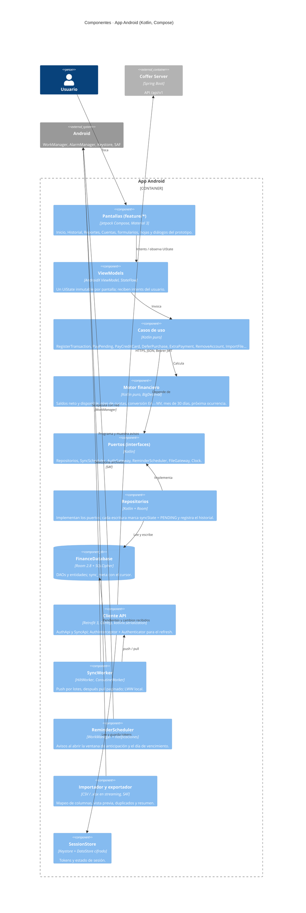

# C4 · Nivel 3 · Componentes de la app Android

Vista de componentes del contenedor *App Android*. Arquitectura **MVVM + Clean Architecture** con un dominio en Kotlin puro: ahí viven todas las reglas financieras del SRS.



## Organización del código

Módulo Gradle único `:app` en la v1.0 (paquete `com.dev.julian09.financeapp`). La división en paquetes permite extraer módulos Gradle (`:core:domain`, `:core:data`, `:feature:*`) cuando crezca el tiempo de compilación.

```
com.dev.julian09.financeapp
├── ui/                 # tema (tokens del design.md), componentes y navegación
│   └── feature/        # home, history, reports, accounts, transaction, recurring,
│                       # cards, loans, tags, categories, importexport, settings, auth
├── domain/
│   ├── model/          # Account, Transaction, Money, InstallmentPlan, Recurrence…
│   ├── finance/        # BalanceCalculator, InstallmentCalculator, RateConverter…
│   ├── usecase/
│   └── port/           # interfaces de repositorios y servicios
├── data/
│   ├── local/          # Room: entities, dao, FinanceDatabase, migraciones
│   ├── remote/         # Retrofit: AuthApi, SyncApi, DTO, interceptores
│   ├── repository/     # implementaciones de los puertos
│   ├── sync/           # SyncWorker, SyncScheduler, mapeo de cambios
│   ├── reminder/       # ReminderWorker, canal de notificaciones
│   └── io/             # CsvReader, XlsxReader, CsvWriter
└── di/                 # módulos de Hilt
```

| Capa | Regla |
| --- | --- |
| `ui` | Solo renderiza `UiState` y emite intents. No importa `data`. |
| `domain` | Kotlin puro (sin `android.*`), 100 % probado con JUnit. |
| `data` | Única capa que conoce Room, Retrofit y las APIs de Android. |
