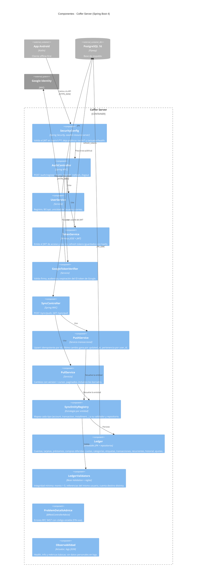

# C4 · Nivel 3 · Componentes del servidor (Coffer Server)

Vista de componentes del contenedor *Coffer Server*. Es un único servicio Spring Boot organizado como **monolito modular**: cada módulo es un paquete de primer nivel con su API interna, y los límites se verifican con pruebas de ArchUnit.

## Módulos y paquetes

Paquete base: `com.dev.julian09.financeserver`

| Módulo (paquete) | Componentes | Puede depender de |
| --- | --- | --- |
| `identity` | `AuthController`, `UserService`, `TokenService`, `GoogleTokenVerifier`, `User`, `RefreshToken` | `shared` |
| `sync` | `SyncController`, `PushService`, `PullService`, `SyncEntityRegistry`, DTO `ChangeDto` | `ledger` (solo su API pública), `shared` |
| `ledger` | Entidades JPA y repositorios del dominio, `LedgerValidators` | `shared` |
| `shared` | `ProblemDetailsAdvice`, `ErrorCode`, configuración, `Clock`, utilidades de dinero | — |
| `config` | `SecurityConfig`, `OpenApiConfig`, `JacksonConfig` | todos |

Reglas verificadas con ArchUnit:
- `ledger` no conoce `sync` ni `identity`.
- Ningún controlador accede a un repositorio directamente.
- `user_id` nunca se lee del cuerpo de la petición: siempre sale de `@AuthenticationPrincipal Jwt`.
