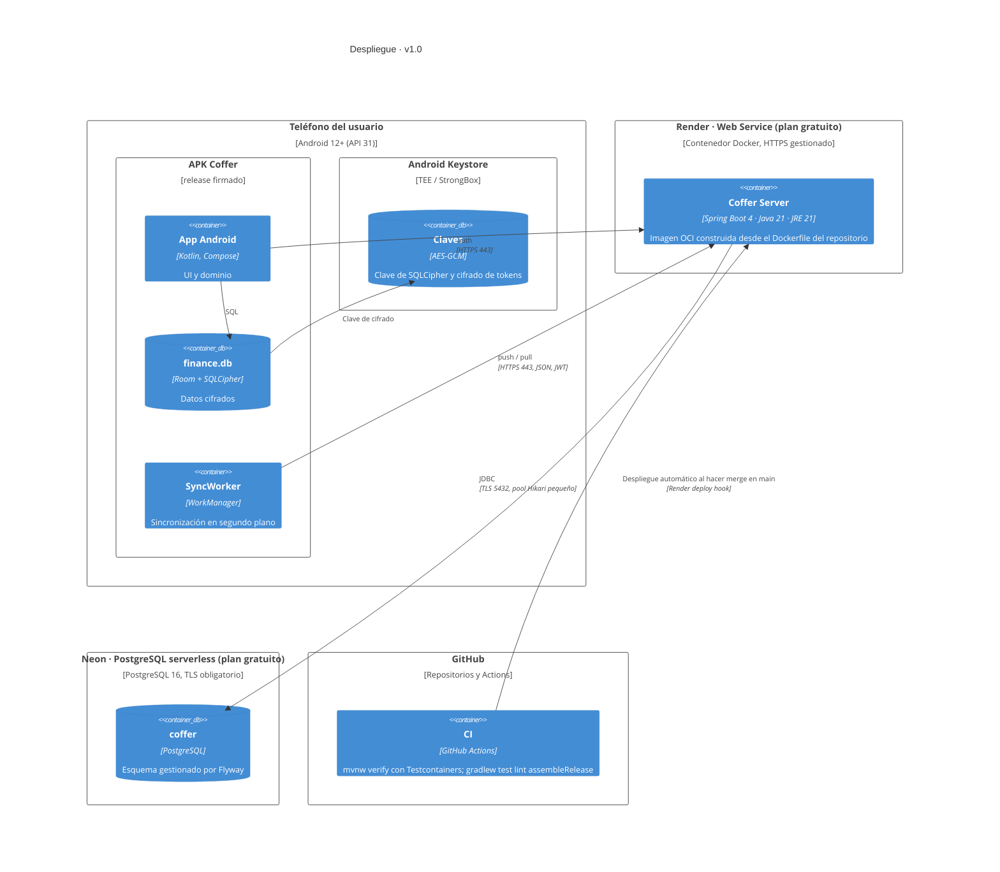

# C4 · Despliegue

Vista de despliegue (punto de vista *Despliegue*). Muestra dónde corre cada contenedor en la v1.0. El proveedor recomendado se justifica en [ADR-0009](../adr/0009-hosting-gratuito.md).

## Entornos

| Entorno | Servidor | Base de datos | URL que usa la app (`BuildConfig.API_BASE_URL`) |
| --- | --- | --- | --- |
| Local | `./mvnw spring-boot:run` | PostgreSQL 16 en `docker compose` | `http://10.0.2.2:8080/` (solo `debug`; cleartext limitado a esa IP) |
| Pruebas automáticas | Spring Boot en CI | Testcontainers PostgreSQL 16 | — |
| Producción | Render (Docker) | Neon | `https://<servicio>.onrender.com/` (`release`) |

## Consideraciones del plan gratuito

- **Arranque en frío:** el servicio se suspende sin tráfico y tarda en despertar. La app nunca espera a la red y el worker reintenta con backoff exponencial (RNF-06).
- **Conexiones:** pool de Hikari con 3–5 conexiones para no superar los límites de Neon.
- **Secretos:** `DB_URL`, `DB_USER`, `DB_PASSWORD`, `JWT_PRIVATE_KEY`, `JWT_PUBLIC_KEY`, `GOOGLE_CLIENT_ID` se configuran como variables de entorno en Render; nunca se guardan en el repositorio.
- **Respaldo de la base:** la base de la nube ya es el respaldo de los teléfonos. Además, un job semanal de GitHub Actions ejecuta `pg_dump` cifrado como respaldo del respaldo.
