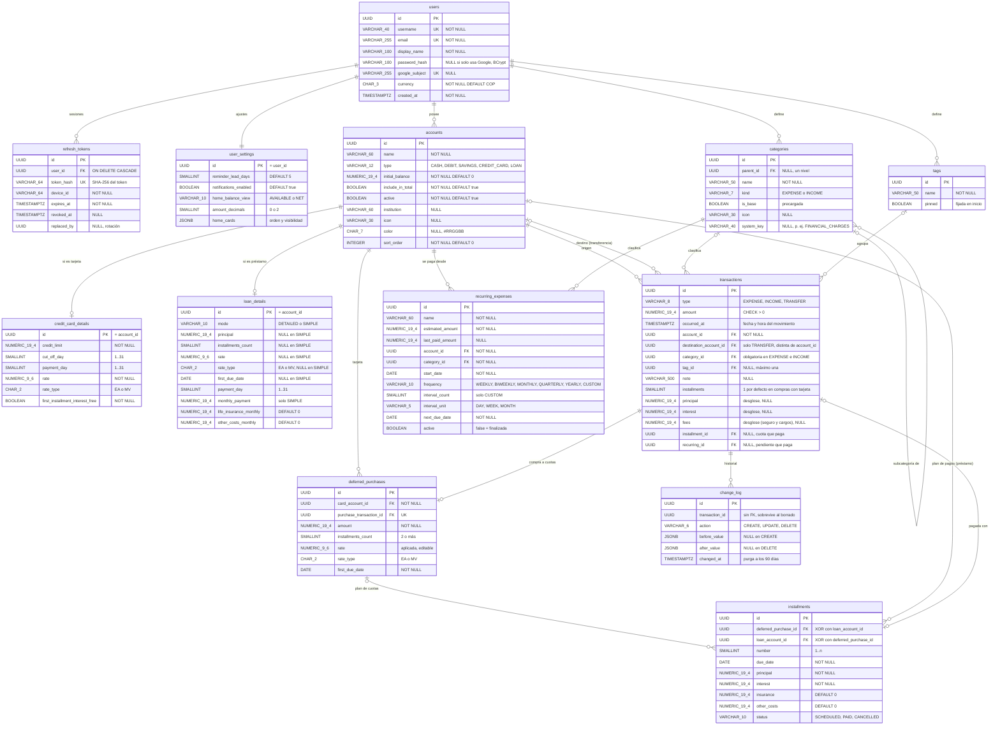

# Modelo de datos (vista de información)

Modelo lógico objetivo, derivado del SRS §7.4. El **modelo físico completo** (diccionario de datos, restricciones y scripts de Flyway) es [`docs/03-design/data-model.md`](../../03-design/data-model.md), que prevalece si hay diferencias.

## Columnas comunes de sincronización

Todas las tablas sincronizables, es decir, todas menos `users` y `refresh_tokens`, llevan estas columnas:

| Columna | Tipo (PostgreSQL) | Regla |
| --- | --- | --- |
| `id` | `UUID` PK | Generado en el dispositivo (UUID v4). Hace idempotente el reenvío. |
| `user_id` | `UUID` FK → `users` | Lo asigna el servidor desde el JWT; nunca se acepta del cliente. |
| `created_at` | `TIMESTAMPTZ` | Momento de creación en el dispositivo. |
| `updated_at` | `TIMESTAMPTZ` | Momento de la última modificación en el dispositivo. Decide el **último cambio gana**. |
| `deleted_at` | `TIMESTAMPTZ NULL` | Borrado lógico. Se sincroniza como un cambio más. |
| `version` | `BIGINT` | `nextval('sync_version')` en cada escritura del servidor. Es el cursor de `GET /sync/pull`. |

En el diagrama se omiten para no repetirlas.

## Diagrama entidad-relación (PostgreSQL)

## Restricciones e índices

| Objeto | Definición | Requisito |
| --- | --- | --- |
| `SEQUENCE sync_version` | global y monotónica | REQ-SYN-01, pull incremental |
| `ix_<tabla>_user_version` | `(user_id, version)` en cada tabla sincronizable | `GET /sync/pull` |
| `ix_tx_user_occurred` | `transactions(user_id, occurred_at DESC) WHERE deleted_at IS NULL` | REQ-TRX-06, 12 |
| `ix_tx_user_account` | `transactions(user_id, account_id, occurred_at DESC)` | Detalle de cuenta |
| `ck_tx_amount` | `amount > 0` | REQ-TRX-01 |
| `ck_tx_transfer` | `type <> 'TRANSFER' OR (destination_account_id IS NOT NULL AND destination_account_id <> account_id)` | REQ-TRX-02 |
| `ck_tx_category` | `type = 'TRANSFER' OR category_id IS NOT NULL` | REQ-TRX-01 |
| `ck_inst_owner` | `num_nonnulls(deferred_purchase_id, loan_account_id) = 1` | REQ-TC-07, REQ-PRE-03 |
| `uq_cat_name` | `(user_id, kind, coalesce(parent_id, '00000000-…'), lower(name)) WHERE deleted_at IS NULL` | REQ-CAT-02 |
| `uq_tag_name` | `(user_id, lower(name)) WHERE deleted_at IS NULL` | REQ-ETQ-01 |
| `ix_change_log_changed` | `change_log(user_id, changed_at)` | Purga de 90 días (REQ-HIS-04) |

## Datos que no se guardan (se calculan)

| Dato | Cómo se obtiene | Requisito |
| --- | --- | --- |
| Saldo de una cuenta | `initial_balance + ingresos − gastos ± transferencias` | REQ-CTA-06 |
| Saldo neto y disponible | Cuentas incluidas, menos lo que vence en el periodo | REQ-CTA-08 |
| Pendientes | `recurring_expenses.next_due_date` dentro de la ventana, cuotas `SCHEDULED` del periodo y pago de la tarjeta | REQ-REC-04, REQ-TC-10, REQ-PRE-04 |
| Lo que vence en el periodo de una tarjeta | Compras a 1 cuota del periodo + cuotas del periodo + intereses + cargos | REQ-TC-08 |

## Diferencias en Room (dispositivo)

| Aspecto | PostgreSQL | Room |
| --- | --- | --- |
| Montos | `NUMERIC(19,4)` | `INTEGER` escalado ×10⁴ (`Long`), convertido a `BigDecimal` en el mapper. Exacto y sumable en SQL. |
| Fechas con hora | `TIMESTAMPTZ` | `INTEGER` epoch en milisegundos UTC |
| Fechas sin hora | `DATE` | `TEXT` ISO-8601 (`2026-10-09`) |
| `user_id`, `version` | Sí | No, porque el dispositivo es de un solo usuario y el cursor vive en `sync_meta` |
| Estado de sincronización | — | `syncState TEXT` (`PENDING`, `SYNCED`, `FAILED`) indexado: la cola de cambios por fila |
| Tablas extra | — | `sync_meta(key, value)` para `pull_cursor` y `last_sync_at` |
| Cifrado | En tránsito (TLS) y en reposo del proveedor | SQLCipher con clave en Keystore (RNF-08) |
