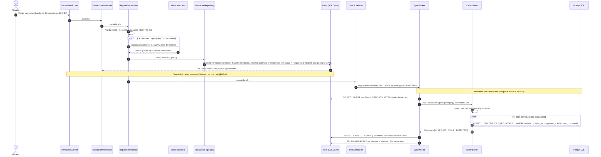
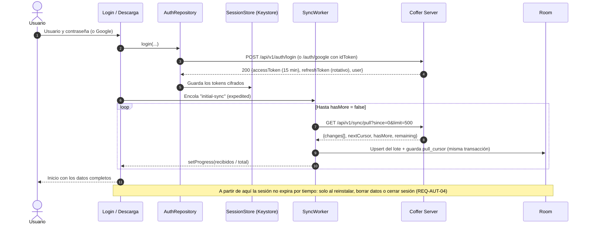
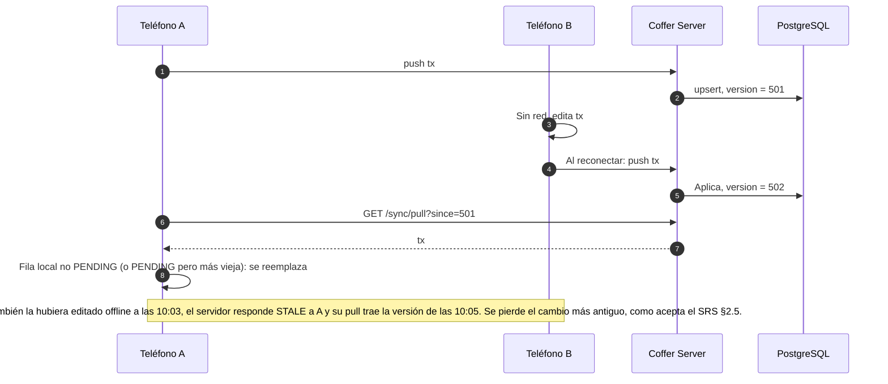
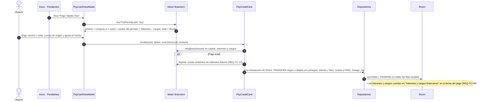
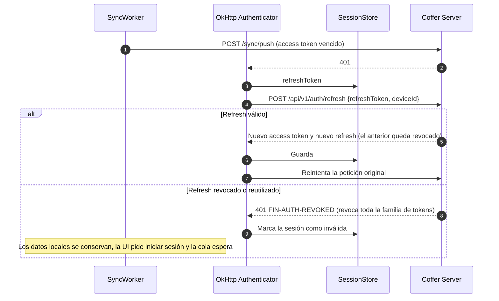

# Vistas dinámicas (escenarios en ejecución)

Escenarios clave del SRS a nivel de componentes C4. Complementan la sección 6 de [`../architecture.md`](../architecture.md).

## D1 · Registrar un gasto sin conexión y respaldarlo (HU-01, HU-05)

## D2 · Primer inicio de sesión y descarga completa (HU-06, REQ-AUT-05)

## D3 · Sincronización periódica y conflicto entre dos dispositivos (REQ-SYN-02)

## D4 · Pagar la tarjeta (HU-09, REQ-TC-10 a 12)

## D5 · Renovar la sesión (RNF-09, REQ-AUT-04)

