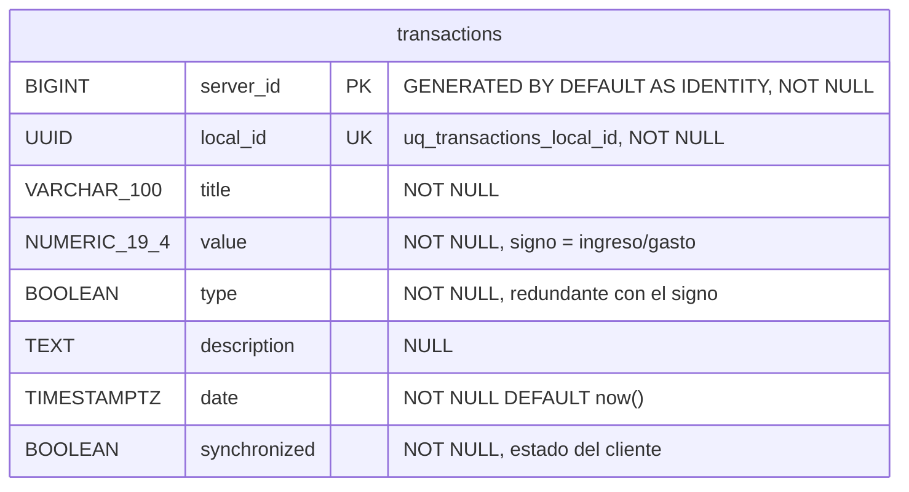
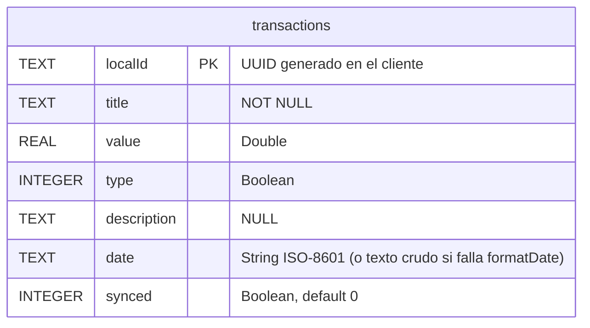

# Diagrama físico de la base de datos

## Estado del MVP (v0.1.0)

### PostgreSQL (servidor), después de `V1__first_schema.sql` + `V2__fix_schema.sql`

### Room / SQLite (dispositivo Android), `AppDatabase` version 1

Observaciones:
- No hay tabla de usuarios: todos los datos son globales.
- `value` se guarda como `NUMERIC` en la BD, pero se mapea a `double` en Java y Kotlin.
- No hay `updated_at` ni `deleted_at`, así que no se pueden sincronizar ediciones ni borrados.
