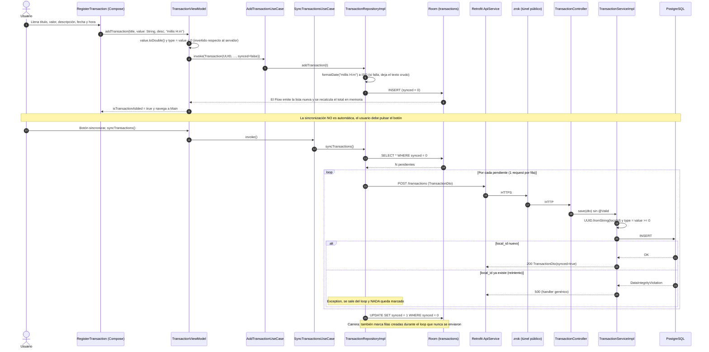

# Flujo: crear una transacción

## Estado del MVP (v0.1.0)

Puntos de fallo:
1. Un error a mitad del loop provoca que la siguiente sincronización reenvíe las filas ya enviadas. El servidor responde 500 por duplicado y la sincronización queda **bloqueada para siempre**.
2. `UPDATE ... WHERE synced = 0` marca como sincronizadas filas que no se enviaron, así que **se pierden datos**.
3. `type` tiene un significado opuesto en el cliente y en el servidor.
4. No hay autenticación: cualquiera con la URL de zrok puede hacer POST.
