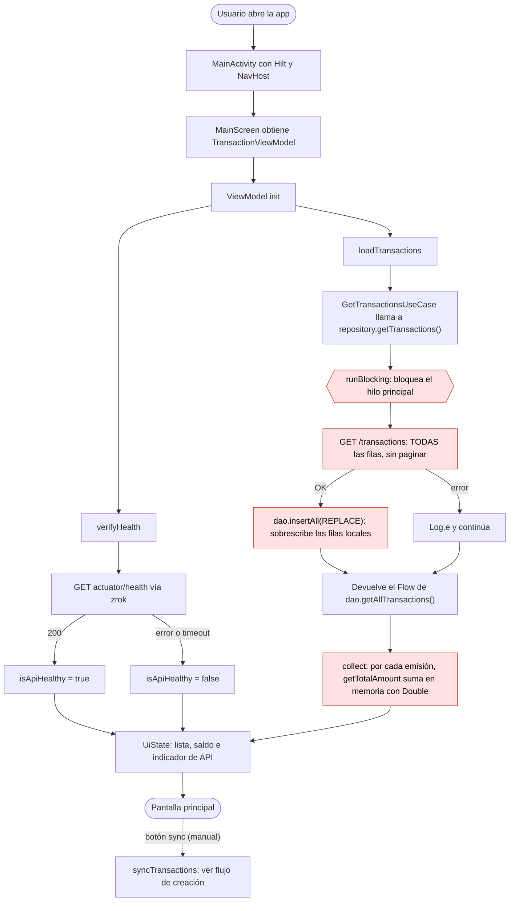

# Flujo: al entrar a la app

## Estado del MVP (v0.1.0)

Problemas en el arranque:
- `runBlocking` bloquea la UI mientras dura la petición de red, con riesgo de ANR si zrok tarda.
- Se descarga **todo** el historial en cada apertura.
- `REPLACE` puede pisar un cambio local que todavía no se ha sincronizado.
- El health check solo dice si el servidor está vivo, no si hay datos pendientes ni si la sesión es válida.
