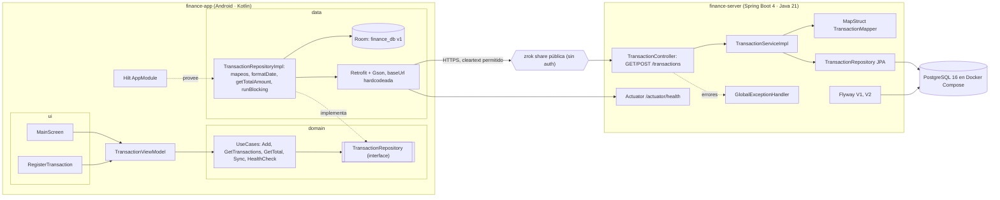

# Arquitectura general

## Estado del MVP (v0.1.0)

Resumen: el cliente usa MVVM con clean architecture pero tiene la lógica concentrada en `RepositoryImpl`. El servidor es un CRUD en capas con un solo recurso y sin seguridad. La sincronización es manual y frágil. No hay CI ni contenedor del servidor.
