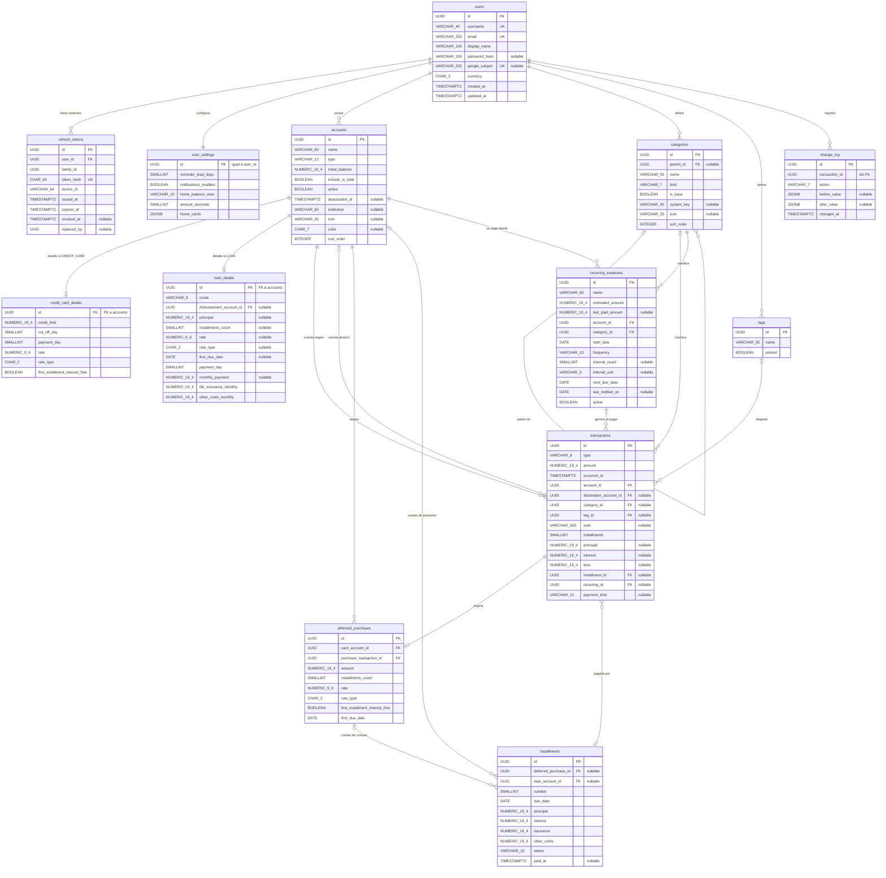

# Modelo de datos — Coffer

| Campo | Valor |
| --- | --- |
| Documento | Modelo de datos físico, diccionario y estrategia de migraciones |
| Parte de | [Detailed Design (IEEE 1016-2009)](detailed-design.md), vista de información (§6.5) |
| Versión | 1.0 · 2026-10-09 |
| Motores | PostgreSQL 16 (servidor, con Flyway) · SQLite con SQLCipher (dispositivo, con Room 2.8) |
| Decisiones | [ADR-0003 Flyway](../02-architecture/adr/0003-flyway-for-migrations.md), [ADR-0004 Montos](../02-architecture/adr/0004-numeric-bigdecimal-amounts.md), [ADR-0006 Sincronización](../02-architecture/adr/0006-sync-protocol.md) |
| Requisitos | SRS §7.4, RNF-12, RNF-17, REQ-SYN-01 a 05 |

Este documento es la **fuente de verdad del esquema físico**. El modelo de la arquitectura ([`data-model.md`](../02-architecture/diagrams/data-model.md)) es la vista lógica resumida.

## 1. Convenciones

| Convención | Regla |
| --- | --- |
| Nombres | Tablas en plural y `snake_case` en inglés; columnas en `snake_case`; restricciones con prefijo (`pk_`, `fk_`, `uq_`, `ck_`, `ix_`, `trg_`). |
| Identificadores | `id UUID` generado en el dispositivo (UUID v4). El servidor nunca genera ids de entidades sincronizables. |
| Propiedad | Toda tabla sincronizable tiene `user_id`. Las referencias entre tablas son FK **compuestas** `(x_id, user_id)` → `(id, user_id)`, así la base impide relacionar datos de usuarios distintos (RNF-17). |
| FK diferibles | Las FK entre entidades sincronizables son `DEFERRABLE INITIALLY DEFERRED`, para que un lote de push se valide al hacer *commit* sin importar el orden interno. |
| Montos | `NUMERIC(19,4)`, siempre positivos; el sentido lo da `type`. Tasas: `NUMERIC(9,6)` como fracción (2 % = `0.020000`). |
| Tiempo | `TIMESTAMPTZ` en UTC para instantes; `DATE` para fechas de calendario (vencimientos, inicio). |
| Enumeraciones | `VARCHAR` + `CHECK (... IN (...))`, sin tipos `ENUM` de PostgreSQL (más fáciles de migrar). |
| Borrado | Lógico, con `deleted_at`. El borrado físico solo lo hacen las purgas (historial de más de 90 días) y la eliminación de la cuenta del usuario. |

### 1.1 Columnas de sincronización (comunes)

Presentes en las 13 tablas sincronizables, es decir, todas menos `users` y `refresh_tokens`.

| Columna | Tipo | Nulo | Por defecto | Descripción |
| --- | --- | --- | --- | --- |
| `id` | `UUID` | No | — | Clave primaria generada en el dispositivo. Hace idempotente el push (REQ-SYN-04). |
| `user_id` | `UUID` | No | — | Dueño. El servidor lo toma del JWT; nunca del cuerpo de la petición. |
| `created_at` | `TIMESTAMPTZ` | No | — | Creación en el dispositivo. |
| `updated_at` | `TIMESTAMPTZ` | No | — | Última modificación en el dispositivo. Criterio de **último cambio gana** (REQ-SYN-02). |
| `deleted_at` | `TIMESTAMPTZ` | Sí | `NULL` | Borrado lógico; se propaga como un cambio (REQ-SYN-03). |
| `version` | `BIGINT` | No | asignado por trigger | `nextval('sync_version')` en cada INSERT o UPDATE. Cursor de `GET /sync/pull`. |

## 2. Diagrama entidad-relación

Las columnas de §1.1 se omiten en cada entidad.



## 3. Diccionario de datos

**Nulo:** S = admite `NULL`; N = `NOT NULL`. **Traza:** requisito del SRS que motiva la columna. Las columnas comunes de §1.1 no se repiten.

### 3.1 `users` (no sincronizable)

Cuenta del usuario en el servidor. El dispositivo solo guarda su `id`, `username`, `display_name` y `currency` en `SessionStore`.

| Columna | Tipo | Nulo | Por defecto | Restricciones | Descripción | Traza |
| --- | --- | --- | --- | --- | --- | --- |
| `id` | `UUID` | N | `gen_random_uuid()` | PK | Identificador del usuario (`sub` del JWT). | RNF-17 |
| `username` | `VARCHAR(40)` | N | — | `uq_users_username` sobre `lower(username)`; `ck_users_username` `^[a-z0-9._]{3,40}$` | Nombre de usuario para iniciar sesión. | REQ-AUT-01, 02 |
| `email` | `VARCHAR(255)` | N | — | `uq_users_email` sobre `lower(email)` | Correo. | REQ-AUT-01 |
| `display_name` | `VARCHAR(100)` | N | — | — | Nombre visible. | REQ-AUT-01 |
| `password_hash` | `VARCHAR(100)` | S | — | — | BCrypt de costo 12. `NULL` si solo usa Google. | RNF-11 |
| `google_subject` | `VARCHAR(255)` | S | — | `uq_users_google_subject` (parcial, no nulo) | `sub` del ID token de Google. | REQ-AUT-03 |
| `currency` | `CHAR(3)` | N | `'COP'` | `ck_users_currency` `^[A-Z]{3}$` | Moneda única del usuario (ISO 4217). | §2.4 |
| `created_at` | `TIMESTAMPTZ` | N | `now()` | — | Alta. | — |
| `updated_at` | `TIMESTAMPTZ` | N | `now()` | — | Última modificación del perfil. | — |

Restricción adicional: `ck_users_credential CHECK (password_hash IS NOT NULL OR google_subject IS NOT NULL)`.

### 3.2 `refresh_tokens` (no sincronizable)

| Columna | Tipo | Nulo | Por defecto | Restricciones | Descripción | Traza |
| --- | --- | --- | --- | --- | --- | --- |
| `id` | `UUID` | N | `gen_random_uuid()` | PK | — | — |
| `user_id` | `UUID` | N | — | FK → `users` `ON DELETE CASCADE` | Dueño. | REQ-AUT-04 |
| `family_id` | `UUID` | N | — | `ix_rt_family` | Cadena de rotación; si se reutiliza un token, se revoca toda la familia. | ADR-0007 |
| `token_hash` | `CHAR(64)` | N | — | `uq_rt_token_hash` | SHA-256 en hexadecimal del token entregado. Nunca se guarda el token. | RNF-11 |
| `device_id` | `VARCHAR(64)` | N | — | — | Identificador de la instalación (lo genera la app). | REQ-AUT-04 |
| `issued_at` | `TIMESTAMPTZ` | N | `now()` | — | Emisión. | — |
| `expires_at` | `TIMESTAMPTZ` | N | — | — | Vence a los 180 días; se renueva en cada rotación. | REQ-AUT-04 |
| `revoked_at` | `TIMESTAMPTZ` | S | — | — | Revocación (rotación, logout o reutilización). | REQ-AUT-06 |
| `replaced_by` | `UUID` | S | — | — | Token que lo sustituyó. | ADR-0007 |

### 3.3 `user_settings`

Un registro por usuario, con `id = user_id`. El cliente lo crea al primer inicio de sesión con el id del usuario.

| Columna | Tipo | Nulo | Por defecto | Restricciones | Descripción | Traza |
| --- | --- | --- | --- | --- | --- | --- |
| `reminder_lead_days` | `SMALLINT` | N | `5` | `BETWEEN 0 AND 30` | Ventana de anticipación de pendientes. | REQ-REC-03 |
| `notifications_enabled` | `BOOLEAN` | N | `true` | — | Activa las notificaciones de pendientes. | REQ-REC-10 |
| `home_balance_view` | `VARCHAR(10)` | N | `'AVAILABLE'` | `IN ('AVAILABLE','NET')` | Vista del saldo en inicio. | REQ-CTA-09 |
| `amount_decimals` | `SMALLINT` | N | `0` | `IN (0, 2)` | Decimales visibles. | RNF-13 |
| `home_cards` | `JSONB` | N | `'[]'` | — | Orden y visibilidad de las tarjetas de inicio: `[{"key":"BALANCE","visible":true}, …]`. | REQ-INI-04 |

Restricción: `ck_settings_id CHECK (id = user_id)`.

### 3.4 `accounts`

| Columna | Tipo | Nulo | Por defecto | Restricciones | Descripción | Traza |
| --- | --- | --- | --- | --- | --- | --- |
| `name` | `VARCHAR(60)` | N | — | — | Nombre visible ("Bancolombia Débito"). | REQ-CTA-01, 02 |
| `type` | `VARCHAR(12)` | N | — | `IN ('CASH','DEBIT','SAVINGS','CREDIT_CARD','LOAN')` | Tipo; no cambia después de creada. | REQ-CTA-01 |
| `initial_balance` | `NUMERIC(19,4)` | N | `0` | — | Saldo inicial. En tarjetas y préstamos es la deuda inicial, guardada como valor positivo. | REQ-CTA-01, 06, REQ-TC-13 |
| `include_in_total` | `BOOLEAN` | N | `true` | — | Suma en el saldo total. | REQ-CTA-07 |
| `active` | `BOOLEAN` | N | `true` | — | `false` = desactivada (oculta en inicio, selectores y total). | REQ-CTA-04, F25 |
| `deactivated_at` | `TIMESTAMPTZ` | S | — | — | Momento de desactivación (se muestra en "Cuentas desactivadas"). | REQ-CTA-04 |
| `institution` | `VARCHAR(60)` | S | — | — | Banco o entidad. | Prototipo |
| `icon` | `VARCHAR(30)` | S | — | — | Clave del ícono. | Prototipo |
| `color` | `CHAR(7)` | S | — | `^#[0-9A-F]{6}$` | Color de la cuenta. | Prototipo |
| `sort_order` | `INTEGER` | N | `0` | — | Orden en el carrusel. | REQ-INI-01 |

### 3.5 `credit_card_details`

Relación 1 a 1 con `accounts` de tipo `CREDIT_CARD` (`id` = `accounts.id`).

| Columna | Tipo | Nulo | Por defecto | Restricciones | Descripción | Traza |
| --- | --- | --- | --- | --- | --- | --- |
| `credit_limit` | `NUMERIC(19,4)` | N | — | `> 0` | Cupo total. | REQ-TC-01 |
| `cut_off_day` | `SMALLINT` | N | — | `BETWEEN 1 AND 31` | Día de corte. Si el mes tiene menos días, se usa el último día del mes. | REQ-TC-01 |
| `payment_day` | `SMALLINT` | N | — | `BETWEEN 1 AND 31` | Día límite de pago. | REQ-TC-01 |
| `rate` | `NUMERIC(9,6)` | N | — | `>= 0` | Tasa en fracción. | REQ-TC-01 |
| `rate_type` | `CHAR(2)` | N | — | `IN ('EA','MV')` | Tipo de tasa ingresada. | REQ-TC-02 |
| `first_installment_interest_free` | `BOOLEAN` | N | `false` | — | Primera cuota sin intereses. | REQ-TC-03 |

### 3.6 `loan_details`

Relación 1 a 1 con `accounts` de tipo `LOAN`.

| Columna | Tipo | Nulo | Por defecto | Restricciones | Descripción | Traza |
| --- | --- | --- | --- | --- | --- | --- |
| `mode` | `VARCHAR(8)` | N | — | `IN ('DETAILED','SIMPLE')` | Modo de registro. | §4.13 |
| `disbursement_account_id` | `UUID` | S | — | FK → `accounts` | Cuenta donde se recibió el dinero (solo `DETAILED`). | REQ-PRE-01 |
| `principal` | `NUMERIC(19,4)` | S | — | `> 0` | Monto del préstamo. | REQ-PRE-01 |
| `installments_count` | `SMALLINT` | S | — | `BETWEEN 1 AND 600` | Número de cuotas. | REQ-PRE-01 |
| `rate` | `NUMERIC(9,6)` | S | — | `>= 0` | Tasa. | REQ-PRE-01 |
| `rate_type` | `CHAR(2)` | S | — | `IN ('EA','MV')` | Tipo de tasa. | REQ-PRE-01 |
| `first_due_date` | `DATE` | S | — | — | Fecha de la primera cuota. | REQ-PRE-01 |
| `payment_day` | `SMALLINT` | N | — | `BETWEEN 1 AND 31` | Día de pago. | REQ-PRE-01, 08 |
| `monthly_payment` | `NUMERIC(19,4)` | S | — | `> 0` | Cuota fija (solo `SIMPLE`). | REQ-PRE-08 |
| `life_insurance_monthly` | `NUMERIC(19,4)` | N | `0` | `>= 0` | Seguro de vida mensual. | REQ-PRE-02 |
| `other_costs_monthly` | `NUMERIC(19,4)` | N | `0` | `>= 0` | Costos adicionales mensuales. | REQ-PRE-02 |

Restricción `ck_loan_mode`: si `mode = 'DETAILED'`, entonces `principal`, `installments_count`, `rate`, `rate_type` y `first_due_date` no son nulos; si `mode = 'SIMPLE'`, `monthly_payment` no es nulo.

### 3.7 `categories`

| Columna | Tipo | Nulo | Por defecto | Restricciones | Descripción | Traza |
| --- | --- | --- | --- | --- | --- | --- |
| `parent_id` | `UUID` | S | — | FK → `categories`; `ck_cat_not_self` | Categoría padre (un solo nivel; lo valida el dominio). | REQ-CAT-02 |
| `name` | `VARCHAR(50)` | N | — | `uq_cat_name` (parcial) | Nombre. | REQ-CAT-02 |
| `kind` | `VARCHAR(7)` | N | — | `IN ('EXPENSE','INCOME')` | Tipo de movimiento que clasifica. | REQ-CAT-01 |
| `is_base` | `BOOLEAN` | N | `false` | — | Precargada en el primer uso (se puede editar o eliminar). | REQ-CAT-01, 02 |
| `system_key` | `VARCHAR(40)` | S | — | `uq_cat_system_key` (parcial) | Clave estable de categorías con lógica: `FINANCIAL_CHARGES`. | REQ-CAT-01, REQ-TC-09 |
| `icon` | `VARCHAR(30)` | S | — | — | Clave del ícono. | Prototipo |
| `sort_order` | `INTEGER` | N | `0` | — | Orden en las listas. | — |

### 3.8 `tags`

| Columna | Tipo | Nulo | Por defecto | Restricciones | Descripción | Traza |
| --- | --- | --- | --- | --- | --- | --- |
| `name` | `VARCHAR(50)` | N | — | `uq_tag_name` sobre `lower(name)` (parcial) | Nombre ("Viaje Cartagena"). | REQ-ETQ-01 |
| `pinned` | `BOOLEAN` | N | `false` | — | Fijada en inicio. | REQ-ETQ-04 |

### 3.9 `transactions`

| Columna | Tipo | Nulo | Por defecto | Restricciones | Descripción | Traza |
| --- | --- | --- | --- | --- | --- | --- |
| `type` | `VARCHAR(8)` | N | — | `IN ('EXPENSE','INCOME','TRANSFER')` | Tipo de movimiento. | REQ-TRX-01, 02 |
| `amount` | `NUMERIC(19,4)` | N | — | `ck_tx_amount` `> 0` | Monto, siempre positivo. | REQ-TRX-01, RNF-12 |
| `occurred_at` | `TIMESTAMPTZ` | N | — | — | Fecha y hora del movimiento (editable). Ordena los listados. | REQ-TRX-05, 06 |
| `account_id` | `UUID` | N | — | FK → `accounts` | Cuenta afectada (origen en transferencias). | REQ-TRX-01, 02 |
| `destination_account_id` | `UUID` | S | — | FK → `accounts`; `ck_tx_transfer` | Destino; solo y obligatoria en `TRANSFER`, distinta del origen. | REQ-TRX-02 |
| `category_id` | `UUID` | S | — | FK → `categories`; `ck_tx_category` | Obligatoria en `EXPENSE` e `INCOME`; nula en `TRANSFER`. | REQ-TRX-01, 03 |
| `tag_id` | `UUID` | S | — | FK → `tags` | Una etiqueta como máximo. | REQ-ETQ-02 |
| `note` | `VARCHAR(500)` | S | — | — | Nota o concepto ("Café y almuerzo"). | REQ-TRX-01 |
| `installments` | `SMALLINT` | N | `1` | `BETWEEN 1 AND 72` | Cuotas de una compra con tarjeta; 1 en el resto. | REQ-TC-05 |
| `principal` | `NUMERIC(19,4)` | S | — | `>= 0` | Desglose: capital de un pago de tarjeta o préstamo. | REQ-TC-11, REQ-PRE-05, F29 |
| `interest` | `NUMERIC(19,4)` | S | — | `>= 0` | Desglose: intereses. | REQ-TC-11, REQ-PRE-05 |
| `fees` | `NUMERIC(19,4)` | S | — | `>= 0` | Desglose: seguro y otros cargos. | REQ-TC-11, REQ-PRE-05 |
| `installment_id` | `UUID` | S | — | FK → `installments` | Cuota de préstamo que paga esta transferencia. | REQ-PRE-05 |
| `recurring_id` | `UUID` | S | — | FK → `recurring_expenses` | Recurrente del que proviene este gasto. | REQ-REC-07 |
| `payment_kind` | `VARCHAR(12)` | S | — | `IN ('CARD_MIN','CARD_TOTAL','LOAN_INSTALL','LOAN_EXTRA')` | Clase de pago de deuda, para reportes y recálculos. | REQ-TC-10, REQ-PRE-06 |

Restricciones:
- `ck_tx_transfer`: `(type = 'TRANSFER') = (destination_account_id IS NOT NULL)` y `destination_account_id IS DISTINCT FROM account_id`.
- `ck_tx_category`: `(type = 'TRANSFER') = (category_id IS NULL)`.
- `ck_tx_breakdown`: si hay desglose, `coalesce(principal,0) + coalesce(interest,0) + coalesce(fees,0) = amount`.

### 3.10 `deferred_purchases`

Compra con tarjeta a 2 o más cuotas. La compra en sí es una transacción `EXPENSE` en la cuenta de la tarjeta.

| Columna | Tipo | Nulo | Por defecto | Restricciones | Descripción | Traza |
| --- | --- | --- | --- | --- | --- | --- |
| `card_account_id` | `UUID` | N | — | FK → `accounts` | Tarjeta. | REQ-TC-05 |
| `purchase_transaction_id` | `UUID` | N | — | FK → `transactions`; `uq_dp_purchase` | Transacción de compra. | REQ-TC-05 |
| `amount` | `NUMERIC(19,4)` | N | — | `> 0` | Monto diferido (igual al de la transacción). | REQ-TC-07 |
| `installments_count` | `SMALLINT` | N | — | `BETWEEN 2 AND 72` | Número de cuotas. | REQ-TC-05, 06 |
| `rate` | `NUMERIC(9,6)` | N | — | `>= 0` | Tasa aplicada (prellenada con la de la tarjeta, editable; 0 para convenios). | REQ-TC-06 |
| `rate_type` | `CHAR(2)` | N | — | `IN ('EA','MV')` | Tipo de tasa. | REQ-TC-02 |
| `first_installment_interest_free` | `BOOLEAN` | N | — | — | Copia de la condición de la tarjeta al momento de comprar. | REQ-TC-03 |
| `first_due_date` | `DATE` | N | — | — | Vencimiento de la primera cuota (según corte y pago). | REQ-TC-07 |

### 3.11 `installments`

Cuota de una compra diferida o de un préstamo.

| Columna | Tipo | Nulo | Por defecto | Restricciones | Descripción | Traza |
| --- | --- | --- | --- | --- | --- | --- |
| `deferred_purchase_id` | `UUID` | S | — | FK → `deferred_purchases`; `ck_inst_owner` | Dueño si es cuota de compra. | REQ-TC-07 |
| `loan_account_id` | `UUID` | S | — | FK → `accounts`; `ck_inst_owner` | Dueño si es cuota de préstamo. | REQ-PRE-03 |
| `number` | `SMALLINT` | N | — | `>= 1`; `uq_inst_number` por dueño | Número de cuota. | REQ-TC-07 |
| `due_date` | `DATE` | N | — | — | Vencimiento. | REQ-TC-08, REQ-PRE-04 |
| `principal` | `NUMERIC(19,4)` | N | — | `>= 0` | Capital. | REQ-TC-07, F29 |
| `interest` | `NUMERIC(19,4)` | N | `0` | `>= 0` | Interés sobre el saldo, con mes de 30 días. | REQ-TC-15 |
| `insurance` | `NUMERIC(19,4)` | N | `0` | `>= 0` | Seguro (préstamos). | REQ-PRE-02 |
| `other_costs` | `NUMERIC(19,4)` | N | `0` | `>= 0` | Otros cargos. | REQ-PRE-02 |
| `status` | `VARCHAR(10)` | N | `'SCHEDULED'` | `IN ('SCHEDULED','PAID','CANCELLED')` | `CANCELLED` = liquidada por un pago total o recalculada por un abono. | REQ-TC-12, REQ-PRE-06 |
| `paid_at` | `TIMESTAMPTZ` | S | — | — | Momento en que se pagó. | REQ-TC-09 |

Restricción: `ck_inst_owner CHECK (num_nonnulls(deferred_purchase_id, loan_account_id) = 1)`.

### 3.12 `recurring_expenses`

| Columna | Tipo | Nulo | Por defecto | Restricciones | Descripción | Traza |
| --- | --- | --- | --- | --- | --- | --- |
| `name` | `VARCHAR(60)` | N | — | — | Nombre ("Arriendo"). | REQ-REC-01 |
| `estimated_amount` | `NUMERIC(19,4)` | N | — | `> 0` | Monto estimado. | REQ-REC-01 |
| `last_paid_amount` | `NUMERIC(19,4)` | S | — | `> 0` | Último pago real; prellena el diálogo de pago. | REQ-REC-07 |
| `account_id` | `UUID` | N | — | FK → `accounts` | Cuenta por defecto. | REQ-REC-01 |
| `category_id` | `UUID` | N | — | FK → `categories` | Categoría (de gasto). | REQ-REC-01, 11 |
| `start_date` | `DATE` | N | — | — | Primera ocurrencia. | REQ-REC-01 |
| `frequency` | `VARCHAR(10)` | N | — | `IN ('WEEKLY','BIWEEKLY','MONTHLY','QUARTERLY','YEARLY','CUSTOM')` | Frecuencia. | REQ-REC-02 |
| `interval_count` | `SMALLINT` | S | — | `BETWEEN 1 AND 365`; obligatorio si `CUSTOM` | Cada N… | REQ-REC-02 |
| `interval_unit` | `VARCHAR(5)` | S | — | `IN ('DAY','WEEK','MONTH')`; obligatorio si `CUSTOM` | …días, semanas o meses. | REQ-REC-02 |
| `next_due_date` | `DATE` | N | — | — | Próxima ocurrencia pendiente. | REQ-REC-04, 08 |
| `last_notified_on` | `DATE` | S | — | — | Evita avisos duplicados (no se usa en reportes). | REQ-REC-09 |
| `active` | `BOOLEAN` | N | `true` | — | `false` = recurrencia finalizada. | REQ-REC-06 |

### 3.13 `change_log`

Historial de cambios de transacciones (solo se agrega; se purga a los 90 días).

| Columna | Tipo | Nulo | Por defecto | Restricciones | Descripción | Traza |
| --- | --- | --- | --- | --- | --- | --- |
| `transaction_id` | `UUID` | N | — | sin FK | Transacción afectada (existe aunque esté borrada). | REQ-HIS-01 |
| `action` | `VARCHAR(7)` | N | — | `IN ('CREATE','UPDATE','DELETE','RESTORE')` | Acción. | REQ-HIS-01, 03 |
| `before_value` | `JSONB` | S | — | — | Instantánea anterior (nula en `CREATE`). | REQ-HIS-01 |
| `after_value` | `JSONB` | S | — | — | Instantánea nueva (nula en `DELETE`). | REQ-HIS-01 |
| `changed_at` | `TIMESTAMPTZ` | N | — | `ix_cl_user_changed` | Momento del cambio; base de la purga. | REQ-HIS-04 |

## 4. Estrategia de migraciones con Flyway

### 4.1 Reglas

1. **Solo Flyway cambia el esquema.** Hibernate corre con `spring.jpa.hibernate.ddl-auto=validate`.
2. **Inmutabilidad:** una migración aplicada en cualquier entorno compartido no se edita. Los errores se corrigen con una migración nueva.
3. **Nombres:** `V{n}__{verbo}_{objeto}.sql` con `n` consecutivo. Una migración tiene un solo propósito.
4. **Expand / contract:** los cambios incompatibles se hacen en dos versiones (añadir, migrar y usar; después eliminar). La tabla del MVP se conserva renombrada como `transactions_mvp` hasta que una migración posterior la elimine.
5. **Transaccionales:** cada migración corre en una transacción (PostgreSQL soporta DDL transaccional). Si un índice necesita `CREATE INDEX CONCURRENTLY`, va solo en su archivo con `-- flyway:executeInTransaction=false`.
6. **Datos semilla:** el servidor no siembra datos de negocio. Las categorías base las crea el cliente en el primer uso (REQ-CAT-01) y llegan por sincronización. La v1.0 no usa migraciones repetibles `R__`.
7. **Pruebas:** `FlywayMigrationIT` (Testcontainers con PostgreSQL 16) aplica todas las migraciones sobre (a) una base vacía y (b) una base con V1 y V2 más datos del MVP, y valida conteos, montos y tipos.
8. **Configuración:** `spring.flyway.baseline-on-migrate=false`, `validate-on-migrate=true`, `clean-disabled=true` en todos los perfiles salvo `test`.

### 4.2 Historial y plan de versiones

| Versión | Archivo | Estado | Propósito | Sprint |
| --- | --- | --- | --- | --- |
| V1 | `V1__first_schema.sql` | Aplicada (MVP) | Tabla `transactions` inicial | — |
| V2 | `V2__fix_schema.sql` | Aplicada (MVP) | `local_id` + `server_id` identidad | — |
| V3 | `V3__create_identity.sql` | Nueva | `users`, `refresh_tokens`, usuario "owner" del MVP | Sprint 2 |
| V4 | `V4__create_sync_infrastructure.sql` | Nueva | `sync_version` y función `set_sync_version()` | Sprint 3 |
| V5 | `V5__create_ledger_core.sql` | Nueva | `user_settings`, `accounts`, `categories`, `tags` | Sprint 3 |
| V6 | `V6__migrate_transactions_v2.sql` | Nueva | Nueva `transactions`; migra el MVP | Sprint 3 |
| V7 | `V7__create_recurring_and_history.sql` | Nueva | `recurring_expenses`, `change_log` | Sprint 5 |
| V8 | `V8__create_credit_and_loans.sql` | Nueva | Tarjetas, préstamos, compras diferidas, cuotas | Sprint 7 |
| V9 | `V9__add_cross_references_and_indexes.sql` | Nueva | FK de `transactions` hacia cuotas y recurrentes; índices de sincronización | Sprint 7 |
| V10 | `V10__drop_transactions_mvp.sql` | Futura (*contract*) | Elimina `transactions_mvp` cuando se verifique la migración en producción | Sprint 8 |

### 4.3 Scripts

#### V3__create_identity.sql

```sql
CREATE TABLE users (
    id              UUID         NOT NULL DEFAULT gen_random_uuid(),
    username        VARCHAR(40)  NOT NULL,
    email           VARCHAR(255) NOT NULL,
    display_name    VARCHAR(100) NOT NULL,
    password_hash   VARCHAR(100),
    google_subject  VARCHAR(255),
    currency        CHAR(3)      NOT NULL DEFAULT 'COP',
    created_at      TIMESTAMPTZ  NOT NULL DEFAULT now(),
    updated_at      TIMESTAMPTZ  NOT NULL DEFAULT now(),
    CONSTRAINT pk_users PRIMARY KEY (id),
    CONSTRAINT ck_users_username   CHECK (username ~ '^[a-z0-9._]{3,40}$'),
    CONSTRAINT ck_users_currency   CHECK (currency ~ '^[A-Z]{3}$'),
    CONSTRAINT ck_users_credential CHECK (password_hash IS NOT NULL OR google_subject IS NOT NULL)
);
CREATE UNIQUE INDEX uq_users_username       ON users (lower(username));
CREATE UNIQUE INDEX uq_users_email          ON users (lower(email));
CREATE UNIQUE INDEX uq_users_google_subject ON users (google_subject) WHERE google_subject IS NOT NULL;

CREATE TABLE refresh_tokens (
    id          UUID        NOT NULL DEFAULT gen_random_uuid(),
    user_id     UUID        NOT NULL,
    family_id   UUID        NOT NULL,
    token_hash  CHAR(64)    NOT NULL,
    device_id   VARCHAR(64) NOT NULL,
    issued_at   TIMESTAMPTZ NOT NULL DEFAULT now(),
    expires_at  TIMESTAMPTZ NOT NULL,
    revoked_at  TIMESTAMPTZ,
    replaced_by UUID,
    CONSTRAINT pk_refresh_tokens PRIMARY KEY (id),
    CONSTRAINT fk_rt_user FOREIGN KEY (user_id) REFERENCES users (id) ON DELETE CASCADE,
    CONSTRAINT uq_rt_token_hash UNIQUE (token_hash)
);
CREATE INDEX ix_rt_user_family ON refresh_tokens (user_id, family_id);

-- Dueño de los datos del MVP. Solo se crea si hay transacciones que migrar.
-- No puede iniciar sesión ('!' no es un hash BCrypt válido) hasta reclamarlo (ver §4.4).
INSERT INTO users (id, username, email, display_name, password_hash)
SELECT '00000000-0000-0000-0000-000000000001', 'owner', 'owner@finance.local', 'Propietario (MVP)', '!'
WHERE EXISTS (SELECT 1 FROM transactions);
```

#### V4__create_sync_infrastructure.sql

```sql
CREATE SEQUENCE sync_version AS BIGINT START WITH 1 INCREMENT BY 1;

-- Asigna un número de versión global y monotónico en cada escritura.
-- Es el cursor de GET /api/v1/sync/pull?since={version}.
CREATE FUNCTION set_sync_version() RETURNS trigger
    LANGUAGE plpgsql AS
$$
BEGIN
    NEW.version := nextval('sync_version');
    RETURN NEW;
END;
$$;
```

#### V5__create_ledger_core.sql

```sql
CREATE TABLE user_settings (
    id                    UUID        NOT NULL,
    user_id               UUID        NOT NULL,
    reminder_lead_days    SMALLINT    NOT NULL DEFAULT 5,
    notifications_enabled BOOLEAN     NOT NULL DEFAULT TRUE,
    home_balance_view     VARCHAR(10) NOT NULL DEFAULT 'AVAILABLE',
    amount_decimals       SMALLINT    NOT NULL DEFAULT 0,
    home_cards            JSONB       NOT NULL DEFAULT '[]'::jsonb,
    created_at            TIMESTAMPTZ NOT NULL,
    updated_at            TIMESTAMPTZ NOT NULL,
    deleted_at            TIMESTAMPTZ,
    version               BIGINT      NOT NULL DEFAULT 0,
    CONSTRAINT pk_user_settings PRIMARY KEY (id),
    CONSTRAINT fk_settings_user FOREIGN KEY (user_id) REFERENCES users (id) ON DELETE CASCADE,
    CONSTRAINT ck_settings_id        CHECK (id = user_id),
    CONSTRAINT ck_settings_lead_days CHECK (reminder_lead_days BETWEEN 0 AND 30),
    CONSTRAINT ck_settings_view      CHECK (home_balance_view IN ('AVAILABLE', 'NET')),
    CONSTRAINT ck_settings_decimals  CHECK (amount_decimals IN (0, 2))
);

CREATE TABLE accounts (
    id               UUID          NOT NULL,
    user_id          UUID          NOT NULL,
    name             VARCHAR(60)   NOT NULL,
    type             VARCHAR(12)   NOT NULL,
    initial_balance  NUMERIC(19,4) NOT NULL DEFAULT 0,
    include_in_total BOOLEAN       NOT NULL DEFAULT TRUE,
    active           BOOLEAN       NOT NULL DEFAULT TRUE,
    deactivated_at   TIMESTAMPTZ,
    institution      VARCHAR(60),
    icon             VARCHAR(30),
    color            CHAR(7),
    sort_order       INTEGER       NOT NULL DEFAULT 0,
    created_at       TIMESTAMPTZ   NOT NULL,
    updated_at       TIMESTAMPTZ   NOT NULL,
    deleted_at       TIMESTAMPTZ,
    version          BIGINT        NOT NULL DEFAULT 0,
    CONSTRAINT pk_accounts PRIMARY KEY (id),
    CONSTRAINT uq_accounts_id_user UNIQUE (id, user_id),
    CONSTRAINT fk_accounts_user FOREIGN KEY (user_id) REFERENCES users (id) ON DELETE CASCADE,
    CONSTRAINT ck_accounts_type  CHECK (type IN ('CASH', 'DEBIT', 'SAVINGS', 'CREDIT_CARD', 'LOAN')),
    CONSTRAINT ck_accounts_color CHECK (color IS NULL OR color ~ '^#[0-9A-F]{6}$')
);

CREATE TABLE categories (
    id         UUID        NOT NULL,
    user_id    UUID        NOT NULL,
    parent_id  UUID,
    name       VARCHAR(50) NOT NULL,
    kind       VARCHAR(7)  NOT NULL,
    is_base    BOOLEAN     NOT NULL DEFAULT FALSE,
    system_key VARCHAR(40),
    icon       VARCHAR(30),
    sort_order INTEGER     NOT NULL DEFAULT 0,
    created_at TIMESTAMPTZ NOT NULL,
    updated_at TIMESTAMPTZ NOT NULL,
    deleted_at TIMESTAMPTZ,
    version    BIGINT      NOT NULL DEFAULT 0,
    CONSTRAINT pk_categories PRIMARY KEY (id),
    CONSTRAINT uq_categories_id_user UNIQUE (id, user_id),
    CONSTRAINT fk_categories_user FOREIGN KEY (user_id) REFERENCES users (id) ON DELETE CASCADE,
    CONSTRAINT fk_categories_parent FOREIGN KEY (parent_id, user_id)
        REFERENCES categories (id, user_id) DEFERRABLE INITIALLY DEFERRED,
    CONSTRAINT ck_categories_kind     CHECK (kind IN ('EXPENSE', 'INCOME')),
    CONSTRAINT ck_categories_not_self CHECK (parent_id IS DISTINCT FROM id)
);
CREATE UNIQUE INDEX uq_cat_name ON categories
    (user_id, kind, coalesce(parent_id, '00000000-0000-0000-0000-000000000000'::uuid), lower(name))
    WHERE deleted_at IS NULL;
CREATE UNIQUE INDEX uq_cat_system_key ON categories (user_id, system_key)
    WHERE system_key IS NOT NULL AND deleted_at IS NULL;

CREATE TABLE tags (
    id         UUID        NOT NULL,
    user_id    UUID        NOT NULL,
    name       VARCHAR(50) NOT NULL,
    pinned     BOOLEAN     NOT NULL DEFAULT FALSE,
    created_at TIMESTAMPTZ NOT NULL,
    updated_at TIMESTAMPTZ NOT NULL,
    deleted_at TIMESTAMPTZ,
    version    BIGINT      NOT NULL DEFAULT 0,
    CONSTRAINT pk_tags PRIMARY KEY (id),
    CONSTRAINT uq_tags_id_user UNIQUE (id, user_id),
    CONSTRAINT fk_tags_user FOREIGN KEY (user_id) REFERENCES users (id) ON DELETE CASCADE
);
CREATE UNIQUE INDEX uq_tag_name ON tags (user_id, lower(name)) WHERE deleted_at IS NULL;

CREATE TRIGGER trg_user_settings_version BEFORE INSERT OR UPDATE ON user_settings
    FOR EACH ROW EXECUTE FUNCTION set_sync_version();
CREATE TRIGGER trg_accounts_version BEFORE INSERT OR UPDATE ON accounts
    FOR EACH ROW EXECUTE FUNCTION set_sync_version();
CREATE TRIGGER trg_categories_version BEFORE INSERT OR UPDATE ON categories
    FOR EACH ROW EXECUTE FUNCTION set_sync_version();
CREATE TRIGGER trg_tags_version BEFORE INSERT OR UPDATE ON tags
    FOR EACH ROW EXECUTE FUNCTION set_sync_version();
```

#### V6__migrate_transactions_v2.sql

```sql
-- Expand: se conserva la tabla del MVP renombrada hasta V10.
ALTER TABLE transactions RENAME TO transactions_mvp;
ALTER TABLE transactions_mvp RENAME CONSTRAINT transactions_pkey TO pk_transactions_mvp;
ALTER TABLE transactions_mvp RENAME CONSTRAINT uq_transactions_local_id TO uq_transactions_mvp_local_id;

CREATE TABLE transactions (
    id                     UUID          NOT NULL,
    user_id                UUID          NOT NULL,
    type                   VARCHAR(8)    NOT NULL,
    amount                 NUMERIC(19,4) NOT NULL,
    occurred_at            TIMESTAMPTZ   NOT NULL,
    account_id             UUID          NOT NULL,
    destination_account_id UUID,
    category_id            UUID,
    tag_id                 UUID,
    note                   VARCHAR(500),
    installments           SMALLINT      NOT NULL DEFAULT 1,
    principal              NUMERIC(19,4),
    interest               NUMERIC(19,4),
    fees                   NUMERIC(19,4),
    installment_id         UUID,
    recurring_id           UUID,
    payment_kind           VARCHAR(12),
    created_at             TIMESTAMPTZ   NOT NULL,
    updated_at             TIMESTAMPTZ   NOT NULL,
    deleted_at             TIMESTAMPTZ,
    version                BIGINT        NOT NULL DEFAULT 0,
    CONSTRAINT pk_transactions PRIMARY KEY (id),
    CONSTRAINT uq_transactions_id_user UNIQUE (id, user_id),
    CONSTRAINT fk_tx_user FOREIGN KEY (user_id) REFERENCES users (id) ON DELETE CASCADE,
    CONSTRAINT fk_tx_account FOREIGN KEY (account_id, user_id)
        REFERENCES accounts (id, user_id) DEFERRABLE INITIALLY DEFERRED,
    CONSTRAINT fk_tx_destination FOREIGN KEY (destination_account_id, user_id)
        REFERENCES accounts (id, user_id) DEFERRABLE INITIALLY DEFERRED,
    CONSTRAINT fk_tx_category FOREIGN KEY (category_id, user_id)
        REFERENCES categories (id, user_id) DEFERRABLE INITIALLY DEFERRED,
    CONSTRAINT fk_tx_tag FOREIGN KEY (tag_id, user_id)
        REFERENCES tags (id, user_id) DEFERRABLE INITIALLY DEFERRED,
    CONSTRAINT ck_tx_type         CHECK (type IN ('EXPENSE', 'INCOME', 'TRANSFER')),
    CONSTRAINT ck_tx_amount       CHECK (amount > 0),
    CONSTRAINT ck_tx_installments CHECK (installments BETWEEN 1 AND 72),
    CONSTRAINT ck_tx_transfer     CHECK ((type = 'TRANSFER') = (destination_account_id IS NOT NULL)
                                         AND destination_account_id IS DISTINCT FROM account_id),
    CONSTRAINT ck_tx_category     CHECK ((type = 'TRANSFER') = (category_id IS NULL)),
    CONSTRAINT ck_tx_breakdown_nonneg CHECK (coalesce(principal, 0) >= 0 AND coalesce(interest, 0) >= 0
                                             AND coalesce(fees, 0) >= 0),
    CONSTRAINT ck_tx_breakdown    CHECK ((principal IS NULL AND interest IS NULL AND fees IS NULL)
                                         OR coalesce(principal, 0) + coalesce(interest, 0) + coalesce(fees, 0) = amount),
    CONSTRAINT ck_tx_payment_kind CHECK (payment_kind IS NULL
                                         OR payment_kind IN ('CARD_MIN', 'CARD_TOTAL', 'LOAN_INSTALL', 'LOAN_EXTRA'))
);
CREATE TRIGGER trg_transactions_version BEFORE INSERT OR UPDATE ON transactions
    FOR EACH ROW EXECUTE FUNCTION set_sync_version();

-- Migración de los datos del MVP al usuario owner (solo si existen).
INSERT INTO accounts (id, user_id, name, type, initial_balance, created_at, updated_at)
SELECT '00000000-0000-0000-0000-0000000000a1', '00000000-0000-0000-0000-000000000001',
       'Efectivo (migrada)', 'CASH', 0, now(), now()
WHERE EXISTS (SELECT 1 FROM transactions_mvp);

INSERT INTO categories (id, user_id, name, kind, is_base, created_at, updated_at)
SELECT c.id, '00000000-0000-0000-0000-000000000001', 'Sin categoría', c.kind, TRUE, now(), now()
FROM (VALUES ('00000000-0000-0000-0000-0000000000b1'::uuid, 'EXPENSE'),
             ('00000000-0000-0000-0000-0000000000b2'::uuid, 'INCOME')) AS c(id, kind)
WHERE EXISTS (SELECT 1 FROM transactions_mvp);

INSERT INTO transactions (id, user_id, type, amount, occurred_at, account_id, category_id, note,
                          created_at, updated_at)
SELECT m.local_id,
       '00000000-0000-0000-0000-000000000001',
       CASE WHEN m.value < 0 THEN 'EXPENSE' ELSE 'INCOME' END,
       abs(m.value),
       m.date,
       '00000000-0000-0000-0000-0000000000a1',
       CASE WHEN m.value < 0 THEN '00000000-0000-0000-0000-0000000000b1'::uuid
                             ELSE '00000000-0000-0000-0000-0000000000b2'::uuid END,
       left(m.title || coalesce(' · ' || nullif(m.description, ''), ''), 500),
       m.date,
       now()
FROM transactions_mvp m
WHERE m.value <> 0;
```

#### V7__create_recurring_and_history.sql

```sql
CREATE TABLE recurring_expenses (
    id               UUID          NOT NULL,
    user_id          UUID          NOT NULL,
    name             VARCHAR(60)   NOT NULL,
    estimated_amount NUMERIC(19,4) NOT NULL,
    last_paid_amount NUMERIC(19,4),
    account_id       UUID          NOT NULL,
    category_id      UUID          NOT NULL,
    start_date       DATE          NOT NULL,
    frequency        VARCHAR(10)   NOT NULL,
    interval_count   SMALLINT,
    interval_unit    VARCHAR(5),
    next_due_date    DATE          NOT NULL,
    last_notified_on DATE,
    active           BOOLEAN       NOT NULL DEFAULT TRUE,
    created_at       TIMESTAMPTZ   NOT NULL,
    updated_at       TIMESTAMPTZ   NOT NULL,
    deleted_at       TIMESTAMPTZ,
    version          BIGINT        NOT NULL DEFAULT 0,
    CONSTRAINT pk_recurring_expenses PRIMARY KEY (id),
    CONSTRAINT uq_recurring_expenses_id_user UNIQUE (id, user_id),
    CONSTRAINT fk_rec_account FOREIGN KEY (account_id, user_id)
        REFERENCES accounts (id, user_id) DEFERRABLE INITIALLY DEFERRED,
    CONSTRAINT fk_rec_category FOREIGN KEY (category_id, user_id)
        REFERENCES categories (id, user_id) DEFERRABLE INITIALLY DEFERRED,
    CONSTRAINT ck_rec_amounts   CHECK (estimated_amount > 0 AND coalesce(last_paid_amount, 1) > 0),
    CONSTRAINT ck_rec_frequency CHECK (frequency IN ('WEEKLY', 'BIWEEKLY', 'MONTHLY', 'QUARTERLY', 'YEARLY', 'CUSTOM')),
    CONSTRAINT ck_rec_custom    CHECK ((frequency = 'CUSTOM') = (interval_count IS NOT NULL AND interval_unit IS NOT NULL)),
    CONSTRAINT ck_rec_interval  CHECK (interval_count IS NULL OR interval_count BETWEEN 1 AND 365),
    CONSTRAINT ck_rec_unit      CHECK (interval_unit IS NULL OR interval_unit IN ('DAY', 'WEEK', 'MONTH'))
);

CREATE TABLE change_log (
    id             UUID        NOT NULL,
    user_id        UUID        NOT NULL,
    transaction_id UUID        NOT NULL,
    action         VARCHAR(7)  NOT NULL,
    before_value   JSONB,
    after_value    JSONB,
    changed_at     TIMESTAMPTZ NOT NULL,
    created_at     TIMESTAMPTZ NOT NULL,
    updated_at     TIMESTAMPTZ NOT NULL,
    deleted_at     TIMESTAMPTZ,
    version        BIGINT      NOT NULL DEFAULT 0,
    CONSTRAINT pk_change_log PRIMARY KEY (id),
    CONSTRAINT fk_cl_user FOREIGN KEY (user_id) REFERENCES users (id) ON DELETE CASCADE,
    CONSTRAINT ck_cl_action CHECK (action IN ('CREATE', 'UPDATE', 'DELETE', 'RESTORE'))
);

CREATE TRIGGER trg_recurring_expenses_version BEFORE INSERT OR UPDATE ON recurring_expenses
    FOR EACH ROW EXECUTE FUNCTION set_sync_version();
CREATE TRIGGER trg_change_log_version BEFORE INSERT OR UPDATE ON change_log
    FOR EACH ROW EXECUTE FUNCTION set_sync_version();
```

#### V8__create_credit_and_loans.sql

```sql
CREATE TABLE credit_card_details (
    id                              UUID          NOT NULL,
    user_id                         UUID          NOT NULL,
    credit_limit                    NUMERIC(19,4) NOT NULL,
    cut_off_day                     SMALLINT      NOT NULL,
    payment_day                     SMALLINT      NOT NULL,
    rate                            NUMERIC(9,6)  NOT NULL,
    rate_type                       CHAR(2)       NOT NULL,
    first_installment_interest_free BOOLEAN       NOT NULL DEFAULT FALSE,
    created_at                      TIMESTAMPTZ   NOT NULL,
    updated_at                      TIMESTAMPTZ   NOT NULL,
    deleted_at                      TIMESTAMPTZ,
    version                         BIGINT        NOT NULL DEFAULT 0,
    CONSTRAINT pk_credit_card_details PRIMARY KEY (id),
    CONSTRAINT fk_ccd_account FOREIGN KEY (id, user_id)
        REFERENCES accounts (id, user_id) DEFERRABLE INITIALLY DEFERRED,
    CONSTRAINT ck_ccd_limit     CHECK (credit_limit > 0),
    CONSTRAINT ck_ccd_cut_off   CHECK (cut_off_day BETWEEN 1 AND 31),
    CONSTRAINT ck_ccd_payment   CHECK (payment_day BETWEEN 1 AND 31),
    CONSTRAINT ck_ccd_rate      CHECK (rate >= 0),
    CONSTRAINT ck_ccd_rate_type CHECK (rate_type IN ('EA', 'MV'))
);

CREATE TABLE loan_details (
    id                      UUID          NOT NULL,
    user_id                 UUID          NOT NULL,
    mode                    VARCHAR(8)    NOT NULL,
    disbursement_account_id UUID,
    principal               NUMERIC(19,4),
    installments_count      SMALLINT,
    rate                    NUMERIC(9,6),
    rate_type               CHAR(2),
    first_due_date          DATE,
    payment_day             SMALLINT      NOT NULL,
    monthly_payment         NUMERIC(19,4),
    life_insurance_monthly  NUMERIC(19,4) NOT NULL DEFAULT 0,
    other_costs_monthly     NUMERIC(19,4) NOT NULL DEFAULT 0,
    created_at              TIMESTAMPTZ   NOT NULL,
    updated_at              TIMESTAMPTZ   NOT NULL,
    deleted_at              TIMESTAMPTZ,
    version                 BIGINT        NOT NULL DEFAULT 0,
    CONSTRAINT pk_loan_details PRIMARY KEY (id),
    CONSTRAINT fk_ld_account FOREIGN KEY (id, user_id)
        REFERENCES accounts (id, user_id) DEFERRABLE INITIALLY DEFERRED,
    CONSTRAINT fk_ld_disbursement FOREIGN KEY (disbursement_account_id, user_id)
        REFERENCES accounts (id, user_id) DEFERRABLE INITIALLY DEFERRED,
    CONSTRAINT ck_ld_mode        CHECK (mode IN ('DETAILED', 'SIMPLE')),
    CONSTRAINT ck_ld_payment_day CHECK (payment_day BETWEEN 1 AND 31),
    CONSTRAINT ck_ld_rate_type   CHECK (rate_type IS NULL OR rate_type IN ('EA', 'MV')),
    CONSTRAINT ck_ld_amounts     CHECK (coalesce(principal, 1) > 0 AND coalesce(monthly_payment, 1) > 0
                                        AND coalesce(rate, 0) >= 0
                                        AND life_insurance_monthly >= 0 AND other_costs_monthly >= 0),
    CONSTRAINT ck_ld_count       CHECK (installments_count IS NULL OR installments_count BETWEEN 1 AND 600),
    CONSTRAINT ck_ld_by_mode     CHECK (
        (mode = 'DETAILED' AND principal IS NOT NULL AND installments_count IS NOT NULL
             AND rate IS NOT NULL AND rate_type IS NOT NULL AND first_due_date IS NOT NULL)
        OR (mode = 'SIMPLE' AND monthly_payment IS NOT NULL))
);

CREATE TABLE deferred_purchases (
    id                              UUID          NOT NULL,
    user_id                         UUID          NOT NULL,
    card_account_id                 UUID          NOT NULL,
    purchase_transaction_id         UUID          NOT NULL,
    amount                          NUMERIC(19,4) NOT NULL,
    installments_count              SMALLINT      NOT NULL,
    rate                            NUMERIC(9,6)  NOT NULL,
    rate_type                       CHAR(2)       NOT NULL,
    first_installment_interest_free BOOLEAN       NOT NULL,
    first_due_date                  DATE          NOT NULL,
    created_at                      TIMESTAMPTZ   NOT NULL,
    updated_at                      TIMESTAMPTZ   NOT NULL,
    deleted_at                      TIMESTAMPTZ,
    version                         BIGINT        NOT NULL DEFAULT 0,
    CONSTRAINT pk_deferred_purchases PRIMARY KEY (id),
    CONSTRAINT uq_deferred_purchases_id_user UNIQUE (id, user_id),
    CONSTRAINT uq_dp_purchase UNIQUE (purchase_transaction_id),
    CONSTRAINT fk_dp_card FOREIGN KEY (card_account_id, user_id)
        REFERENCES accounts (id, user_id) DEFERRABLE INITIALLY DEFERRED,
    CONSTRAINT fk_dp_transaction FOREIGN KEY (purchase_transaction_id, user_id)
        REFERENCES transactions (id, user_id) DEFERRABLE INITIALLY DEFERRED,
    CONSTRAINT ck_dp_amount    CHECK (amount > 0),
    CONSTRAINT ck_dp_count     CHECK (installments_count BETWEEN 2 AND 72),
    CONSTRAINT ck_dp_rate      CHECK (rate >= 0),
    CONSTRAINT ck_dp_rate_type CHECK (rate_type IN ('EA', 'MV'))
);

CREATE TABLE installments (
    id                   UUID          NOT NULL,
    user_id              UUID          NOT NULL,
    deferred_purchase_id UUID,
    loan_account_id      UUID,
    number               SMALLINT      NOT NULL,
    due_date             DATE          NOT NULL,
    principal            NUMERIC(19,4) NOT NULL,
    interest             NUMERIC(19,4) NOT NULL DEFAULT 0,
    insurance            NUMERIC(19,4) NOT NULL DEFAULT 0,
    other_costs          NUMERIC(19,4) NOT NULL DEFAULT 0,
    status               VARCHAR(10)   NOT NULL DEFAULT 'SCHEDULED',
    paid_at              TIMESTAMPTZ,
    created_at           TIMESTAMPTZ   NOT NULL,
    updated_at           TIMESTAMPTZ   NOT NULL,
    deleted_at           TIMESTAMPTZ,
    version              BIGINT        NOT NULL DEFAULT 0,
    CONSTRAINT pk_installments PRIMARY KEY (id),
    CONSTRAINT uq_installments_id_user UNIQUE (id, user_id),
    CONSTRAINT fk_inst_purchase FOREIGN KEY (deferred_purchase_id, user_id)
        REFERENCES deferred_purchases (id, user_id) DEFERRABLE INITIALLY DEFERRED,
    CONSTRAINT fk_inst_loan FOREIGN KEY (loan_account_id, user_id)
        REFERENCES accounts (id, user_id) DEFERRABLE INITIALLY DEFERRED,
    CONSTRAINT ck_inst_owner   CHECK (num_nonnulls(deferred_purchase_id, loan_account_id) = 1),
    CONSTRAINT ck_inst_number  CHECK (number >= 1),
    CONSTRAINT ck_inst_amounts CHECK (principal >= 0 AND interest >= 0 AND insurance >= 0 AND other_costs >= 0),
    CONSTRAINT ck_inst_status  CHECK (status IN ('SCHEDULED', 'PAID', 'CANCELLED'))
);
CREATE UNIQUE INDEX uq_inst_number ON installments
    (coalesce(deferred_purchase_id, loan_account_id), number)
    WHERE deleted_at IS NULL AND status <> 'CANCELLED';

CREATE TRIGGER trg_credit_card_details_version BEFORE INSERT OR UPDATE ON credit_card_details
    FOR EACH ROW EXECUTE FUNCTION set_sync_version();
CREATE TRIGGER trg_loan_details_version BEFORE INSERT OR UPDATE ON loan_details
    FOR EACH ROW EXECUTE FUNCTION set_sync_version();
CREATE TRIGGER trg_deferred_purchases_version BEFORE INSERT OR UPDATE ON deferred_purchases
    FOR EACH ROW EXECUTE FUNCTION set_sync_version();
CREATE TRIGGER trg_installments_version BEFORE INSERT OR UPDATE ON installments
    FOR EACH ROW EXECUTE FUNCTION set_sync_version();
```

#### V9__add_cross_references_and_indexes.sql

```sql
-- Referencias de transactions hacia tablas creadas después de V6.
ALTER TABLE transactions
    ADD CONSTRAINT fk_tx_installment FOREIGN KEY (installment_id, user_id)
        REFERENCES installments (id, user_id) DEFERRABLE INITIALLY DEFERRED,
    ADD CONSTRAINT fk_tx_recurring FOREIGN KEY (recurring_id, user_id)
        REFERENCES recurring_expenses (id, user_id) DEFERRABLE INITIALLY DEFERRED;

-- Pull incremental: una por tabla sincronizable.
CREATE INDEX ix_user_settings_user_version       ON user_settings       (user_id, version);
CREATE INDEX ix_accounts_user_version            ON accounts            (user_id, version);
CREATE INDEX ix_credit_card_details_user_version ON credit_card_details (user_id, version);
CREATE INDEX ix_loan_details_user_version        ON loan_details        (user_id, version);
CREATE INDEX ix_categories_user_version          ON categories          (user_id, version);
CREATE INDEX ix_tags_user_version                ON tags                (user_id, version);
CREATE INDEX ix_transactions_user_version        ON transactions        (user_id, version);
CREATE INDEX ix_deferred_purchases_user_version  ON deferred_purchases  (user_id, version);
CREATE INDEX ix_installments_user_version        ON installments        (user_id, version);
CREATE INDEX ix_recurring_expenses_user_version  ON recurring_expenses  (user_id, version);
CREATE INDEX ix_change_log_user_version          ON change_log          (user_id, version);

-- Consultas de negocio y purga.
CREATE INDEX ix_tx_user_occurred ON transactions (user_id, occurred_at DESC) WHERE deleted_at IS NULL;
CREATE INDEX ix_tx_user_account  ON transactions (user_id, account_id, occurred_at DESC);
CREATE INDEX ix_inst_user_due    ON installments (user_id, due_date) WHERE status = 'SCHEDULED';
CREATE INDEX ix_cl_user_changed  ON change_log   (user_id, changed_at);
```

### 4.4 Reclamar los datos del MVP

Si V3 creó el usuario `owner`, después del primer despliegue se ejecuta una vez (con el usuario ya registrado desde la app):

```sql
-- Mueve todo lo del owner al usuario real y elimina el owner.
BEGIN;
SET CONSTRAINTS ALL DEFERRED;
UPDATE accounts     SET user_id = :real_user_id, updated_at = now() WHERE user_id = '00000000-0000-0000-0000-000000000001';
UPDATE categories   SET user_id = :real_user_id, updated_at = now() WHERE user_id = '00000000-0000-0000-0000-000000000001';
UPDATE transactions SET user_id = :real_user_id, updated_at = now() WHERE user_id = '00000000-0000-0000-0000-000000000001';
DELETE FROM users WHERE id = '00000000-0000-0000-0000-000000000001';
COMMIT;
```

Si los datos del MVP eran de prueba, basta con no ejecutarlo; V10 eliminará `transactions_mvp` y las filas del owner se pueden borrar.

### 4.5 Purgas programadas (servidor)

| Job | Frecuencia | Sentencia | Requisito |
| --- | --- | --- | --- |
| `ChangeLogPurgeJob` | Diario, 03:00 UTC | `DELETE FROM change_log WHERE changed_at < now() - interval '90 days'` | REQ-HIS-04 |
| `RefreshTokenPurgeJob` | Diario | `DELETE FROM refresh_tokens WHERE expires_at < now() - interval '7 days'` | ADR-0007 |
| `TombstonePurgeJob` | Mensual | Borra físicamente filas con `deleted_at` de hace más de 180 días; un dispositivo con un cursor más antiguo hace una resincronización completa | REQ-SYN-03 |

Las purgas físicas no cambian `version` (no hay un UPDATE que dispare el trigger). Por eso la purga del historial se hace en ambos lados con la misma regla de fecha.

## 5. Modelo en el dispositivo (Room + SQLCipher)

### 5.1 Correspondencia

| Tabla (PostgreSQL) | Entidad Room | Diferencias |
| --- | --- | --- |
| `user_settings` | `SettingsEntity` | — |
| `accounts` | `AccountEntity` | — |
| `credit_card_details` | `CreditCardDetailsEntity` | — |
| `loan_details` | `LoanDetailsEntity` | — |
| `categories` | `CategoryEntity` | — |
| `tags` | `TagEntity` | — |
| `transactions` | `TransactionEntity` | — |
| `deferred_purchases` | `DeferredPurchaseEntity` | — |
| `installments` | `InstallmentEntity` | — |
| `recurring_expenses` | `RecurringExpenseEntity` | — |
| `change_log` | `ChangeLogEntity` | `before_value`/`after_value` como `TEXT` JSON |
| — | `SyncMetaEntity` (`key`, `value`) | Solo local: `pull_cursor`, `last_sync_at`, `last_sync_result` |

Reglas de tipo en Room:

| Tipo lógico | PostgreSQL | Room (SQLite) | Conversión |
| --- | --- | --- | --- |
| Monto | `NUMERIC(19,4)` | `INTEGER` (×10⁴) | `MoneyConverter`: `BigDecimal.movePointRight(4).longValueExact()` |
| Tasa | `NUMERIC(9,6)` | `INTEGER` (×10⁶) | `RateConverter` |
| Instante | `TIMESTAMPTZ` | `INTEGER` epoch ms UTC | `Instant` |
| Fecha | `DATE` | `TEXT` `yyyy-MM-dd` | `LocalDate` |
| UUID | `UUID` | `TEXT` | `UUID.toString()` |
| JSON | `JSONB` | `TEXT` | kotlinx.serialization |

Columnas solo locales en cada entidad sincronizable: `syncState TEXT NOT NULL DEFAULT 'PENDING'` (`PENDING`, `SYNCED`, `FAILED`), con índice, y `syncError TEXT NULL`. No existen `user_id` ni `version`.

Índices Room: `transactions(occurredAt DESC)`, `transactions(accountId, occurredAt)`, `transactions(categoryId)`, `transactions(tagId)`, `installments(dueDate, status)`, `recurring_expenses(nextDueDate, active)` y `syncState` en cada tabla.

### 5.2 Versionado y migración del MVP

- La base nueva se llama `finance.db`, va cifrada con SQLCipher, empieza en `version = 1` y usa `exportSchema = true` (los esquemas JSON se versionan en `app/schemas/`).
- Los cambios posteriores usan `Migration(n, n+1)` y se prueban con `MigrationTestHelper`. No se permite `fallbackToDestructiveMigration`.
- **Migración del MVP (única vez):** SQLCipher no puede cifrar en sitio la base `finance_db` sin cifrar. `LegacyDatabaseMigrator` se ejecuta al primer arranque de la v1.0:
  1. Abre `finance_db` (SQLite sin cifrar) si existe.
  2. Crea la cuenta "Efectivo (migrada)" y las categorías "Sin categoría" con los mismos UUID fijos del servidor (`…a1`, `…b1`, `…b2`).
  3. Convierte cada fila con las mismas reglas que V6 (signo a `type`, `abs` a `amount`, `title` + `description` a `note`) y la inserta en `finance.db`. **Todas quedan `PENDING`:** en el MVP, `synced = 1` significaba subida a su servidor de pruebas, no a la nube de Coffer. Como el push es idempotente (mismo UUID, último cambio gana), reenviarlas no duplica nada. Corregido en S3-H02.
  4. Borra `finance_db` y marca `legacy_migrated = true` en `sync_meta`.
- Como los UUID coinciden con los del servidor, la primera sincronización no duplica nada.
