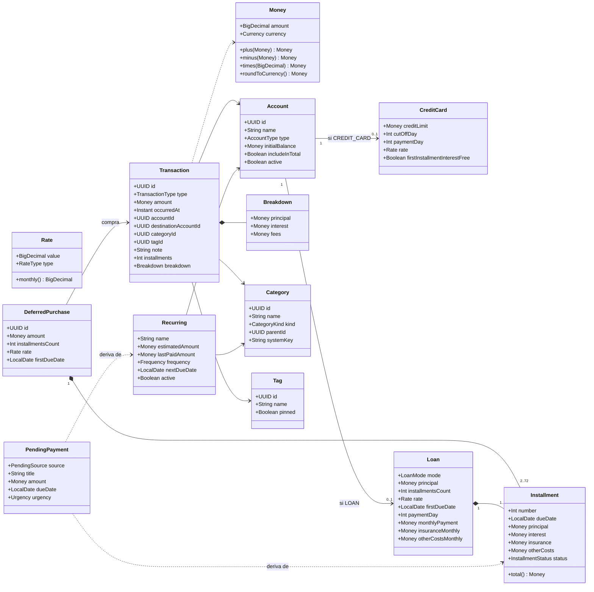
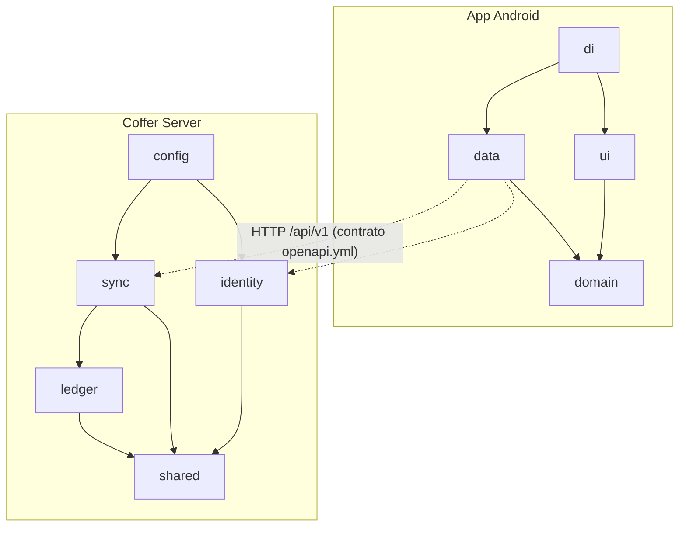
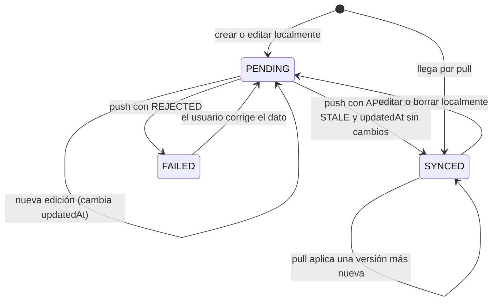
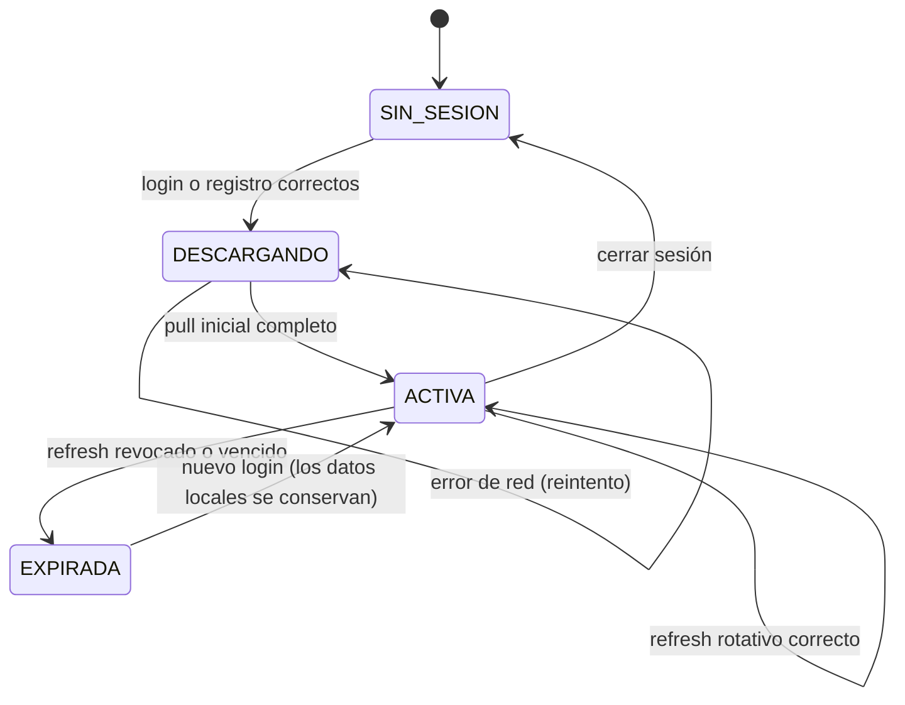
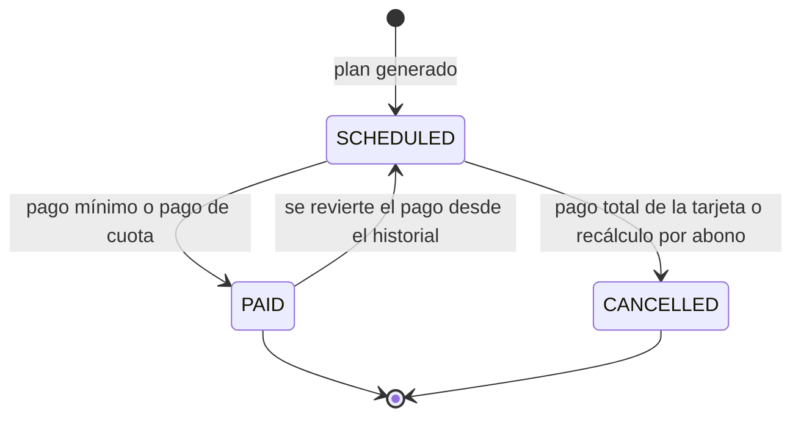
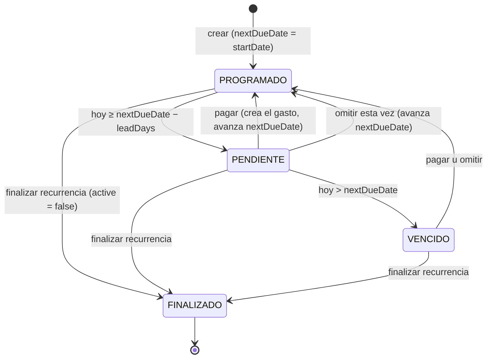
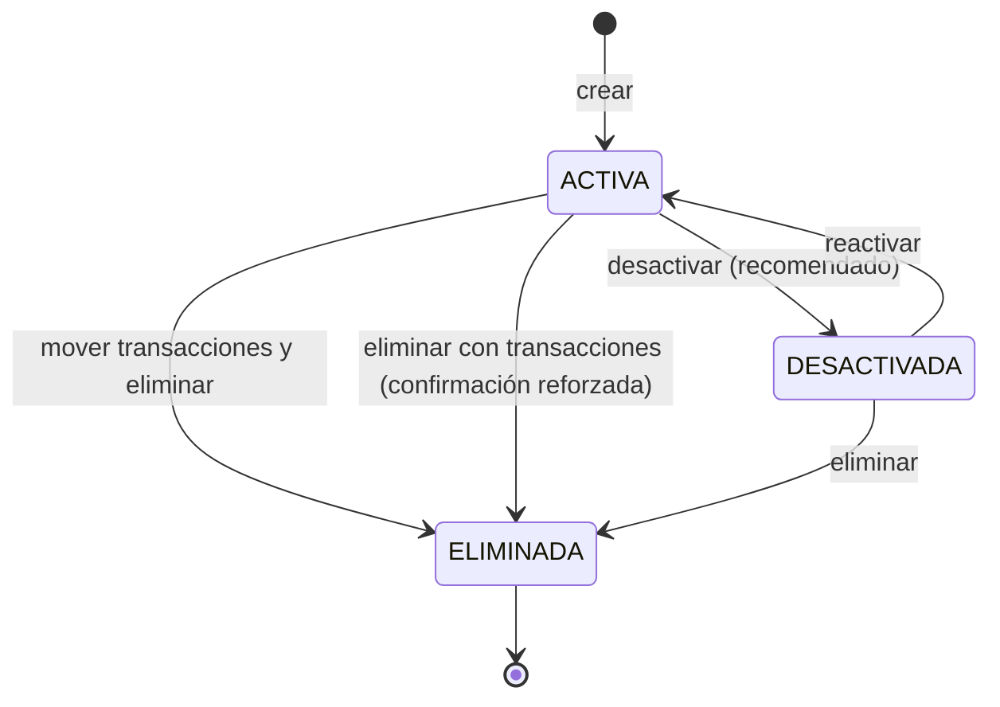

# Software Design Description (Detailed Design) — Coffer

Descripción del diseño de software según **IEEE 1016-2009** (*Standard for Information Technology — Systems Design — Software Design Descriptions*).

## Datos del documento

| Campo | Valor |
| --- | --- |
| Fecha de emisión | 2026-10-09 |
| Estado | Aprobado para implementación (v1.0) |
| Organización emisora | Proyecto Coffer · @Julian |
| Autoría | @Julian (product owner y desarrollador), con redacción asistida por Claude |
| Alcance del SDD | Diseño detallado de la app Android `coffer-app` y del servicio `coffer-server` |
| Documentos de entrada | [SRS v1.0](../01-requirements/SRS%20—%20Aplicación%20de%20Finanzas%20Personales.md), [Arquitectura (arc42 + ISO/IEC/IEEE 42010)](../02-architecture/architecture.md), [ADR](../02-architecture/adr/README.md) |
| Documentos del SDD | Este archivo · [data-model.md](data-model.md) (vista de información) · [sequences/](sequences/README.md) (vista de interacción) |

### Historial de cambios

| Versión | Fecha | Autor | Cambio |
| --- | --- | --- | --- |
| 1.0 | 2026-10-09 | @Julian + Claude | Primera versión del diseño detallado de la v1.0 |

---

## 1. Introducción

### 1.1 Propósito

Este SDD describe **cómo** se construye Coffer: los elementos de diseño (paquetes, clases, tablas, interfaces, algoritmos), sus responsabilidades, interacciones y estados. Lo usan el desarrollador para implementar y probar, y el evaluador para verificar la trazabilidad SRS → arquitectura → diseño → código.

### 1.2 Alcance

Cubre la versión 1.0 definida en el SRS: app Android offline-first (Kotlin, Compose, Room) y servicio en la nube (Spring Boot 4, PostgreSQL, Flyway). No cubre la versión web, el multiusuario compartido ni las funciones *Won't (v1)* del SRS §9.

### 1.3 Contexto

La arquitectura ([`architecture.md`](../02-architecture/architecture.md)) fija los contenedores, el estilo (local-first + servicio de respaldo, monolito modular) y las decisiones (ADR-0001 a 0012). Este SDD baja esas decisiones a elementos implementables sin cambiarlas. Si un detalle de diseño contradice un ADR, prevalece el ADR y se corrige este documento.

### 1.4 Resumen

| Sección | Contenido |
| --- | --- |
| §2–§3 | Referencias y glosario |
| §4 | Partes interesadas e intereses del diseño |
| §5 | Puntos de vista de diseño seleccionados (IEEE 1016 cláusula 5) |
| §6 | Vistas de diseño: contexto, composición, lógica, dependencias, información, interfaces, interacción, estados, algoritmos y recursos |
| §7 | Justificación del diseño |
| §8 | Trazabilidad requisito → elemento de diseño |

---

## 2. Referencias

| Id | Documento |
| --- | --- |
| [R1] | IEEE Std 1016-2009, *Software Design Descriptions* |
| [R2] | ISO/IEC/IEEE 42010:2022, *Architecture description* |
| [R3] | SRS — Aplicación de Finanzas Personales v1.0 (ISO/IEC/IEEE 29148:2018) |
| [R4] | Arquitectura de Coffer (arc42) y ADR-0001 a ADR-0012 |
| [R5] | `design.md` (sistema visual) y prototipo de Figma "Finance App" |
| [R6] | RFC 9457 *Problem Details for HTTP APIs* · RFC 7519 *JSON Web Token* |
| [R7] | Documentación de Spring Boot 4, Spring Security, Flyway, Room, WorkManager y SQLCipher |

## 3. Glosario

Se usan los términos del SRS §10.3 y de la arquitectura §12. Términos propios de este SDD:

| Término | Definición |
| --- | --- |
| Elemento de diseño | Entidad del SDD con nombre: paquete, clase, tabla, interfaz o algoritmo (IEEE 1016 §3.1). |
| Puerto | Interfaz del dominio que implementa la capa `data` (por ejemplo, `TransactionRepository`). |
| Handler de sincronización | Estrategia por entidad que valida y persiste un cambio del push en el servidor. |
| Instantánea (*snapshot*) | Representación JSON completa de una fila enviada en push, pull o `change_log`. |
| `syncState` | Estado local de sincronización de una fila: `PENDING`, `SYNCED` o `FAILED`. |

---

## 4. Partes interesadas e intereses del diseño

| Parte interesada | Intereses de diseño | Vistas que los atienden |
| --- | --- | --- |
| Desarrollador | ¿Qué clases creo, en qué paquete y con qué dependencias? ¿Qué firma tiene cada interfaz? | Composición, lógica, dependencias, interfaces |
| Desarrollador y probador | ¿Cómo interactúan los componentes en cada caso de uso? ¿Qué estados existen? | Interacción, dinámica de estados |
| Product owner | ¿Los cálculos de tarjetas, préstamos y saldos son correctos? | Algoritmos, información |
| Evaluador | ¿Cada requisito tiene un elemento de diseño y una prueba? | Trazabilidad (§8) |
| Operador | ¿Qué recursos consume y cómo se configura? | Recursos, interfaces (configuración) |

## 5. Puntos de vista de diseño

Se aplican diez de los puntos de vista de IEEE 1016-2009 §5. No se usa el de *uso de patrones* como vista separada; los patrones se indican en cada vista.

| Punto de vista (IEEE 1016) | Intereses | Elementos | Lenguaje | Vista |
| --- | --- | --- | --- | --- |
| Contexto (5.2) | Límites, actores y servicios ofrecidos | Sistema, actores, interfaces externas | C4 (Mermaid) | §6.1 |
| Composición (5.3) | Descomposición en paquetes y clases | Módulos, paquetes, clases | Árbol de paquetes, tablas | §6.2 |
| Lógico (5.4) | Tipos, clases y sus relaciones | Clases de dominio, entidades, DTO | Diagrama de clases (Mermaid) | §6.3 |
| Dependencias (5.5) | Qué depende de qué; orden de construcción | Módulos y capas | Grafo (Mermaid) | §6.4 |
| Información (5.6) | Estructura, persistencia y migración de datos | Tablas, columnas, migraciones | ER, diccionario, SQL | §6.5 y [data-model.md](data-model.md) |
| Interfaces (5.8) | Contratos entre componentes | Endpoints, DTO, puertos, DAO | Tablas, JSON, firmas Kotlin y Java | §6.6 |
| Interacción (5.10) | Colaboración en cada caso de uso | Objetos y mensajes | Diagramas de secuencia (Mermaid) | §6.7 y [sequences/](sequences/README.md) |
| Dinámica de estados (5.11) | Ciclos de vida | Estados y transiciones | Diagramas de estado (Mermaid) | §6.8 |
| Algoritmos (5.12) | Cálculos financieros y de sincronización | Funciones | Pseudocódigo y fórmulas | §6.9 |
| Recursos (5.13) | Uso de CPU, memoria, red y almacenamiento | Hilos, *pools*, cuotas | Tablas | §6.10 |

---

## 6. Vistas de diseño

### 6.1 Vista de contexto

Se reutiliza la vista de contexto de la arquitectura: [C4 nivel 1](../02-architecture/diagrams/c4-1-contexto.md). Servicios que ofrece el sistema a su único actor (el usuario), agrupados por caso de uso del SRS:

| CU | Servicio | Contenedor |
| --- | --- | --- |
| CU-01 | Registro, login (usuario o Google) y descarga inicial | App + Coffer Server |
| CU-02 a 07 | Cuentas, transacciones, recurrentes, tarjetas, préstamos, reportes y etiquetas | App (sin red) |
| CU-08 | Importar y exportar archivos | App |
| CU-09 | Sincronización y respaldo | App (SyncWorker) + Coffer Server |

### 6.2 Vista de composición

#### 6.2.1 Coffer Server (`com.dev.julian09.financeserver`)

```
financeserver/
├── FinanceServerApplication.java
├── config/
│   ├── SecurityConfig.java            # cadena de filtros, rutas públicas, JwtDecoder y JwtEncoder RS256
│   ├── JacksonConfig.java             # BigDecimal como string, fechas ISO-8601
│   ├── OpenApiConfig.java
│   └── ClockConfig.java               # Clock.systemUTC() inyectable
├── shared/
│   ├── error/  ProblemDetailsAdvice.java, ErrorCode.java, ApiException.java
│   ├── web/    CurrentUser.java (resuelve userId desde el Jwt)
│   └── money/  Amounts.java (validación de escala y signo)
├── identity/
│   ├── api/    AuthController.java, MeController.java
│   ├── dto/    RegisterRequest, LoginRequest, GoogleLoginRequest, RefreshRequest, AuthResponse, UserDto
│   ├── domain/ User.java, RefreshToken.java (entidades JPA)
│   ├── repo/   UserRepository.java, RefreshTokenRepository.java
│   └── service/ AuthService.java, UserService.java, TokenService.java,
│                GoogleTokenVerifier.java, LoginRateLimiter.java, RefreshTokenPurgeJob.java
├── ledger/
│   ├── domain/ Account, CreditCardDetails, LoanDetails, Category, Tag, Transaction,
│   │           DeferredPurchase, Installment, RecurringExpense, ChangeLogEntry, UserSettings,
│   │           SyncableEntity (@MappedSuperclass)
│   ├── repo/   un JpaRepository por entidad
│   ├── validation/ LedgerValidators.java
│   └── LedgerStore.java               # API interna usada por sync
└── sync/
    ├── api/    SyncController.java
    ├── dto/    PushRequest, ChangeDto, PushResponse, ChangeResult, PullResponse
    ├── service/ PushService.java, PullService.java, SyncEntityRegistry.java
    ├── handler/ SyncHandler.java (interfaz) + AccountSyncHandler, TransactionSyncHandler, … (13)
    └── job/    ChangeLogPurgeJob.java, TombstonePurgeJob.java
```

| Elemento | Tipo | Responsabilidad |
| --- | --- | --- |
| `SecurityConfig` | Configuración | `/api/v1/auth/**` y `/actuator/health` públicos; el resto con `oauth2ResourceServer().jwt()`; sin sesión HTTP (stateless); CORS cerrado |
| `AuthService` | Servicio | Orquesta registro, login, Google, refresh y logout |
| `TokenService` | Servicio | Emite el JWT (`JwtEncoder`, RS256, `sub`, `iat`, `exp` = 15 min) y rota los refresh tokens |
| `GoogleTokenVerifier` | Servicio | Valida el ID token con `NimbusJwtDecoder` sobre el JWKS de Google |
| `LoginRateLimiter` | Componente | Ventana deslizante en memoria: 5 intentos por minuto por (IP, identificador) |
| `PushService` | Servicio `@Transactional` | Aplica un lote de cambios con FK diferidas; devuelve resultados por id |
| `PullService` | Servicio `@Transactional(readOnly)` | Lee los cambios con `version > since` de todas las tablas |
| `SyncEntityRegistry` | Registro | Mapa `entity → SyncHandler` (13 entradas) |
| `SyncHandler<E>` | Estrategia | `validate`, `upsert` (SQL nativo con `ON CONFLICT`), `toDto` |
| `LedgerValidators` | Componente | Reglas de integridad que la base no expresa (por ejemplo, la categoría debe ser del mismo `kind` que el `type` de la transacción) |
| `*PurgeJob` | `@Scheduled` | Purgas de §4.5 de [data-model.md](data-model.md#45-purgas-programadas-servidor) |

#### 6.2.2 App Android (`com.dev.julian09.financeapp`)

```
financeapp/
├── FinanceApp.kt                     # @HiltAndroidApp, Configuration.Provider para HiltWorkerFactory
├── MainActivity.kt                   # NavHost, sesión y tema
├── ui/
│   ├── theme/        Color.kt (tokens design.md), Type.kt, Shape.kt, Theme.kt (claro y oscuro)
│   ├── components/   MoneyText, AmountField, AccountChip, CategoryIcon, PendingRow, SyncBadge,
│   │                 SegmentedSelector, BottomSheetScaffold, ConfirmDialog, EmptyState
│   ├── navigation/   Routes.kt (@Serializable), AppNavHost.kt, BottomBar.kt (4 pestañas)
│   └── feature/
│       ├── auth/          LoginScreen, RegisterScreen, InitialDownloadScreen + ViewModels
│       ├── home/          HomeScreen, BalanceDetailSheet, HomeViewModel
│       ├── history/       HistoryScreen, FiltersSheet, HistoryViewModel
│       ├── transaction/   TransactionScreen, TransferScreen, TransactionDetailScreen + ViewModels
│       ├── accounts/      AccountsScreen, AccountDetailScreen, EditAccountScreen, NewAccountScreen,
│       │                  RemoveAccountSheet, DeactivatedAccountsScreen + ViewModels
│       ├── cards/         NewCardScreen, CardDetailScreen, PayCardSheet + ViewModels
│       ├── loans/         NewLoanScreen, LoanDetailScreen, ExtraPaymentSheet + ViewModels
│       ├── recurring/     RecurringScreen, NewRecurringScreen, PendingSheet, PayPendingSheet + ViewModels
│       ├── categories/    CategoriesScreen, NewCategorySheet + ViewModels
│       ├── tags/          TagsScreen, TagDetailScreen, NewTagSheet + ViewModels
│       ├── reports/       ReportsScreen, ReportsViewModel
│       ├── importexport/  ImportExportScreen, ImportViewModel, ExportViewModel
│       ├── changelog/     ChangeLogScreen, ChangeLogViewModel
│       └── settings/      SettingsScreen, CustomizeHomeScreen, LogoutDialog + ViewModels
├── domain/
│   ├── model/      Money, Rate, Account, AccountType, CreditCard, Loan, Category, Tag, Transaction,
│   │               TransactionType, DeferredPurchase, Installment, Recurring, Frequency,
│   │               PendingPayment, Urgency, ChangeLogEntry, Settings, SyncStatus, DomainError
│   ├── finance/    RateConverter, InstallmentCalculator, CardPeriodCalculator, LoanScheduler,
│   │               BalanceCalculator, RecurrenceCalculator, ReportAggregator, FinanceMath
│   ├── usecase/    un archivo por caso de uso (ver la arquitectura §5.4)
│   └── port/       TransactionRepository, AccountRepository, CardRepository, LoanRepository,
│                   RecurringRepository, CategoryRepository, TagRepository, SettingsRepository,
│                   ChangeLogRepository, AuthRepository, SyncScheduler, ReminderScheduler,
│                   FileGateway, Clock
├── data/
│   ├── local/      FinanceDatabase, entity/*, dao/*, converter/*, LegacyDatabaseMigrator, DatabaseKeyProvider
│   ├── remote/     AuthApi, SyncApi, dto/*, AuthInterceptor, TokenAuthenticator, NetworkModule
│   ├── repository/ *RepositoryImpl, ChangeLogWriter, BaseCatalogSeeder
│   ├── sync/       SyncWorker, SyncSchedulerImpl, OutboxReader, ChangeApplier, EntityCodec, ConnectivityObserver
│   ├── reminder/   ReminderWorker, NotificationPublisher, ReminderSchedulerImpl
│   ├── session/    SessionStore (DataStore Proto + Keystore AES-GCM), DeviceIdProvider
│   └── io/         CsvReader, XlsxReader, TabularReader, CsvWriter, DuplicateDetector, ImportWorker
└── di/             DatabaseModule, NetworkModule, RepositoryModule, WorkerModule, DispatchersModule
```

### 6.3 Vista lógica

#### 6.3.1 Modelo de dominio del cliente (`domain/model`)



Enumeraciones: `AccountType {CASH, DEBIT, SAVINGS, CREDIT_CARD, LOAN}`, `TransactionType {EXPENSE, INCOME, TRANSFER}`, `RateType {EA, MV}`, `LoanMode {DETAILED, SIMPLE}`, `InstallmentStatus {SCHEDULED, PAID, CANCELLED}`, `Frequency {WEEKLY, BIWEEKLY, MONTHLY, QUARTERLY, YEARLY, Custom(count, unit)}`, `Urgency {UPCOMING, SOON, OVERDUE}`, `CategoryKind {EXPENSE, INCOME}`.

Invariantes del dominio (verificadas en constructores o fábricas `create(...)`, que devuelven `Result`):
- `Money.amount` con escala ≤ 4; los montos de `Transaction` son > 0.
- `Transaction` de tipo `TRANSFER` tiene `destinationAccountId` distinto de `accountId` y no tiene `categoryId`.
- Si existe `Breakdown`, `principal + interest + fees == amount`.
- Las cuotas de un `DeferredPurchase` suman su `amount` en capital.

#### 6.3.2 Entidades del servidor

Las entidades JPA del módulo `ledger` reflejan una a una las tablas de [data-model.md](data-model.md) y heredan de:

```java
@MappedSuperclass
public abstract class SyncableEntity {
    @Id private UUID id;
    @Column(name = "user_id", nullable = false, updatable = false) private UUID userId;
    @Column(nullable = false) private OffsetDateTime createdAt;
    @Column(nullable = false) private OffsetDateTime updatedAt;
    private OffsetDateTime deletedAt;
    @Column(nullable = false, insertable = false, updatable = false) private long version; // lo asigna el trigger
}
```

Los montos son `BigDecimal` con `@Column(precision = 19, scale = 4)`. Los enums se guardan con `@Enumerated(EnumType.STRING)`. El push no usa `save()` de JPA: usa SQL nativo con `ON CONFLICT` (§6.9.7) para garantizar la condición de último cambio gana en una sola sentencia.

### 6.4 Vista de dependencias



| Regla | Herramienta que la verifica |
| --- | --- |
| `domain` no importa `android.*`, `androidx.*` ni `data` | Prueba de dependencias (Konsist) en CI |
| `ui` no importa `data` | Konsist |
| `ledger` no depende de `sync` ni de `identity` | ArchUnit `ArchitectureTest` |
| Los controladores no usan repositorios | ArchUnit |
| Prohibido `double` o `float` en `domain` y en `ledger.domain` | Konsist y ArchUnit |

Orden de construcción por incremento (arquitectura §4.3): `shared` → `identity` → `ledger` + `sync` en el servidor, y `domain` → `data/local` → `data/sync` → `ui/feature/*` en la app.

### 6.5 Vista de información

Definida completamente en **[data-model.md](data-model.md)**:
- §2 Diagrama entidad-relación (14 tablas).
- §3 Diccionario de datos (tipos, nulos, valores por defecto, restricciones y trazabilidad por columna).
- §4 Estrategia de migraciones con Flyway (reglas, plan V3–V10, scripts SQL, recuperación de los datos del MVP y purgas). Los scripts se validaron sobre PostgreSQL 16 aplicando V1–V9 encima de datos del MVP.
- §5 Modelo en el dispositivo (Room + SQLCipher), conversiones de tipo y migración de la base del MVP.

### 6.6 Vista de interfaces

#### 6.6.1 API REST `/api/v1` (Coffer Server)

Convenciones: JSON `camelCase`; montos como string decimal (`"28000.0000"`); instantes ISO-8601 en UTC; fechas `yyyy-MM-dd`; errores `application/problem+json` (RFC 9457) con `code` ([ADR-0012](../02-architecture/adr/0012-contrato-api-v1-y-errores.md)). El contrato formal se publica en `docs/04-api/openapi.yml`.

| Operación | Petición | Respuesta correcta | Errores |
| --- | --- | --- | --- |
| `POST /auth/register` | `RegisterRequest {displayName, email, username, password, deviceId}` | `201 AuthResponse` | 400 `FIN-VALIDATION`, 409 `FIN-CONFLICT` |
| `POST /auth/login` | `LoginRequest {identifier, password, deviceId}` | `200 AuthResponse` | 401 `FIN-AUTH-INVALID`, 429 `FIN-RATE-LIMIT` |
| `POST /auth/google` | `GoogleLoginRequest {idToken, deviceId}` | `200 AuthResponse` | 401 `FIN-AUTH-INVALID` |
| `POST /auth/refresh` | `RefreshRequest {refreshToken, deviceId}` | `200 AuthResponse` | 401 `FIN-AUTH-REVOKED` |
| `POST /auth/logout` | `RefreshRequest` | `204` | — |
| `GET /me` | — | `200 UserDto` | 401 |
| `POST /sync/push` | `PushRequest` | `200 PushResponse` | 400, 401, 413 (más de 200 cambios) |
| `GET /sync/pull?since&limit` | parámetros | `200 PullResponse` | 400, 401 |

```json
// AuthResponse
{ "accessToken": "eyJ…", "accessTokenExpiresAt": "2026-10-09T13:25:00Z",
  "refreshToken": "q8L…", "user": { "id": "uuid", "username": "julianb",
  "displayName": "Julian Bocanegra", "email": "julian@correo.com", "currency": "COP" } }

// PushRequest
{ "deviceId": "b1f2…",
  "changes": [ { "entity": "transaction", "id": "uuid",
                 "updatedAt": "2026-10-09T13:10:00Z", "deletedAt": null,
                 "createdAt": "2026-10-09T13:10:00Z",
                 "data": { "type": "EXPENSE", "amount": "28000.0000",
                           "occurredAt": "2026-10-09T13:05:00Z", "accountId": "uuid",
                           "categoryId": "uuid", "tagId": null, "note": "Almuerzo",
                           "installments": 1 } } ] }

// PushResponse
{ "results": [ { "id": "uuid", "status": "APPLIED", "version": 512 },
               { "id": "uuid", "status": "REJECTED", "code": "FIN-VALIDATION",
                 "detail": "amount must be > 0" } ] }

// PullResponse
{ "changes": [ { "entity": "account", "id": "uuid", "version": 513, "...": "..." } ],
  "nextCursor": 513, "hasMore": true, "remaining": 1830 }
```

Valores de `entity`: `settings`, `account`, `creditCardDetails`, `loanDetails`, `category`, `tag`, `transaction`, `deferredPurchase`, `installment`, `recurringExpense`, `changeLog`. El campo `data` contiene las columnas de la tabla en `camelCase`, sin `user_id` ni `version`.

#### 6.6.2 Puertos del dominio (app)

```kotlin
interface TransactionRepository {
    fun observeRecent(days: Int): Flow<List<Transaction>>                       // REQ-TRX-11
    fun search(filter: TransactionFilter, query: String): Flow<PagingData<Transaction>> // REQ-TRX-09, 10, 12
    suspend fun insert(tx: Transaction): Result<Unit>
    suspend fun insertDeferredPurchase(tx: Transaction, purchase: DeferredPurchase,
                                       plan: List<Installment>): Result<Unit>
    suspend fun update(tx: Transaction): Result<Unit>
    suspend fun softDelete(id: UUID): Result<Unit>
}
interface AccountRepository {
    fun observeActive(): Flow<List<AccountWithBalance>>                         // REQ-INI-01
    fun observeBalances(): Flow<TotalBalance>                                   // REQ-CTA-06, 08
    suspend fun impact(id: UUID): AccountImpact                                 // REQ-CTA-05
    suspend fun remove(id: UUID, option: RemoveOption): Result<Unit>            // REQ-CTA-03
}
interface SyncScheduler {
    fun requestSync()
    fun requestInitialSync(): UUID
    fun cancelAll()
    fun observeStatus(): Flow<SyncStatus>                                       // REQ-SYN-05
}
interface ReminderScheduler { fun ensureScheduled() }
interface Clock { fun now(): Instant; fun today(): LocalDate; fun zone(): ZoneId }
```

Los demás puertos (`CardRepository`, `LoanRepository`, `RecurringRepository`, `CategoryRepository`, `TagRepository`, `SettingsRepository`, `ChangeLogRepository`, `AuthRepository`, `FileGateway`) siguen el mismo patrón: lecturas como `Flow` y escrituras `suspend` que devuelven `Result`.

#### 6.6.3 Consultas clave de Room (DAO)

```kotlin
// Saldo por cuenta (montos escalados ×10⁴). El principal de un pago reduce la deuda (§6.9.5).
@Query("""
  SELECT a.id,
         CASE WHEN a.type IN ('CREDIT_CARD', 'LOAN') THEN -a.initialBalance ELSE a.initialBalance END
       + COALESCE((SELECT SUM(CASE t.type WHEN 'INCOME' THEN t.amount WHEN 'EXPENSE' THEN -t.amount ELSE -t.amount END)
                   FROM transactions t WHERE t.accountId = a.id AND t.deletedAt IS NULL), 0)
       + COALESCE((SELECT SUM(COALESCE(t.principal, t.amount))
                   FROM transactions t WHERE t.destinationAccountId = a.id AND t.type = 'TRANSFER'
                   AND t.deletedAt IS NULL), 0) AS balanceScaled
  FROM accounts a WHERE a.deletedAt IS NULL AND a.active = 1
""")
fun observeBalances(): Flow<List<AccountBalanceRow>>
```

Para cuentas de deuda (`CREDIT_CARD`, `LOAN`), `initialBalance` se guarda positivo (la deuda inicial) y la consulta lo invierte, así el saldo de una tarjeta o un préstamo sale negativo (REQ-TC-04, §6.9.5).

#### 6.6.4 Configuración del servidor (`application.yaml`)

| Propiedad | Variable de entorno | Ejemplo y uso |
| --- | --- | --- |
| `spring.datasource.url` | `DB_URL` | `jdbc:postgresql://…/coffer?sslmode=require` |
| `spring.datasource.username` / `password` | `DB_USER` / `DB_PASSWORD` | — |
| `spring.datasource.hikari.maximum-pool-size` | `DB_POOL_SIZE` | `4` |
| `spring.jpa.hibernate.ddl-auto` | — | `validate` |
| `spring.flyway.validate-on-migrate` / `clean-disabled` | — | `true` / `true` |
| `finance.jwt.private-key` / `public-key` | `JWT_PRIVATE_KEY` / `JWT_PUBLIC_KEY` | PEM RSA 2048 |
| `finance.jwt.access-ttl` | — | `PT15M` |
| `finance.jwt.refresh-ttl` | — | `P180D` |
| `finance.google.client-id` | `GOOGLE_CLIENT_ID` | Audiencia aceptada |
| `finance.sync.max-push` / `max-pull` | — | `200` / `500` |

### 6.7 Vista de interacción

Los 14 flujos están en **[sequences/](sequences/README.md)**, uno por archivo, con los participantes de §6.2:

| Id | Flujo | Elementos principales |
| --- | --- | --- |
| SEQ-01 | Registro, login y Google | `AuthController`, `AuthService`, `TokenService`, `GoogleTokenVerifier`, `SessionStore` |
| SEQ-02 | Descarga inicial | `SyncWorker`, `PullService`, `BaseCatalogSeeder` |
| SEQ-03 | Renovar y cerrar sesión | `TokenAuthenticator`, `TokenService`, `Logout` |
| SEQ-04 | Gasto o ingreso | `RegisterTransaction`, `TransactionRepositoryImpl`, `ChangeLogWriter` |
| SEQ-05 | Transferencia | `RegisterTransfer` |
| SEQ-06 | Compra con tarjeta a cuotas | `DeferCardPurchase`, `InstallmentCalculator`, `CardPeriodCalculator` |
| SEQ-07 | Pagar tarjeta | `PayCreditCard`, `CardPeriodCalculator` |
| SEQ-08 | Push | `OutboxReader`, `PushService`, `SyncHandler` |
| SEQ-09 | Pull y conflictos | `PullService`, `ChangeApplier` |
| SEQ-10 | Pendientes y avisos | `ObservePendingPayments`, `PayPending`, `ReminderWorker` |
| SEQ-11 | Préstamo y abono | `CreateLoan`, `LoanScheduler`, `ExtraPayment` |
| SEQ-12 | Quitar cuenta | `RemoveAccount` |
| SEQ-13 | Importar y exportar | `PreviewImport`, `CommitImport`, `ImportWorker`, `ExportCsv` |
| SEQ-14 | Editar, eliminar y restaurar | `UpdateTransaction`, `DeleteTransaction`, `RestoreTransaction`, `RevertEdit` |

### 6.8 Vista de dinámica de estados

#### 6.8.1 Estado de sincronización de una fila (`syncState`)



#### 6.8.2 Sesión



#### 6.8.3 Cuota (`installments.status`)



Estado derivado (no se guarda): una cuota `SCHEDULED` con `dueDate` dentro de la ventana de anticipación es un **pendiente**, con urgencia `UPCOMING`, `SOON` u `OVERDUE`.

#### 6.8.4 Gasto recurrente



#### 6.8.5 Cuenta



### 6.9 Vista de algoritmos

Todos viven en `domain/finance` (Kotlin puro, `BigDecimal`, `MathContext.DECIMAL128` en los cálculos intermedios) salvo §6.9.7 y §6.9.8, que son del servidor ([ADR-0010](../02-architecture/adr/0010-logica-financiera-en-el-cliente.md)).

#### 6.9.1 `RateConverter` — REQ-TC-02

```
toMonthly(rate, type):
    MV → rate
    EA → (1 + rate)^(1/12) − 1          // potencia fraccionaria con BigDecimalMath, 10 decimales
toAnnual(rate, type):
    EA → rate
    MV → (1 + rate)^12 − 1
```

Prueba: 2 % MV ↔ 26,8242 % EA.

#### 6.9.2 `InstallmentCalculator` — REQ-TC-03, 07, 15 · REQ-PRE-03

Capital fijo + interés sobre el saldo pendiente con mes comercial de 30 días (la tasa mensual se aplica completa a cada periodo).

```
plan(amount P, n, monthlyRate i, firstDueDate d1, firstInterestFree, extrasPerMonth = 0):
    scale  = currency.scale                      // COP = 0
    base   = (P / n) redondeado a scale, HALF_EVEN
    saldo  = P
    para k en 1..n:
        capital  = si k == n: saldo  sino base   // la última absorbe la diferencia
        interés  = si (k == 1 y firstInterestFree) o i == 0: 0
                   sino (saldo × i) redondeado a scale, HALF_EVEN
        cuota_k  = Installment(k, dueDate = d1 + (k−1) meses (ajustado al fin de mes),
                               principal = capital, interest = interés, insurance/otherCosts = extras)
        saldo    = saldo − capital
    devolver cuotas                              // Σ principal == P siempre
```

Ejemplo del SRS (HU-08): $1.200.000 a 12 cuotas al 2 % MV da capital de $100.000 por cuota; intereses de $24.000, $22.000, …, $2.000. Si la primera cuota no tiene intereses, la cuota 1 = $100.000.

#### 6.9.3 `CardPeriodCalculator` — REQ-TC-08, 10, 12, 13

```
periodo(fecha, corte c):
    fin    = c del mes de "fecha" si fecha ≤ ese día; si no, c del mes siguiente (ajustado a fin de mes)
    inicio = (fin − 1 mes) + 1 día
firstDueDate(compra, c, p): día p del mes siguiente al fin del periodo de la compra
vence(periodo):            // REQ-TC-08
      Σ compras a 1 cuota con occurredAt en el periodo (incluida la deuda inicial, REQ-TC-13)
    + Σ (principal + interest + otherCosts) de cuotas SCHEDULED con dueDate = fecha de pago del periodo
mínimo = vence(periodo actual)
total  = deuda actual (−saldo de la tarjeta)
payoff(hoy):               // REQ-TC-12
    cuotas del periodo → PAID
    cuotas futuras     → CANCELLED, su capital se suma al pago (sin intereses futuros)
desglose(monto editado):   // cargos, luego intereses, luego capital
    fees = min(monto, Σ cargos), interest = min(resto, Σ intereses), principal = resto
```

Pregunta abierta (SRS §10.2): el interés de las compras entre el corte y el pago se aísla en `interestForGracePeriod()`, que hoy devuelve 0.

#### 6.9.4 `LoanScheduler` — REQ-PRE-03, 06, 08

```
schedule(detallado):  InstallmentCalculator.plan(P, n, i, d1, false, seguro + costos)
abono(saldo S, abono A, restantes r, i, modo):
    S' = S − A
    REDUCE_TERM:    base = capital de cuota vigente; r' = ceil(S' / base); plan(S', r', i, próxima fecha)
    REDUCE_PAYMENT: plan(S', r, i, próxima fecha)              // capital fijo menor
simple: pendiente mensual = monthlyPayment el día paymentDay; cada pago reduce la deuda por su valor completo
```

#### 6.9.5 `BalanceCalculator` — REQ-CTA-06, 07, 08 · REQ-PRE-07

```
saldo(cuenta a):
    activo (CASH, DEBIT, SAVINGS):
        a.initial + Σ INCOME − Σ EXPENSE − Σ TRANSFER salientes + Σ TRANSFER entrantes
    deuda (CREDIT_CARD, LOAN):                   // se muestra negativo (REQ-TC-04)
        −a.initial − Σ EXPENSE (compras) − Σ TRANSFER salientes (desembolso)
        + Σ coalesce(principal, amount) de TRANSFER entrantes (pagos: solo el capital reduce la deuda)
disponible = Σ saldo(a) para a activa, includeInTotal, tipo de activo
neto       = disponible − Σ vence(periodo actual) de tarjetas incluidas − Σ cuota del periodo de préstamos incluidos
```

Ejemplo del SRS (HU-04): $1.000.000 disponible − $800.000 que vencen = $200.000 neto.

#### 6.9.6 `RecurrenceCalculator` — REQ-REC-02, 04, 05, 08

```
next(fecha, freq):
    WEEKLY +7 d · BIWEEKLY +14 d · MONTHLY +1 mes · QUARTERLY +3 meses · YEARLY +1 año
    CUSTOM(n, DAY|WEEK|MONTH) +n unidades
    los meses se suman sobre startDate (no encadenados) para no perder el día 31: start.plusMonths(k)
enVentana(due, hoy, lead) = hoy ≥ due − lead
urgencia(due, hoy) = OVERDUE si hoy > due · SOON si due − hoy ≤ 2 · UPCOMING en otro caso
```

#### 6.9.7 Upsert con último cambio gana (servidor) — REQ-SYN-02, 04

```sql
INSERT INTO transactions AS t (id, user_id, type, amount, …, created_at, updated_at, deleted_at)
VALUES (:id, :userId, :type, :amount, …, :createdAt, :updatedAt, :deletedAt)
ON CONFLICT (id) DO UPDATE
   SET type = EXCLUDED.type, amount = EXCLUDED.amount, …,
       updated_at = EXCLUDED.updated_at, deleted_at = EXCLUDED.deleted_at
 WHERE t.user_id = EXCLUDED.user_id
   AND EXCLUDED.updated_at > t.updated_at
RETURNING version;
-- Sin fila devuelta: STALE si t.user_id = :userId; REJECTED (FIN-NOT-OWNER) si no.
```

#### 6.9.8 Pull paginado (servidor) — REQ-SYN-01, REQ-AUT-05

```
pull(userId, since, limit):
    filas = UNION ALL de las 13 tablas (entity, id, version, to_jsonb(fila))
            WHERE user_id = :userId AND version > :since
            ORDER BY version LIMIT limit + 1
    hasMore    = filas.size > limit
    nextCursor = version de la última fila devuelta (o since si no hay filas)
    remaining  = solo si since == 0: conteo total con version > nextCursor (para la barra de progreso)
```

#### 6.9.9 Duplicados de importación — REQ-IMP-04

`clave = (occurredAt truncado al minuto, amount, accountId, type)`. Hay posible duplicado si la clave existe en la base local o se repite dentro del archivo. Por defecto se omite.

### 6.10 Vista de recursos

| Recurso | Diseño | Requisito |
| --- | --- | --- |
| Hilos (app) | UI en `Main`; Room en `Dispatchers.IO` (inyectado); cálculos del dominio en `Default`; nunca `runBlocking` | RNF-02, RNF-03 |
| Arranque | Inicio solo consulta Room con índices; la sincronización espera 5 s después del arranque | RNF-02 |
| Memoria (app) | Historial con Paging 3 (páginas de 50); importación en streaming, nunca el archivo completo en memoria | RNF-04 |
| Base local | SQLCipher con `PRAGMA cipher_memory_security = OFF` por rendimiento; WAL activado | RNF-02, RNF-08 |
| Red (app) | Timeouts: 15 s para auth, 60 s para el worker (arranque en frío); lotes de 200 y 500 | RNF-06 |
| Batería | WorkManager con restricción `CONNECTED`; periódico cada 15 min (mínimo del sistema); avisos una vez al día | REQ-REC-09 |
| Servidor | Imagen JRE 21 con `-XX:MaxRAMPercentage=75`; 512 MB; Hikari de 4 conexiones; `spring.threads.virtual.enabled=true` | ADR-0002, ADR-0009 |
| Almacenamiento (nube) | Del orden de 10.000 transacciones por usuario, unos pocos MB; purgas de §4.5 de data-model | ADR-0009 |

---

## 7. Justificación del diseño

| Decisión de diseño | Motivo | Alternativa descartada |
| --- | --- | --- |
| La tabla misma como cola (`syncState` por fila) en lugar de una tabla de eventos | Una sola escritura por cambio; no hay que compactar la cola | Tabla `outbox` con eventos |
| FK compuestas `(id, user_id)` | La base impide relacionar datos de usuarios distintos aunque falle una validación | Validar solo en el código |
| FK `DEFERRABLE INITIALLY DEFERRED` | Un lote de push puede llegar en cualquier orden interno | Ordenar estrictamente cada lote |
| SQL nativo con `ON CONFLICT … WHERE` | Último cambio gana atómico, sin leer antes de escribir | `findById` + `save` (condición de carrera) |
| Trigger para `version` | Ninguna escritura puede olvidar avanzar el cursor | Asignar la versión en el código Java |
| Montos ×10⁴ en Room | Exactos y sumables con `SUM` en SQLite | `TEXT` con `BigDecimal` (no se puede sumar en SQL) |
| Pendientes calculados, no guardados | Siempre coherentes con los recurrentes y las cuotas; no hay nada que sincronizar | Tabla de pendientes |
| Migrador del MVP fuera de Room | SQLCipher no cifra en sitio una base existente | `Migration(1, 2)` de Room |
| `ChangeLogWriter` dentro de la misma transacción | El historial nunca queda desalineado con el cambio | Disparadores de SQLite |

Las decisiones de nivel arquitectónico están en los [ADR](../02-architecture/adr/README.md).

## 8. Trazabilidad requisito → diseño

| Requisitos | Elementos de diseño | Secuencia | Pruebas previstas |
| --- | --- | --- | --- |
| REQ-AUT-01 a 03 | `AuthController`, `AuthService`, `UserService`, `GoogleTokenVerifier`, `users` | SEQ-01 | `AuthControllerIT`, `RegisterViewModelTest` |
| REQ-AUT-04 a 06 | `TokenService`, `refresh_tokens`, `TokenAuthenticator`, `SessionStore`, `Logout` | SEQ-03 | `TokenServiceTest` (rotación y reutilización) |
| REQ-AUT-05 | `SyncWorker`, `PullService`, `InitialDownloadViewModel` | SEQ-02 | `SyncWorkerTest` con MockWebServer |
| REQ-CTA-01 a 09 | `accounts`, `AccountRepository`, `BalanceCalculator`, `RemoveAccount` | SEQ-12 | `BalanceCalculatorTest` (HU-04) |
| REQ-TRX-01 a 12 | `transactions`, `RegisterTransaction`, `RegisterTransfer`, `TransactionRepository.search` | SEQ-04, 05, 14 | `RegisterTransactionTest`, `TransactionDaoTest` |
| REQ-CAT-01 a 03 | `categories`, `BaseCatalogSeeder`, `DeleteCategory` (reasigna) | SEQ-02 | `CategoryRepositoryTest` |
| REQ-ETQ-01 a 04 | `tags`, `ObserveTagSummary`, `PinTag` | — | `TagSummaryTest` |
| REQ-REC-01 a 11 | `recurring_expenses`, `RecurrenceCalculator`, `PayPending`, `ReminderWorker` | SEQ-10 | `RecurrenceCalculatorTest` (día 31, febrero) |
| REQ-TC-01 a 15 | `credit_card_details`, `deferred_purchases`, `installments`, `InstallmentCalculator`, `CardPeriodCalculator`, `PayCreditCard` | SEQ-06, 07 | `InstallmentCalculatorTest` (HU-08), `CardPeriodCalculatorTest` |
| REQ-REP-01 a 05 | `ReportAggregator`, `ReportsViewModel` | — | `ReportAggregatorTest` (reconocimiento por cuota) |
| REQ-INI-01 a 04 | `HomeViewModel`, `user_settings.home_cards`, `CustomizeHomeScreen` | SEQ-10 | `HomeViewModelTest` |
| REQ-IMP-01 a 06, REQ-EXP-01 | `PreviewImport`, `CommitImport`, `DuplicateDetector`, `ImportWorker`, `ExportCsv` | SEQ-13 | `CsvReaderTest`, `DuplicateDetectorTest` |
| REQ-SYN-01 a 05 | `SyncWorker`, `OutboxReader`, `ChangeApplier`, `PushService`, `PullService`, `sync_version` | SEQ-08, 09 | `PushServiceIT` (idempotencia, STALE, propiedad) |
| REQ-HIS-01 a 04 | `change_log`, `ChangeLogWriter`, `RestoreTransaction`, `ChangeLogPurgeJob` | SEQ-14 | `ChangeLogRepositoryTest` |
| REQ-PRE-01 a 10 | `loan_details`, `LoanScheduler`, `CreateLoan`, `ExtraPayment` | SEQ-11 | `LoanSchedulerTest` (HU-14) |
| RNF-02, 03 | Índices de Room, Paging 3, guardado sin red | SEQ-04 | Macrobenchmark |
| RNF-08, 09 | `DatabaseKeyProvider`, SQLCipher, `SessionStore` | — | Prueba instrumentada de cifrado |
| RNF-12 | `Money`, `NUMERIC(19,4)`, montos ×10⁴ | — | Regla de Konsist y ArchUnit (sin `double`) |
| RNF-17 | `user_id`, FK compuestas, `CurrentUser` | SEQ-08 | `PushServiceIT` (usuario ajeno) |
