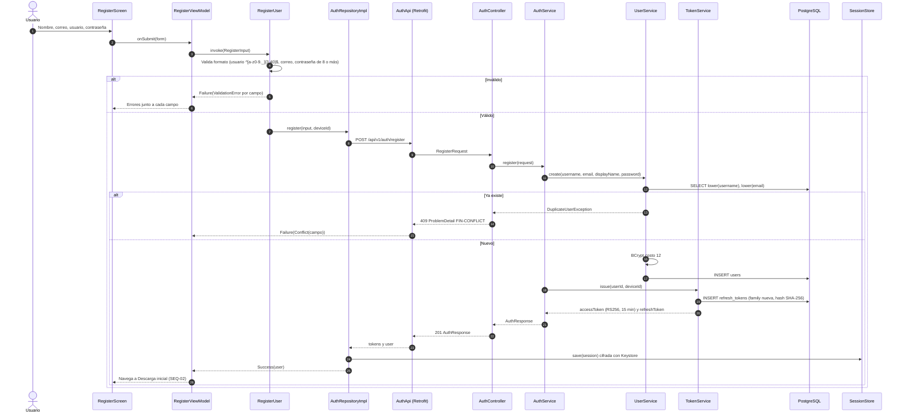
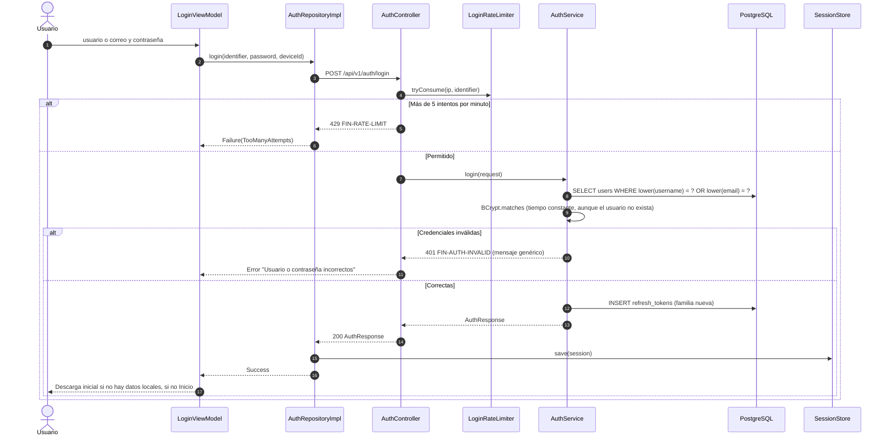
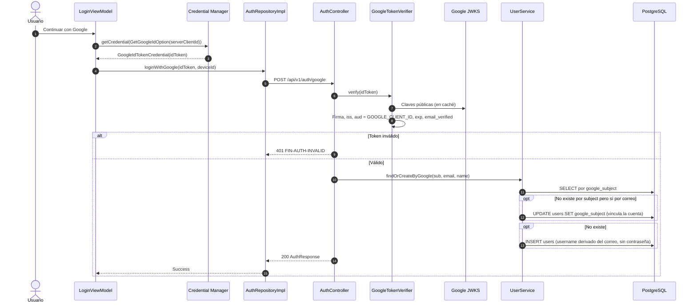

# SEQ-01 · Registro e inicio de sesión

Requisitos: REQ-AUT-01, 02, 03, RNF-09, RNF-11 · Pantallas: Iniciar sesión, Registro · Diseño: [§6.6 Interfaces](../detailed-design.md#66-vista-de-interfaces)

## 1.1 Registro con usuario y contraseña

## 1.2 Inicio de sesión con usuario o correo

## 1.3 Registro o inicio con Google

