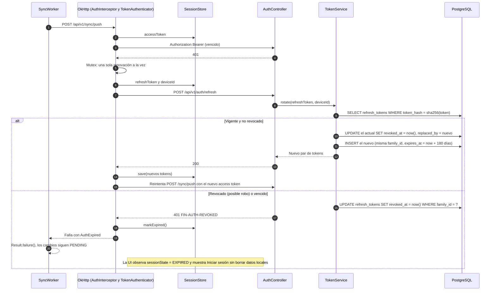
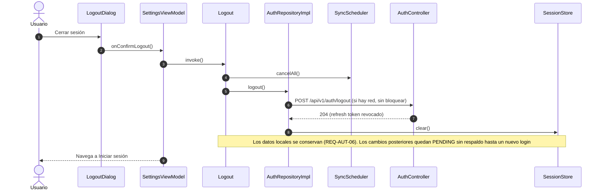

# SEQ-03 · Renovar y cerrar la sesión

Requisitos: REQ-AUT-04, REQ-AUT-06, RNF-09 · Pantallas: Ajustes, Diálogo cerrar sesión

## 3.1 Renovación transparente con refresh rotativo

## 3.2 Cerrar sesión

