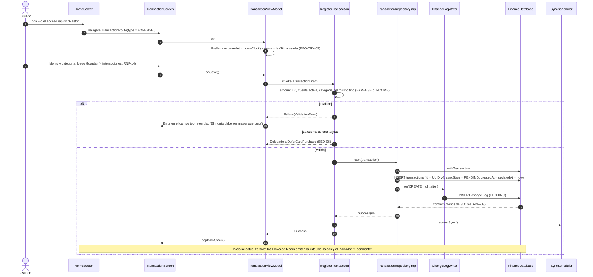

# SEQ-04 · Registrar un gasto o un ingreso

Requisitos: REQ-TRX-01, 05, 08, RNF-03, RNF-14, RNF-15, REQ-HIS-01 · Pantalla: Nueva transacción

Notas de diseño:
- El tipo "Ingreso" usa el mismo flujo con `type = INCOME` y categorías de ingreso.
- RNF-15: el formulario solo muestra cuotas y tasa si la cuenta elegida es `CREDIT_CARD` (estado `showCardFields` en `TransactionUiState`).
