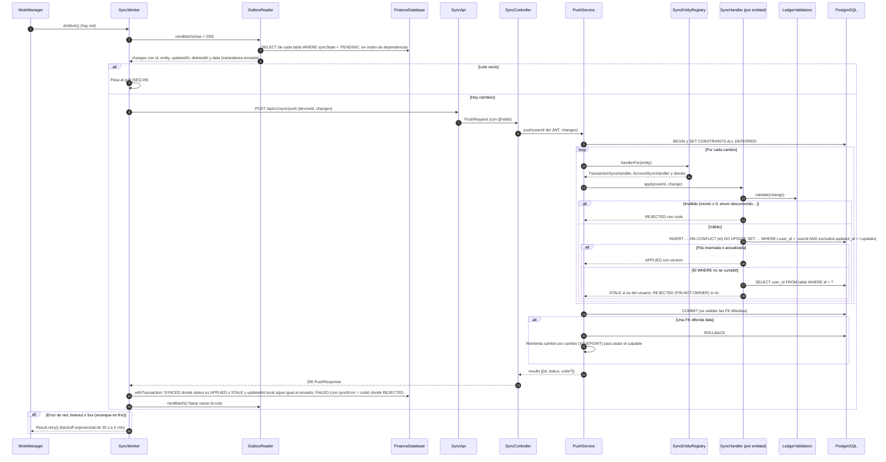

# SEQ-08 · Sincronización: push de cambios locales

Requisitos: REQ-SYN-01, 02, 04, RNF-06, RNF-07 · Decisión: [ADR-0006](../../02-architecture/adr/0006-sync-protocol.md)

Garantías:
- **Idempotencia:** reenviar un lote ya aplicado devuelve `STALE`, sin duplicar (REQ-SYN-04).
- **Sin pérdidas:** si el usuario editó una fila mientras el lote viajaba, su `updatedAt` cambió y la fila sigue `PENDING` para el próximo push.
- **Aislamiento:** el `user_id` viene del JWT; un id ajeno se rechaza (RNF-17).
