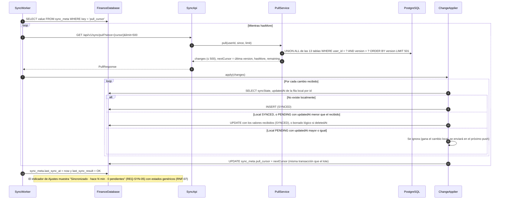
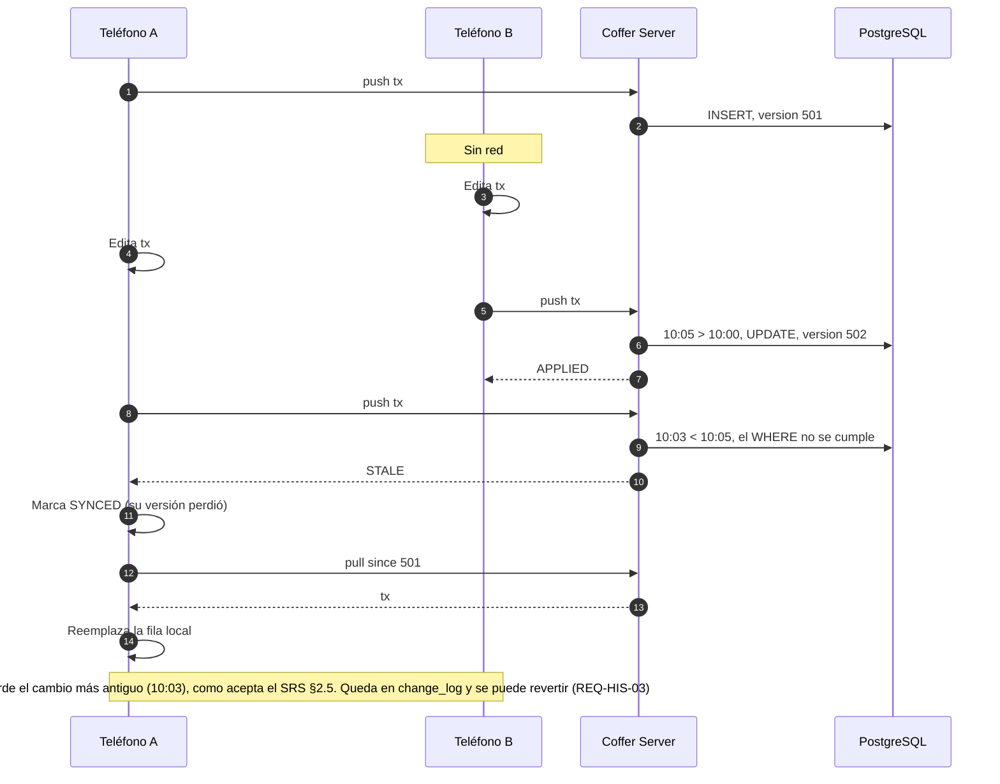

# SEQ-09 · Sincronización: pull incremental y resolución de conflictos

Requisitos: REQ-SYN-02, 03, 05, RNF-07 · Decisión: [ADR-0006](../../02-architecture/adr/0006-sync-protocol.md)

## 9.1 Pull

## 9.2 Conflicto entre dos dispositivos (último cambio gana)

## 9.3 Programación del worker

| Disparador | Trabajo | Política |
| --- | --- | --- |
| Cualquier escritura local (`requestSync()`) | `OneTimeWorkRequest` "sync" | `ExistingWorkPolicy.KEEP`, restricción `CONNECTED`, retraso inicial de 5 s para agrupar cambios |
| Periódico | `PeriodicWorkRequest` "sync-periodic" | Cada 15 min, `CONNECTED` |
| Recuperar la red | `ConnectivityObserver`, que llama a `requestSync()` | — |
| Primer login | "initial-sync" (SEQ-02) | `REPLACE`, *expedited* |
