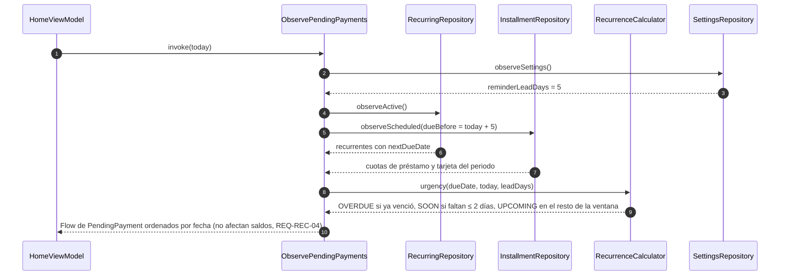
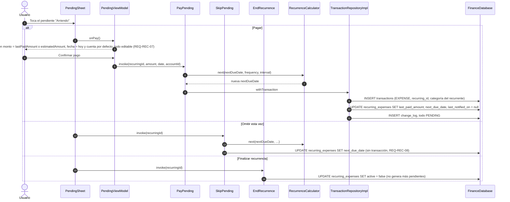
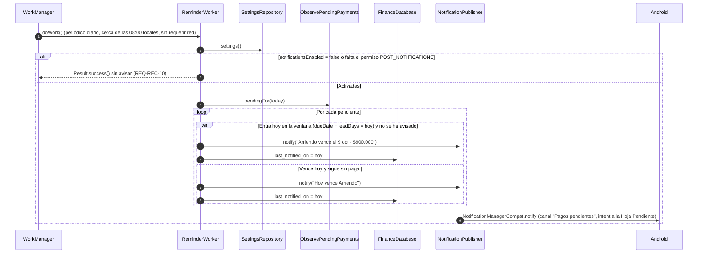

# SEQ-10 · Gastos recurrentes: pendientes, pago, omisión, finalización y avisos

Requisitos: REQ-REC-01 a 11, HU-07 · Pantallas: Inicio (Próximos pagos), Hoja Pendiente, Hoja Pagar pendiente, Gastos recurrentes

## 10.1 Mostrar pendientes en Inicio

## 10.2 Pagar, omitir o finalizar

## 10.3 Avisos (notificaciones locales)

