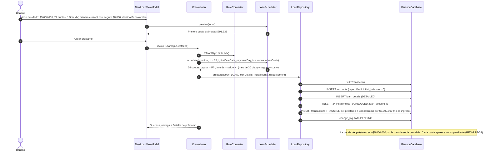
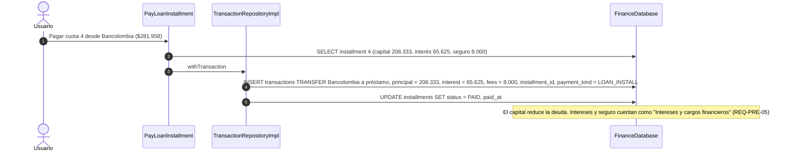
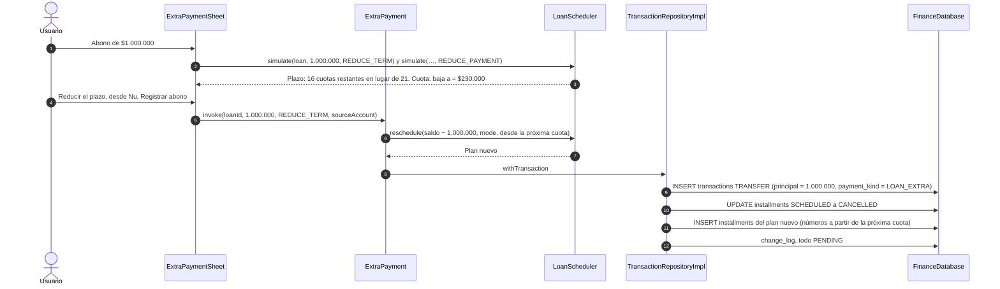

# SEQ-11 · Préstamos: registro, pago de cuota y abono a capital

Requisitos: REQ-PRE-01 a 10, HU-14, F29 · Pantallas: Nuevo préstamo (detallado o simple), Detalle de préstamo, Hoja Abono a capital

## 11.1 Registrar un préstamo detallado

## 11.2 Pagar una cuota

## 11.3 Abono extraordinario a capital

## 11.4 Préstamo en modo simple

En modo simple (REQ-PRE-08), `CreateLoan` recibe el saldo actual, la cuota mensual y el día de pago:
1. Crea la cuenta `LOAN` con `initial_balance = saldo` (deuda inicial) y `loan_details(mode = SIMPLE)`, sin plan de cuotas.
2. El pendiente mensual se calcula con `payment_day` y `monthly_payment`.
3. Cada pago es una `TRANSFER` sin desglose que reduce la deuda por su valor completo.
4. Pasar a detallado (REQ-PRE-09) usa `CreateLoan` en modo `DETAILED` sobre la misma cuenta y genera el plan desde la fecha actual.
