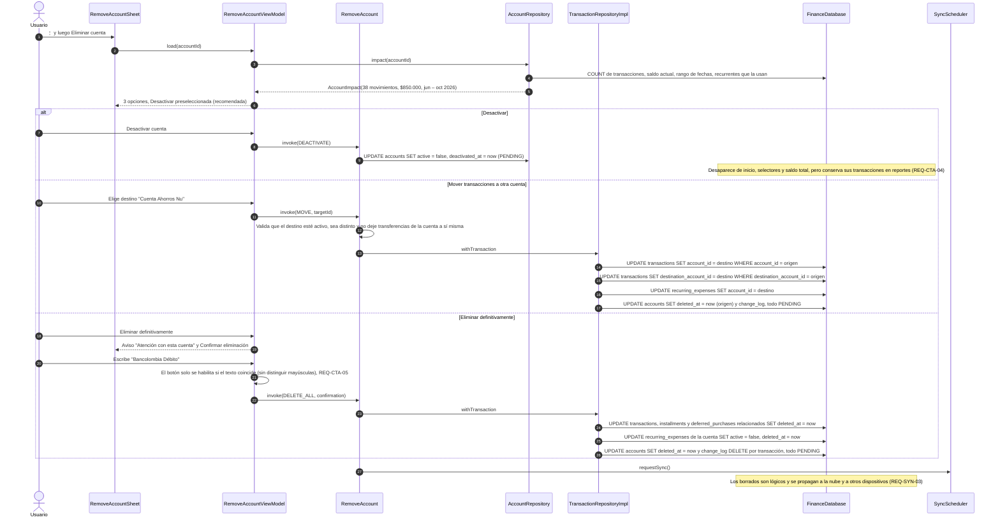

# SEQ-12 · Quitar una cuenta (desactivar, mover o eliminar)

Requisitos: REQ-CTA-03, 04, 05, HU-13 · Pantallas: Gestión de cuentas (menú ⋮), Hoja Opciones de la cuenta, Hojas Eliminar cuenta (3 estados), Hoja Confirmar eliminación, Cuentas desactivadas

Reactivar (REQ-CTA-04): desde "Cuentas desactivadas", `ReactivateAccount` hace `UPDATE accounts SET active = true, deactivated_at = null` (PENDING).
