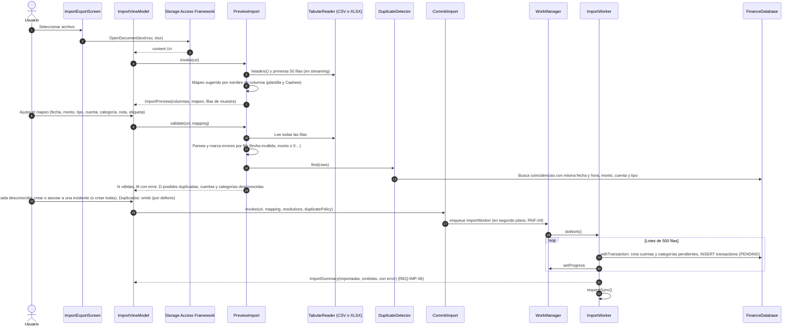
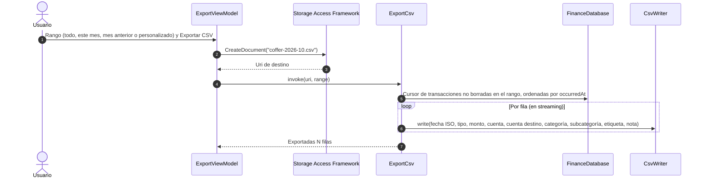

# SEQ-13 · Importar y exportar

Requisitos: REQ-IMP-01 a 06, REQ-EXP-01, HU-11, RNF-04 · Pantalla: Importar y exportar

## 13.1 Importar CSV o Excel

## 13.2 Exportar a CSV

La plantilla descargable usa las mismas columnas que la exportación, así un archivo exportado se puede volver a importar sin cambios de mapeo.
