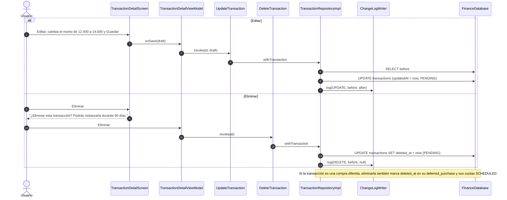
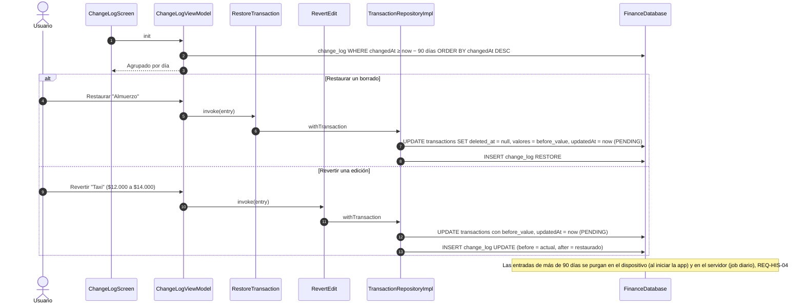

# SEQ-14 · Editar, eliminar y restaurar transacciones

Requisitos: REQ-TRX-07, REQ-HIS-01 a 04, HU-12 · Pantallas: Detalle de transacción, Diálogo eliminar, Historial de cambios

## 14.1 Editar y eliminar

## 14.2 Restaurar o revertir desde el historial

