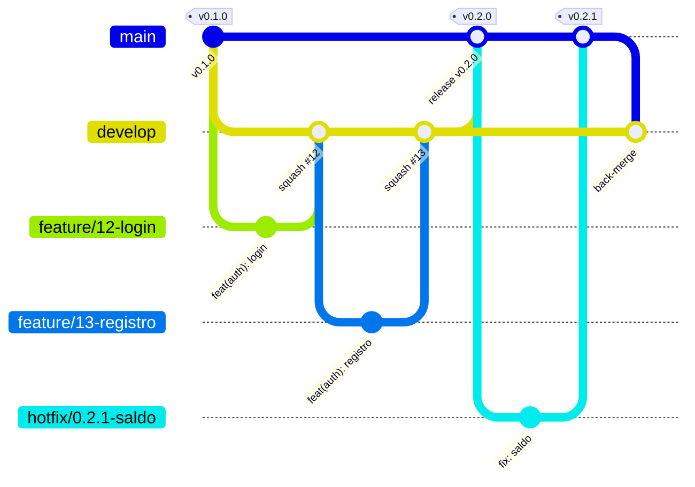
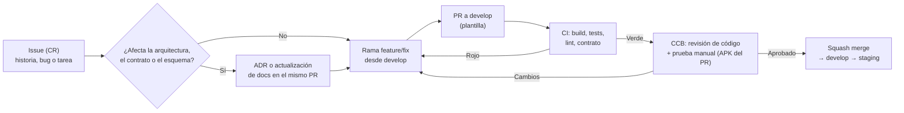

# Plan de gestión de configuración — Coffer

Plan de gestión de configuración (*Configuration Management Plan*, CMP) según **IEEE 828-2012** (*Standard for Configuration Management in Systems and Software Engineering*). Define qué se controla, cómo se versiona, cómo se aprueban los cambios (ramas y pull requests) y cómo se liberan versiones.

## 1. Introducción

### 1.1 Datos del documento

| Campo | Valor |
| --- | --- |
| Identificador | FA-CMP-001 |
| Versión | 1.0 · 2026-10-09 |
| Estado | Aprobado |
| Responsable | @Julian (product owner y gestor de configuración) |

### 1.2 Propósito y alcance

Asegurar que en todo momento se sepa **qué versión** de cada elemento (documentos, código, contrato, base de datos, artefactos y entornos) está en uso, **por qué** cambió y **quién** lo aprobó. Aplica a los repositorios `coffer-app` y `coffer-server`, a la documentación de `docs/`, al prototipo de Figma y a los entornos de staging y producción, durante el desarrollo de la v1.0 y su mantenimiento.

### 1.3 Situación de partida

| Elemento | Estado actual (2026-10-09) |
| --- | --- |
| `Julian049/coffer-app` | Rama `main` únicamente; tag `v0.1.0` (MVP, despliegue mínimo); `CLAUDE.md` sin versionar; `versionName "1.0"` y `versionCode 1` en Gradle, **inconsistentes** con el tag |
| `Julian049/coffer-server` | Rama `main` únicamente; tag `v0.1.0` (MVP expuesto con zrok); `CLAUDE.md` sin versionar; `pom.xml` en `0.0.1-SNAPSHOT`, **inconsistente** con el tag; `.env` correctamente fuera de Git |
| `docs/` | **No está bajo control de versiones** |
| CI/CD | No existe (sin `.github/workflows`, sin Dockerfile del servidor) |
| Prototipo de Figma | Archivo "Finance App" (key `tiOOI1wfZyn2xaG9ENO9Wp`) con historial de versiones de Figma; plugins de cambios en una carpeta local fuera de Git |

Las acciones para cerrar estas brechas están en §8.

### 1.4 Referencias

[SRS v1.0](../01-requirements/srs.md) · [Arquitectura](../02-architecture/architecture.md) y [ADR](../02-architecture/adr/README.md) · [Diseño detallado](../03-design/detailed-design.md) · [Contrato de la API](../04-api/openapi.yml) · [Plan de pruebas](../05-test/test-plan.md) · Semantic Versioning 2.0.0 · Conventional Commits 1.0.0 · Keep a Changelog 1.1.0.

### 1.5 Definiciones

| Término (IEEE 828) | Definición en este proyecto |
| --- | --- |
| Elemento de configuración (CI) | Unidad que se identifica, versiona y controla (§3.1). |
| Línea base (*baseline*) | Conjunto aprobado de versiones de CI que solo cambia por control de cambios (§3.2). |
| Solicitud de cambio (CR) | GitHub Issue con etiqueta de tipo; su implementación es un pull request. |
| Comité de control de cambios (CCB) | El product owner (@Julian), que aprueba o rechaza los PR y los releases. |
| Release | Versión etiquetada (`vX.Y.Z`) de un repositorio, con sus artefactos y notas. |

---

## 2. Organización y responsabilidades

| Rol | Quién | Responsabilidades de CM |
| --- | --- | --- |
| CCB y gestor de configuración | @Julian | Aprueba PR y releases; mantiene la protección de ramas y los secretos; decide las líneas base |
| Desarrollador | Claude (asistente de IA) bajo dirección de @Julian | Crea ramas y PR, mantiene el CHANGELOG, actualiza versiones, prepara releases; **nunca** hace push directo a `main` ni a `develop` |
| CI (GitHub Actions) | Automático | Verifica cada PR; construye y publica los artefactos de cada release |
| Plataformas | Render, Neon, GitHub | Despliegue y almacenamiento de artefactos |

Política para contribuciones con IA: los commits generados con asistencia incluyen el *trailer* `Co-Authored-By`; todo cambio pasa por PR y por aprobación humana.

---

## 3. Actividades de gestión de configuración

### 3.1 Identificación de la configuración

#### 3.1.1 Elementos de configuración

| Id | Elemento | Ubicación | Identificación de la versión |
| --- | --- | --- | --- |
| CI-01 | SRS | `docs/01-requirements/` | Versión en el documento (1.0) + tag de docs |
| CI-02 | Arquitectura, diagramas y ADR | `docs/02-architecture/` | Versión en el documento; estado de cada ADR |
| CI-03 | Diseño detallado, modelo de datos y secuencias | `docs/03-design/` | Versión en el documento |
| CI-04 | Contrato de la API | `docs/04-api/openapi.yml` | `info.version` (SemVer del contrato) |
| CI-05 | Plan de pruebas y reportes | `docs/05-test/` | Identificador FA-TP-001 y versión |
| CI-06 | Este plan | `docs/06-settings/manage-config.md` | FA-CMP-001 y versión |
| CI-07 | Gestión y sprints | `docs/07-management/` | Versión en el documento |
| CI-08 | Sistema de diseño y prototipo | `design.md` + Figma "Finance App" | Nombre de la versión guardada en el historial de Figma (`v1.0-srs-prototype`, …) |
| CI-09 | Código de la app | `coffer-app` | Tag `vX.Y.Z`; `versionName` y `versionCode` |
| CI-10 | Código del servidor | `coffer-server` | Tag `vX.Y.Z`; `<version>` del `pom.xml` |
| CI-11 | Migraciones Flyway | `coffer-server/src/main/resources/db/migration` | `V{n}`; tabla `flyway_schema_history` |
| CI-12 | Esquemas de Room | `coffer-app/app/schemas/` | `version` de `FinanceDatabase` |
| CI-13 | Configuración de build | `build.gradle.kts`, `libs.versions.toml`, `pom.xml`, `Dockerfile` | Versiones fijadas (sin rangos dinámicos) |
| CI-14 | Pipelines | `.github/workflows/*.yml` de cada repositorio | Versionados con el código |
| CI-15 | Configuración de entornos | Variables de Render y Neon (nombres, no valores), `application-*.yaml`, `buildTypes` | Documentadas en §5.3 |
| CI-16 | Artefactos | APK y AAB firmados; imagen Docker | Nombre con versión y SHA (§3.1.4) |

**No son CI** (pero se protegen): valores de secretos (Render, GitHub Secrets) y `.env` local.

#### 3.1.2 Esquema de versiones (SemVer 2.0.0)

- Cada repositorio se versiona **de forma independiente** con `MAJOR.MINOR.PATCH`.
- **MAJOR:** 1 para el producto definido en el SRS v1.0. Pasa a 2 solo con un cambio incompatible para el usuario o la API (`/api/v2`).
- **MINOR:** cada release de sprint con funciones nuevas.
- **PATCH:** correcciones sin funciones nuevas (*hotfix*).
- **Pre-release:** `-rc.N` para candidatas en staging cuando haga falta (`v0.4.0-rc.1`).
- El `0.x` se mantiene hasta completar todas las historias *Must*; esa versión será **1.0.0**.

| Componente | Dónde vive la versión | Regla |
| --- | --- | --- |
| App | `versionName` = SemVer; `versionCode` = `MAJOR×10000 + MINOR×100 + PATCH` | `0.2.0` → 200 · `1.0.0` → 10000 · `1.2.3` → 10203 (siempre creciente, como exige Google Play) |
| Servidor | `pom.xml` `<version>`; `develop` lleva `X.Y.Z-SNAPSHOT` y el release la fija sin sufijo | Expuesta en `/actuator/info` |
| Contrato | `openapi.yml` `info.version` | MINOR por endpoint o campo nuevo opcional; MAJOR = `/api/v2` |
| Base de datos | Número de migración Flyway | Solo avanza; nunca se edita una migración aplicada |
| Documentos | Versión en la cabecera + tag `docs-vX.Y.Z` en el repositorio de docs | MINOR por sección nueva; PATCH por corrección |

#### 3.1.3 Mapa de versiones previsto

| Versión | Sprint | Contenido |
| --- | --- | --- |
| `v0.1.0` | — | MVP actual (línea base BL-0) |
| `v0.2.0` | S1 | Cimientos, CI/CD, staging, tema `design.md`, navegación |
| `v0.3.0` | S2 | Identidad y sesión |
| `v0.4.0` | S3 | Base local cifrada, sincronización, migración del MVP |
| `v0.5.0` | S4 | Cuentas, categorías e Inicio |
| `v0.6.0` | S5 | Transacciones e historial |
| `v0.7.0` | S6 | Recurrentes y avisos |
| `v0.8.0` | S7 | Tarjetas de crédito |
| `v1.0.0` | S8 | Importar/exportar + producción: todo lo *Must* (BL-3) |
| `v1.1.0` | S9 | Reportes y etiquetas |
| `v1.2.0` | S10 | Préstamos |
| `v1.3.0` | S11 | Historial de cambios, saldo neto, Google, personalización |

La fuente de verdad del alcance de cada versión es el [plan de sprints](../07-management/sprint-plan.md). La app y el servidor publican la misma MINOR cuando un sprint toca ambos, para facilitar la lectura; no es obligatorio.

#### 3.1.4 Convenciones de nombres

| Objeto | Convención | Ejemplo |
| --- | --- | --- |
| Tag de release | `vX.Y.Z` (anotado) | `v0.2.0` |
| Tag de documentación | `docs-vX.Y.Z` | `docs-v1.0.0` |
| APK y AAB | `coffer-app-<versionName>-<buildType>.apk` | `coffer-app-0.2.0-staging.apk` |
| Imagen Docker | `coffer-server:<version>` y `coffer-server:sha-<7>` | `coffer-server:0.2.0` |
| Migración | `V{n}__{verbo}_{objeto}.sql` | `V3__create_identity.sql` |
| ADR | `NNNN-titulo.md` | `0013-…` |
| Reporte de pruebas | `reports/sprint-NN.md`, `reports/release-X.Y.Z.md` | `reports/sprint-01.md` |

#### 3.1.5 Líneas base

| Línea base | Contenido | Estado | Identificación |
| --- | --- | --- | --- |
| **BL-0 · MVP** | `coffer-app` y `coffer-server` en `v0.1.0` | Establecida (despliegue mínimo) | Tags `v0.1.0` |
| **BL-1 · Funcional** | SRS v1.0 (CI-01) | Aprobada el 2026-10-06 | `docs-v1.0.0` |
| **BL-2 · Asignada / diseño** | Arquitectura 1.0, ADR 0001–0012, diseño detallado 1.0, modelo de datos, `openapi.yml` 1.0.0, plan de pruebas 1.0, este plan 1.0, prototipo de Figma `v1.0-srs-prototype` | Por establecer al versionar `docs/` (§8) | `docs-v1.0.0` |
| **BL-3 · Producto** | `coffer-app` y `coffer-server` `v1.0.0` + base en V10 + docs de la release | Al terminar las historias *Must* | Tags `v1.0.0` |

Cambiar una línea base establecida requiere un PR aprobado por el CCB y, si afecta a la arquitectura, un ADR.

### 3.2 Control de la configuración

#### 3.2.1 Estrategia de ramas

Se usa un **Git Flow simplificado**, igual en ambos repositorios:



| Rama | Propósito | Se crea desde | Se integra en | Despliegue |
| --- | --- | --- | --- | --- |
| `main` | Lo publicado en producción; cada commit es un release etiquetado | — | — | Producción (Render `coffer-server`, APK `release`) |
| `develop` | Integración del sprint; siempre compilable | `main` (una vez) | `main` vía PR de release | Staging (Render `coffer-server-staging`, APK `staging`) |
| `feature/<issue>-<slug>` | Una historia o tarea | `develop` | `develop` (squash) | Artefacto APK del PR |
| `fix/<issue>-<slug>` | Defecto encontrado antes del release | `develop` | `develop` (squash) | — |
| `docs/<slug>`, `chore/<slug>` | Documentación o mantenimiento | `develop` | `develop` (squash) | — |
| `hotfix/<versión>-<slug>` | Defecto crítico en producción | `main` | `main` (y luego *back-merge* a `develop`) | Producción |

Reglas:
- Ramas cortas (idealmente una historia; menos de 3 días).
- Protección de `main` y `develop`: PR obligatorio, CI en verde, 1 aprobación (CCB), sin *force-push* ni borrado; `main` además exige que la rama esté actualizada.
- Merge de features con **squash** (un commit por historia en `develop`). Release con **merge commit** (`develop` → `main`) para conservar el punto de integración.

#### 3.2.2 Flujo de solicitud de cambio



| Paso | Detalle |
| --- | --- |
| Solicitud | GitHub Issue con plantilla (historia con criterios de aceptación, bug con pasos y severidad, o tarea). Etiquetas: `type:feature`, `type:bug`, `type:docs`, `type:chore`, `area:*`, `sprint:NN`, `priority:must/should/could`. |
| Análisis de impacto | En el PR: CI afectados, requisitos (REQ/HU), migraciones, cambios de contrato, riesgos del plan de pruebas. |
| Implementación | Rama según §3.2.1; commits con Conventional Commits. |
| Verificación | CI (§5.2) + casos de prueba del plan. |
| Aprobación | CCB aprueba en el PR tras su prueba manual ("Cómo probar"). |
| Integración | Squash merge; la rama se borra. |

**Commits (Conventional Commits):** `tipo(ámbito): descripción en imperativo`. Tipos: `feat`, `fix`, `docs`, `refactor`, `test`, `build`, `ci`, `chore`, `perf`. Ámbitos: `auth`, `sync`, `ledger`, `accounts`, `transactions`, `cards`, `loans`, `recurring`, `reports`, `tags`, `import`, `ui`, `db`, `api`. Los cambios incompatibles llevan `!` o `BREAKING CHANGE:`.

**Plantilla de PR** (`.github/pull_request_template.md`):

```markdown
## Qué cambia
Closes #<issue> · Historias/requisitos: HU-.., REQ-..

## Impacto
- [ ] Migración Flyway / Room   - [ ] Cambio en openapi.yml   - [ ] ADR nuevo o actualizado
- [ ] CHANGELOG (sección Unreleased) actualizado

## Cómo probar
(ver plantilla del plan de pruebas, anexo A)

## Evidencia
Capturas o video corto
```

#### 3.2.3 Cambios que requieren control adicional

| Tipo de cambio | Control adicional |
| --- | --- |
| Arquitectura (estilo, stack, protocolo) | ADR nuevo aceptado antes del merge |
| Contrato de la API | Actualizar `openapi.yml` (`info.version`) en el mismo ciclo y en ambos repositorios; prohibido romper `/api/v1` |
| Esquema de base de datos | Nueva migración (nunca editar una aplicada) + prueba `FlywayMigrationIT`; si es incompatible, *expand/contract* en dos releases |
| Esquema de Room | `Migration(n, n+1)` + `MigrationTestHelper`; se commitea el JSON del esquema |
| Dependencias | Dependabot semanal; las actualizaciones MAJOR van en su propio PR |
| Diseño visual | Nueva versión con nombre en el historial de Figma + mención en el PR |

### 3.3 Contabilidad del estado de la configuración

| Registro | Contenido | Dónde |
| --- | --- | --- |
| `CHANGELOG.md` | Keep a Changelog; sección `[Unreleased]` que se mueve a la versión en cada release | Cada repositorio |
| GitHub Releases | Notas (copiadas del CHANGELOG), artefactos firmados y checksums SHA-256 | Cada repositorio |
| Matriz de compatibilidad | Versión de la app ↔ versión del servidor ↔ contrato ↔ última migración | §6.3 de este plan (se actualiza en cada release) |
| Historial de esquema | `flyway_schema_history` (servidor); JSON de esquemas de Room (app) | Base de datos y `app/schemas/` |
| Estado de los PR y las CR | Issues y PR con etiquetas y milestones por sprint | GitHub |
| Estado de las pruebas | Reportes de sprint y release | `docs/05-test/reports/` |
| Despliegues | Historial de despliegues de Render (versión e imagen) | Panel de Render |

### 3.4 Auditorías de configuración

| Auditoría | Cuándo | Comprobaciones | Evidencia |
| --- | --- | --- | --- |
| **Funcional** (FCA) | Antes de cada release a `main` | Las historias del milestone cumplen sus criterios de aceptación; el reporte de pruebas recomienda liberar | `reports/release-X.Y.Z.md` |
| **Física** (PCA) | Al crear el release | El tag apunta al merge commit de `main`; `versionName`/`versionCode` y `pom.xml` coinciden con el tag; el CHANGELOG tiene la entrada; los artefactos llevan la versión y el checksum; las migraciones de la release están listadas | Checklist del release (§6.1) marcado en el PR de release |
| **De línea base** | Al establecer BL-2 y BL-3 | Todos los CI de la línea base tienen versión y estado aprobado | Tag `docs-vX.Y.Z` / `v1.0.0` |

### 3.5 Control de interfaces

| Interfaz | Control |
| --- | --- |
| App ↔ servidor | `openapi.yml` es el contrato. El servidor verifica en CI que su OpenAPI generado coincide con el archivo; la app valida sus DTO contra los ejemplos del contrato. Una versión de la app nunca exige un endpoint que no exista en el servidor de su entorno (el servidor se libera primero) |
| Servidor ↔ base de datos | Flyway con `validate-on-migrate` y Hibernate `ddl-auto=validate` |
| App ↔ Google Sign-In | `GOOGLE_CLIENT_ID` por entorno; las huellas SHA-1 de las firmas `staging` y `release` se registran en Google Cloud |
| Diseño ↔ UI | Tokens de `design.md` replicados en `ui/theme`; los cambios de tokens se hacen en ambos lados en el mismo PR |

### 3.6 Proveedores y componentes externos

| Componente | Control |
| --- | --- |
| Librerías (Gradle y Maven) | Versiones fijadas (catálogo `libs.versions.toml`, `pom.xml` sin rangos); Dependabot; OWASP Dependency-Check en CI (falla con CVSS ≥ 7) |
| Imágenes base de Docker | Etiqueta con versión exacta (`eclipse-temurin:21.0.x-jre`), sin `latest` |
| Acciones de GitHub | Versión mayor fijada (`actions/checkout@v4`) |
| Plataformas (Render, Neon) | Configuración documentada en §5.3; cambios de plan revisados contra ADR-0009 |

### 3.7 Gestión de releases y entrega

#### Procedimiento de release (fin de sprint)

1. En `develop`: actualizar la versión (`versionName`/`versionCode`, `pom.xml` sin `-SNAPSHOT`), mover `[Unreleased]` del CHANGELOG a `[X.Y.Z] - fecha` y actualizar la matriz de §6.3 (PR `chore(release): X.Y.Z`).
2. Verificar staging: migraciones aplicadas, regresión en verde, humo manual del plan de pruebas y reporte del sprint.
3. Abrir el PR `release: vX.Y.Z` de `develop` a `main` con el checklist de §6.1. El CCB lo aprueba.
4. Merge commit a `main`, seguido del tag anotado `vX.Y.Z` en ese commit.
5. CI de release: construye los artefactos firmados, crea el GitHub Release con las notas y los checksums, y Render despliega producción desde `main`.
6. Humo en producción. En `develop`, subir a la siguiente `-SNAPSHOT`.
7. **Orden entre repositorios:** primero se libera el **servidor** y después la **app** (el servidor siempre es compatible hacia atrás dentro de `/api/v1`).

#### Hotfix

1. Crear `hotfix/X.Y.(Z+1)-slug` desde `main` y hacer el arreglo con su prueba de regresión.
2. PR a `main`, tag `vX.Y.(Z+1)` y despliegue.
3. *Back-merge* de `main` a `develop`.

#### Vuelta atrás (*rollback*)

| Componente | Cómo |
| --- | --- |
| Servidor | Redeploy de la imagen anterior en Render. Las migraciones son solo hacia adelante: si una migración causa el problema, se corrige con una migración nueva (las migraciones *expand* son compatibles con la versión anterior) |
| Base de datos | Antes de cada release a producción se crea una rama o *snapshot* de Neon (`pre-vX.Y.Z`) para restaurar en caso de corrupción |
| App | Android no permite instalar un `versionCode` menor: se publica un PATCH con el código anterior y un `versionCode` mayor |

---

## 4. Calendario de actividades de CM

| Momento | Actividad |
| --- | --- |
| Antes del sprint 1 | Acciones de §8 (versionar `docs`, crear `develop`, protecciones, plantillas, CI base) y establecer BL-2 |
| Cada PR | Control de cambios (§3.2) |
| Fin de cada sprint | Release, auditoría funcional y física, contabilidad del estado |
| Fin del alcance *Must* | Release `v1.0.0` y establecer BL-3 |
| Mensual | Revisión de dependencias y secretos; purga de ramas remotas sin uso |

## 5. Recursos

### 5.1 Herramientas

| Necesidad | Herramienta |
| --- | --- |
| Control de versiones y revisión | Git + GitHub (repositorios, Issues, Projects, PR, Releases) |
| Integración continua y releases | GitHub Actions |
| Despliegue del servidor | Render (servicios `coffer-server-staging` y `coffer-server`) |
| Base de datos | Neon (proyecto `coffer`: ramas `production` y `staging`) |
| Firma de la app | Keystore de release en GitHub Secrets (base64) |
| Dependencias | Dependabot, OWASP Dependency-Check |
| Diseño | Figma (historial de versiones con nombre) |

### 5.2 Pipelines

| Repositorio | Workflow | Disparador | Pasos |
| --- | --- | --- | --- |
| `coffer-server` | `ci.yml` | PR y push a `develop`/`main` | `./mvnw -B verify` (unitarias + Testcontainers + ArchUnit + contrato + JaCoCo) · Dependency-Check |
| `coffer-server` | `release.yml` | Tag `v*` | Construye la imagen `coffer-server:X.Y.Z` · GitHub Release con las notas |
| `coffer-app` | `ci.yml` | PR y push a `develop`/`main` | `./gradlew lint ktlintCheck testDebugUnitTest koverVerify assembleStaging` · sube el APK `staging` como artefacto del PR |
| `coffer-app` | `release.yml` | Tag `v*` | Pruebas instrumentadas en emulador API 31 · `assembleRelease bundleRelease` firmados · GitHub Release con APK, AAB y SHA-256 |
| `coffer-docs` | `docs.yml` | PR | Lint de Markdown, validación de Mermaid y `redocly lint openapi.yml` |

### 5.3 Configuración por entorno

| Entorno | Rama | Servidor | Base de datos | App (`buildType`) | `API_BASE_URL` |
| --- | --- | --- | --- | --- | --- |
| Local | cualquiera | `spring-boot:run` (perfil `local`) | Docker Compose | `debug` (`applicationIdSuffix .debug`) | `http://10.0.2.2:8080/` |
| Staging | `develop` | Render `coffer-server-staging` (perfil `staging`, despliegue automático) | Neon rama `staging` | `staging` (`.staging`, firmada como debug) | `https://coffer-server-staging.onrender.com/` |
| Producción | `main` | Render `coffer-server` (perfil `prod`, despliegue automático) | Neon rama `production` | `release` (firmada) | `https://coffer-server.onrender.com/` |

Con los sufijos de `applicationId`, las variantes `staging` y `release` se instalan a la vez en el teléfono del PO, así puede probar staging sin tocar sus datos reales.

Variables por servicio en Render (solo los nombres son CI; los valores son secretos): `SPRING_PROFILES_ACTIVE`, `DB_URL`, `DB_USER`, `DB_PASSWORD`, `JWT_PRIVATE_KEY`, `JWT_PUBLIC_KEY`, `GOOGLE_CLIENT_ID`, `DB_POOL_SIZE`. Secretos de GitHub: `RELEASE_KEYSTORE_BASE64`, `RELEASE_KEYSTORE_PASSWORD`, `RELEASE_KEY_ALIAS`, `RELEASE_KEY_PASSWORD`, `RENDER_DEPLOY_HOOK_*`.

## 6. Anexos operativos

### 6.1 Checklist del PR de release

```markdown
## Release vX.Y.Z (coffer-app | coffer-server)
- [ ] Versión actualizada (versionName/versionCode · pom.xml sin -SNAPSHOT)
- [ ] CHANGELOG: [Unreleased] → [X.Y.Z] - AAAA-MM-DD
- [ ] openapi.yml: info.version coherente (si cambió el contrato)
- [ ] Migraciones nuevas listadas: V… (aplicadas en staging sin error)
- [ ] Snapshot de Neon pre-vX.Y.Z creado (servidor)
- [ ] Regresión en verde · humo manual en staging OK · reports/release-X.Y.Z.md
- [ ] Matriz de compatibilidad (§6.3) actualizada
- [ ] (App) el servidor compatible ya está en producción
```

### 6.2 Ejemplo de entrada del CHANGELOG

```markdown
## [0.2.0] - 2026-10-23
### Added
- Login y registro con nombre de usuario y contraseña (REQ-AUT-01, 02).
### Changed
- Tema según design.md.
### Security
- Tokens cifrados con Android Keystore (RNF-09).
```

### 6.3 Matriz de compatibilidad

| App | Servidor mínimo | Contrato | Última migración | Fecha |
| --- | --- | --- | --- | --- |
| 0.1.0 | 0.1.0 | — (`/transactions` sin versión) | V2 | 2026-05 |
| 0.2.0 | 0.2.0 (montos como string JSON) | — (`/transactions` sin versión; `openapi.yml` 1.0.0 aún no implementado) | V2 | 2026-10-16 |
| *(se completa en cada release)* | | | | |

---

## 7. Mantenimiento del plan

Este plan es el CI-06: se modifica por PR y lo aprueba el CCB. Se revisa al cerrar cada release MINOR o cuando cambie una herramienta o plataforma.

## 8. Acciones iniciales (antes del primer sprint)

| # | Acción | Repositorio | Responsable |
| --- | --- | --- | --- |
| A1 | **Versionar `docs/`:** crear el repositorio `Julian049/coffer-docs` y hacer el primer commit con todo `docs/`; tag `docs-v1.0.0` (establece BL-1 y BL-2) | coffer-docs | @Julian (crear el repo) + desarrollador |
| A2 | Commitear `CLAUDE.md` y actualizar su ruta a `docs/` | ambos | Desarrollador |
| A3 | Crear `develop` desde `main` (en `v0.1.0`) y configurar la protección de `main` y `develop` | ambos | @Julian |
| A4 | Alinear versiones: `versionName "0.2.0-SNAPSHOT"`, `versionCode 200` · `pom.xml 0.2.0-SNAPSHOT` | ambos | Desarrollador (sprint 1) |
| A5 | Plantillas de Issue y PR, etiquetas y milestones por sprint | ambos | Desarrollador |
| A6 | `ci.yml` de cada repositorio y `Dockerfile` del servidor | ambos | Desarrollador (sprint 1, I0) |
| A7 | Crear los servicios de Render y las ramas de Neon; cargar los secretos | — | @Julian |
| A8 | Guardar en Figma la versión con nombre `v1.0-srs-prototype` | Figma | @Julian |
| A9 | Mover los plugins de Figma (`figma-plugins/`) a `coffer-docs/08-ui/figma-plugins/` para versionarlos | coffer-docs | Desarrollador |
