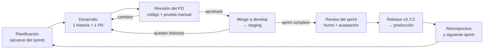

# Metodología de trabajo — Scrum adaptado

| Campo | Valor |
| --- | --- |
| Identificador | FA-PM-001 · versión 1.0 · 2026-10-11 |
| Marco | Scrum Guide 2020, adaptado a un equipo de una persona más un asistente de IA |
| Plan de sprints | [`sprint-plan.md`](sprint-plan.md) |
| Relacionados | [Plan de pruebas](../05-test/test-plan.md) · [Gestión de configuración](../06-settings/manage-config.md) · [Arquitectura §4.3](../02-architecture/architecture.md) |

## 1. Idea central

El producto se construye **sprint por sprint, en orden**. Cada sprint termina en una **versión instalable** (`v0.2.0`, `v0.3.0`…) con algo nuevo que el product owner puede probar en su teléfono. Así la app crece de forma visible y verificable, y nunca aparece "de golpe".

## 2. Roles

| Rol | Quién | Responsabilidades |
| --- | --- | --- |
| **Product owner** | @Julian | Ordena el backlog; confirma el alcance de cada sprint; revisa y aprueba cada PR; prueba en su teléfono; acepta o rechaza el incremento; resuelve dudas del SRS |
| **Equipo de desarrollo** | Claude Code (asistente de IA) | Implementa las historias del sprint (servidor, base de datos, app y pruebas); abre un PR por historia con "Cómo probar"; mantiene la documentación y el CHANGELOG; prepara la release |
| **Scrum master** | @Julian (facilita) | Cuida que se respeten la DoR y la DoD, el orden secuencial y el límite del alcance de cada sprint |

## 3. Artefactos

| Artefacto | Dónde vive | Compromiso |
| --- | --- | --- |
| **Product backlog** | [`sprint-plan.md`](sprint-plan.md) (ordenado por sprint) + GitHub Issues | Objetivo del producto: SRS v1.0 completo (`v1.0.0` con lo *Must* y `v1.3.0` con lo *Should* planificado) |
| **Sprint backlog** | Milestone `Sprint NN` en GitHub, con un issue por historia y sus tareas como checklist | Objetivo del sprint (definido en el plan) |
| **Incremento** | Release `vX.Y.Z` de cada repositorio, desplegada en staging y luego en producción | **Definition of Done** (§5) |

## 4. Eventos

| Evento | Duración | Cómo se hace en este proyecto |
| --- | --- | --- |
| **Sprint** | Sin fecha fija: termina cuando se cumple el objetivo y el PO acepta el incremento (referencia: 1 a 2 semanas) | Un sprint a la vez; el siguiente no empieza hasta cerrar la release del anterior |
| **Planificación** | Corta, al inicio | El PO lee la sección del sprint en el plan y confirma o ajusta el alcance. Claude Code crea el milestone y los issues (historias con criterios de aceptación y tareas) |
| **Seguimiento diario** | Asíncrono | Reemplazado por el estado de los PR: cada PR indica qué cubre, qué falta y qué está bloqueado |
| **Review** | Al cerrar el sprint | El PO instala el APK de staging y ejecuta los casos de aceptación del sprint y el humo del plan de pruebas (§5.7). Resultado en `docs/05-test/reports/sprint-NN.md` |
| **Retrospectiva** | 10 minutos | Tres preguntas al final del reporte del sprint: qué funcionó, qué no, qué cambiamos en el siguiente |

## 5. Definition of Ready y Definition of Done

### 5.1 Definition of Ready (una historia puede empezar si…)

- [ ] Tiene id (`S03-H02`), descripción "Como usuario, quiero… para…" y requisitos del SRS enlazados.
- [ ] Sus criterios de aceptación están escritos (o referenciados al plan de pruebas).
- [ ] La pantalla está en el prototipo de Figma o se indica que no tiene UI.
- [ ] Sus dependencias (migraciones, endpoints, historias previas) ya están en `develop`.
- [ ] No hay preguntas abiertas del SRS que la bloqueen (si las hay, se resuelven con el PO antes).

### 5.2 Definition of Done (una historia está terminada si…)

- [ ] El código está en un PR a `develop` con Conventional Commits y la plantilla completa.
- [ ] CI en verde: compilación, lint, pruebas unitarias e integración, reglas de arquitectura y contrato.
- [ ] Tiene pruebas automatizadas de sus casos y respeta la cobertura mínima (plan de pruebas §5.4).
- [ ] La UI corresponde al prototipo de Figma y a `design-system.md` (claro y oscuro).
- [ ] Funciona sin conexión cuando aplica (RNF-05).
- [ ] Documentación actualizada en el mismo ciclo: CHANGELOG `[Unreleased]`; `openapi.yml`, `data-model.md` o ADR si cambiaron.
- [ ] El PO la probó con "Cómo probar" y aprobó el PR.

### 5.3 Definition of Done del sprint (incremento)

- [ ] Todas las historias del sprint cumplen la DoD (o se devolvieron explícitamente al backlog).
- [ ] Release `vX.Y.Z` creada según el plan de configuración §3.7, con el checklist completo.
- [ ] Reporte de pruebas del sprint publicado y aceptado por el PO.

## 6. Estimación y seguimiento

- Puntos de historia (Fibonacci 1, 2, 3, 5, 8, 13), estimados por Claude Code y validados por el PO. Una historia de 13 se divide.
- Se mide la **velocidad** (puntos aceptados por sprint) para ajustar los sprints siguientes.
- Tablero: GitHub Projects con columnas *Backlog*, *Sprint*, *En progreso*, *En revisión (PR)*, *Hecho*.

## 7. Reglas de trabajo para Claude Code

1. **Contexto primero:** antes de un sprint, leer `CLAUDE.md` del repositorio, la sección del sprint en `sprint-plan.md` y los documentos que esta referencia (diseño, secuencias, modelo de datos, contrato).
2. **Una historia, una rama, un PR:** `feature/<issue>-<slug>` desde `develop`; PR pequeño y revisable. Si una historia toca servidor y app, se abre un PR en cada repositorio, enlazados entre sí, y **primero se integra el del servidor**.
3. **Sin adelantar alcance:** no se implementa nada de sprints futuros, aunque sea "fácil". Lo que se descubra se anota como issue para el backlog.
4. **Dudas al PO:** si el SRS, el diseño o el prototipo son ambiguos o contradictorios, se pregunta antes de decidir. Si se decide algo estructural, va con un ADR.
5. **Nunca** push directo a `main` ni a `develop`, ni *force-push* sobre ramas compartidas; nunca se commitean secretos.
6. **Probado antes de pedir revisión:** CI en verde y, cuando aplique, la app ejecutada en el emulador contra staging o el servidor local.
7. **Cierre:** al terminar las historias, preparar el PR de release, el reporte del sprint y la lista de casos de aceptación para el PO.
