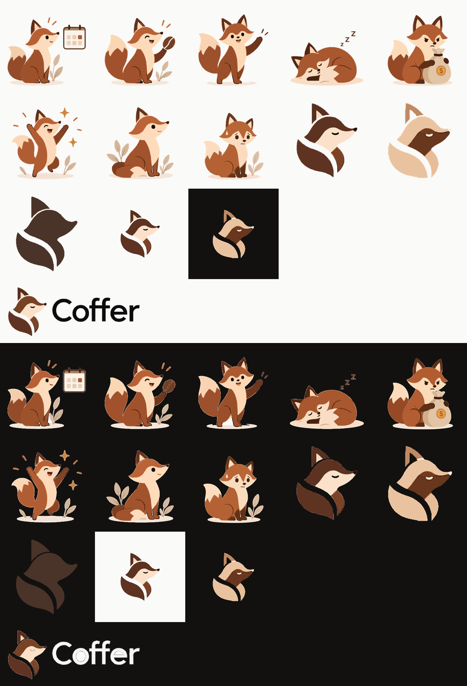

# Marca y mascota — Coffer

Identidad visual de Coffer: un **zorro** cuyo cuerpo forma un **grano de café**. El ícono y la mascota se generaron con IA a partir del sistema de diseño ([design-system.md](../design-system.md)). Las piezas finales se recortaron, se les quitó el fondo y se normalizaron con [`tools/build.py`](tools/build.py).

## Contenido

| Carpeta | Qué hay |
| --- | --- |
| `brand/` | Ícono, logotipo e íconos de la app |
| `mascot/` | Los 8 estados del zorro |
| `source/` | Imágenes originales generadas (entrada de `build.py`) |
| `tools/` | Script que produce `brand/` y `mascot/` a partir de `source/` |

**Formato: PNG** con fondo transparente. La vectorización automática a SVG se probó y se descartó: con ilustraciones de origen tan pequeñas, el trazado salía con bordes de serrucho. La única pieza vectorial es la silueta monocroma, que es de un solo color y sí traza limpia.

## Reemplazar una imagen (copiar y pegar)

**Los archivos de `brand/` y `mascot/` son la fuente de verdad**, y la app los toma de aquí por su **nombre**. Para cambiar una imagen:

1. Se pega la nueva imagen **con el mismo nombre**, encima de la anterior.
2. Se respeta el **contrato** de esa pieza (tabla de abajo): tamaño del lienzo, fondo transparente y, en la mascota, la misma escala y la misma línea de suelo.
3. Se hace commit en `coffer-docs` y se avisa a Claude: *"reemplacé `mascot-worried.png`"*. Claude copia la imagen a los recursos de la app (ver "Sincronización con la app") y no hay que tocar código.

### Sincronización con la app

En `coffer-app`, un script (`scripts/sync-brand-assets.sh`, que se crea en la primera historia que use la marca o la mascota) copia estas imágenes a los recursos de Android. Lo hace con un mapeo fijo de nombres: Android no admite guiones, así que `mascot-worried.png` pasa a ser `res/drawable-nodpi/mascot_worried.webp`. El código solo referencia esos recursos (`R.drawable.mascot_worried`); nunca rutas ni copias sueltas de las imágenes. Para reemplazar una imagen se vuelve a correr el script y se abre un PR en `coffer-app` con los recursos actualizados.

Si la imagen nueva no cumple el contrato (otro tamaño, fondo blanco, zorro más grande), Claude la normaliza antes de sincronizar, igual que hace `build.py`. **No se cambian los nombres**: un nombre nuevo es un recurso nuevo en la app.

## Marca (`brand/`)

| Archivo | Uso | Contrato |
| --- | --- | --- |
| `coffer-mark.png` | Ícono del zorro a color, para fondos claros | 1024 × 1024, transparente, glifo centrado (~84 %) |
| `coffer-mark-dark.png` | Ícono en tonos latte, para fondos oscuros | Igual |
| `coffer-mark-mono.svg` / `.png` | Silueta de un solo color (`primary` `#4A3328`): ícono temático de Android 13+ y notificaciones | Igual; un solo color |
| `coffer-logo-horizontal.png` | Ícono + palabra "Coffer" (sin lema), fondos claros | 1920 de ancho, transparente |
| `coffer-logo-horizontal-dark.png` | Igual, con la palabra en `#F5F5F4`, fondos oscuros | Igual |
| `app-icon-light.png` / `-512` | Ícono de la app sobre `#FAFAF9` (1024 y 512 px; el de 512 es el de Google Play) | Cuadrado, opaco |
| `app-icon-dark.png` / `-512` | Ícono de la app sobre `#121110` | Cuadrado, opaco |

En los íconos de app el glifo ocupa el 66 % central, que es la zona segura del **ícono adaptativo** de Android. En la app, `ic_launcher` usa `coffer-mark.png` como *foreground*, el fondo `#FAFAF9` y `coffer-mark-mono.svg` como *monochrome*.

**Sin lema** por ahora: el producto todavía no tiene uno.

## Mascota (`mascot/`)

Contrato: **1024 × 1024, fondo transparente, misma escala** (el zorro sentado mide ~900 px de alto) y **suelo a 62 px del borde inferior**. Así los estados se intercambian sin que el zorro "salte".

| Estado | Archivo | Cuándo se muestra |
| --- | --- | --- |
| Normal | `mascot-normal.png` | Finanzas estables, sin novedades |
| Bien | `mascot-good.png` | Mes con balance positivo / ahorro |
| Meta cumplida | `mascot-goal.png` | Presupuesto o meta cumplida |
| Atento | `mascot-attentive.png` | Pago pendiente próximo a vencer |
| Preocupado | `mascot-worried.png` | Presupuesto superado |
| Deudas | `mascot-debt.png` | Saldo negativo o deudas altas |
| Descanso | `mascot-resting.png` | Estados vacíos (sin movimientos) |
| Bienvenida | `mascot-welcome.png` | Inicio de sesión y primer uso |

Las reglas exactas (umbrales de cada estado) se definen en la historia que introduzca la mascota en la app.

### En Figma

- **Sección "Marca y mascota"** (junto a "Componentes"): las 9 imágenes con su nombre de archivo. Si se reemplaza una imagen aquí, también hay que subirla de nuevo a Figma.
- **Componente "Estado del zorro"** (sección "Componentes"): una tarjeta con el zorro y un mensaje corto. Tiene la variante `Estado` = Normal, Bien, Meta cumplida, Atento, Preocupado o Deudas.
- **Inicio** muestra la tarjeta debajo del saldo; la pantalla base está en el estado *Bien*.
- **Sección "2b · Inicio según el estado financiero"**: una copia de Inicio por estado, con valores coherentes (saldo, tendencia, chip y pagos próximos). Incluye *Primer uso*, con el zorro descansando como estado vacío.
- **Iniciar sesión** usa el zorro de bienvenida, y el encabezado de Inicio usa `coffer-mark`.

## Calidad

Las piezas que salieron de la hoja original (todas menos `preocupado` y `deudas`) venían de ilustraciones de ~270 px, ampliadas a 1024 px con bordes afinados: se ven bien al tamaño de uso en el teléfono, pero algo suaves a pantalla completa. Para más nitidez, basta con regenerar esa pieza **suelta** con la IA (como se hizo con `preocupado` y `deudas`, que vienen de imágenes de 1264 px) y reemplazarla con copiar y pegar.

## Regenerar desde `source/`

Copiar `source/fox-sheet.png`, `source/fox-debt.jpg` y `source/fox-worried.jpg` junto a `tools/build.py` como `src-sheet.png`, `src-a.jpg` y `src-b.jpg`, y ejecutar `python build.py` (requiere `pillow`, `numpy`, `vtracer`, `resvg-py`). El resultado sale en `out/`.
